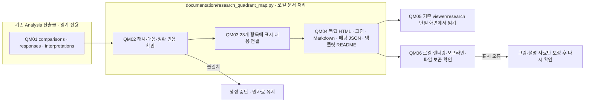

# 사분면 자료 제작 확인 기록

기존 집계와 해석을 읽어 도표·매핑 자료를 만들었습니다. 실험·분석 모델 호출은 없습니다. 이 README는 documentation/templates/research/quadrant-map-log-readme.md에서 생성합니다.

## 읽는 순서

1. `build-verification.json`: 항목·그림·정확 인용 수, 읽은 원자료·논문·뷰어 코드의 보존 여부.
2. `browser-verification.json`: 도표 경계, 오류, 모바일 너비, 통합 뷰어의 그림 해석, 독립 HTML의 오프라인 표시 확인.
3. `overview-luna.png`, `overview-haiku.png`: 전체 지도 화면 확인.
4. `m01-luna.png`, `m14-luna.png`: 정량 지도와 정성 사례 지도의 표시 확인.
5. `research-viewer.png`, `mobile.png`: 단일 연구 뷰어와 모바일 표시 확인.
6. `before-runs.json`: 자료 목록 변경 전 사본.

원자료는 `reports/experiments-run`에 그대로 두고, 설명 자료는 `reports/run/20260928-analysis-quadrant-map`에 저장합니다. `viewer/research/index.html`의 자료 선택에서 **Analysis 사분면 맵**을 엽니다.

브라우저 검사는 로컬 파일과 네트워크 요청을 로컬 파일로 대체한 기존 뷰어를 사용합니다. 실제 localhost 서버 상태나 사용자의 직접 확인을 대신하지 않습니다. 독립 HTML에 48개 그림이 모두 내장되어 JavaScript 없이 표시되는지를 별도로 확인합니다.

## 자료 생성 흐름

새 LLM 처리나 Evaluation/Analysis 실행은 없습니다. 상자는 파일 책임을 나타내며 별도 색상·분홍 확장 노드는 없습니다.
