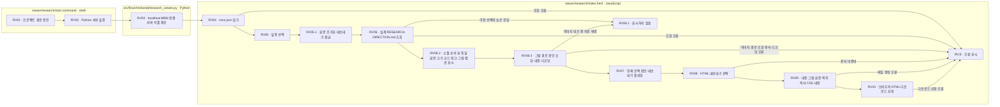

# 연구 복기 자료 화면

`start.command` 실행 후 http://127.0.0.1:8896/viewer/research/ 를 엽니다.

## HTML 내보내기

자료를 선택하고 본문과 그림이 나타나면 상단의 **HTML 내보내기**를 누릅니다. 선택한 자료의 본문·그림·표·목차·서식을 담은 `<실행 ID>-research.html` 파일을 브라우저가 다운로드합니다. 이미지 파일 자체를 HTML 안에 담으므로 저장한 파일 하나만 서버나 인터넷 연결 없이 열 수 있습니다. 목차 이동과 접기도 사용할 수 있고, 파일 상단에 문서 제목·자료 이름·저장 시각을 표시합니다.

현재 화면에 표시된 문서를 저장합니다. 본문에 삽입한 그림은 포함하며, 다른 보고서나 일반 링크로 적힌 별도 첨부파일은 함께 묶지 않습니다. 본문·그림을 불러오는 중이거나 조회에 실패하면 버튼을 비활성화하고, 빠르게 자료를 바꿔도 마지막 선택의 응답만 표시합니다. 다운로드 위치·저장 창은 브라우저 설정을 따르며, 화면 안내는 다운로드 요청과 실제 디스크 저장 완료를 구별합니다.

## 본문 그림

Markdown 이미지 문법을 단독 행에 쓰면 그림과 설명으로 표시합니다. 이미지 경로는 뷰어 주소가 아니라 해당 Markdown 파일의 위치를 기준으로 해석합니다. 같은 서버의 SVG·PNG·JPEG·GIF·WebP·AVIF를 지원하며 외부 서버 이미지와 일반 첨부파일은 자동으로 가져오지 않습니다. HTML 태그를 문서에서 직접 실행하지 않습니다.

그림은 화면 너비에 맞춰 보입니다. **원본 크기로 보기**를 선택하면 그림 영역을 스크롤하며 작은 글씨를 읽을 수 있습니다. 이 기능은 내보낸 HTML에서도 JavaScript 없이 동작합니다. 이미지가 없거나 손상되면 해당 위치와 상단에 오류를 표시하고, 그림이 누락된 파일을 정상 내보내기로 처리하지 않습니다.

모바일에서는 본문의 긴 경로·문자열을 줄바꿈하고, 넓은 표와 확대 그림은 각 영역 안에서 스크롤합니다.

제목 아래의 첫 문단과 뒤 문단은 같은 크기입니다. 본문·목록·표는 데스크톱 17px, 모바일 16px을 상속하고 강조는 굵기로 구별합니다. 그림 바로 다음의 ‘그림 1.’ 또는 ‘Figure 1.’ 같은 설명은 그림의 figcaption에 묶어 15px로 표시합니다. 제목은 별도의 큰 크기를 유지합니다. PoT·Graph처럼 열 제목을 강조한 비교표는 본문 글자 크기를 유지하면서 셀 여백과 열 너비를 조정해 여러 항목을 함께 보여 줍니다. 표는 소속 소절 안에 원문 순서대로 표시하고, 인라인 코드·링크와 코드 블록도 구분합니다. 본문 파일의 상대 링크는 해당 원문 경로를 기준으로 연결하며, 외부 근거 링크의 내용까지 HTML에 복사하는 기능은 아닙니다.

|파일|역할|
|---|---|
|index.html|선택한 Markdown·그림 표시, 최신 선택 유지, 그림·서식을 포함한 HTML 생성과 브라우저 다운로드|
|runs.json|reports/run 아래 복기 자료의 실행 목록|
|start.command|프로젝트 루트를 찾아 Python 조회 서버 실행|
|[research_viewer.py](../../src/finarch/shared/research_viewer.py)|localhost:8896에서 읽기 전용 파일·`/api/health` 제공|
|[HTML 내보내기 확인 기록](../../log/research-viewer/20260928-html-export/README.md)|변경 전 사본·원문 해시·다운로드 및 오프라인 확인 범위|
|[그림 표시·내보내기 확인 기록](../../log/research-viewer/20260928-image-export/README.md)|v0.26의 기존 그림 연결, 이미지 내장과 확대, 원문·그림 보존 확인 범위|
|[부록·문자 크기 확인 기록](../../log/research-viewer/20260928-appendix-typography/README.md)|v0.27 부록, 전체 자료의 본문·표·캡션 크기, 표시 순서와 오프라인 HTML 확인|

Python 서버는 파일 조회와 위젯용 서버 식별만 담당하고 LLM 처리는 없습니다. 자료 읽기 재시도는 새로고침, 내보내기 재시도는 버튼으로 수행합니다. 통합 뷰어는 항상 reports/run의 실제 문서를 읽으며 결과 폴더마다 뷰어를 만들지 않습니다. 사용자가 내보낸 파일만 현재 표시 내용의 독립 사본이고, 서버나 원문을 갱신해도 이미 저장한 파일은 바뀌지 않습니다. 내보낸 파일에는 자료를 요청하는 JavaScript나 외부 스타일 파일이 없습니다.

흐름도의 상자는 실제 파일별 책임을 나타내며 별도 색상 의미나 분홍 확장 노드는 없습니다. 디스크 저장 완료와 사용자의 직접 확인은 별도로 확인해야 합니다. 이 README는 documentation/templates/research/viewer-readme.md에서 생성합니다.
