# The study's data is displayed on the screen.

`start.command` After execution. http://127.0.0.1:8896/viewer/research/ It opens up.

## I'm going to send out the HTML.

If you select the data, and you see text and pictures, you can see the top of the page. **I'm going to send out the HTML.**Click on the text, the graphics, the traffic signs, the documentation of the selected material. `This is the first time I've seen this.` The browser downloads the file, so the image file itself is in HTML, so you can open only one saved file without a server or Internet connection, you can use the cart move and fold, and you can see the document title, the resource name, and the cache view at the top of the file.

It stores the documents displayed on the screen now. Includes the images inserted in the text, and the separate attachments written as other reports or general links are not linked together. If the text image is being called or the view fails, disable the button, quickly change the data, and only display the response of the last choice. The download location-storage window follows browser settings, distinguishing between the in-screen download request and the actual disk storage completion.

## The picture in the title

When you write a Markdown image grammar in a single row, it is shown as a picture and description. The image path is interpreted by the location of the relevant Markdown file, not the viewer's address. It supports SVG, PNG, JPEG, GIF, WebP, AVIF on the same server, and it doesn't automatically bring in external server images and common attachments. HTML tags aren't executed directly from the document.

The picture is exactly the same as the screen width. **See the original size.**If you select a screenshot, you can scroll through the image area and read small letters. This function works without JavaScript even in the output HTML. If the image is missing or damaged, it will display errors in the location and at the top, and it won't process the missing file to normal output.

On mobile, you can narrow down the long lines of text, and the wide tables and the enlarged images scroll through each area.

The first sentence under the title is the same size as the next one. 17pxMobile, and mobile. 16pxThe following graph is the graph of the graph. 1or Figure 1The same description as the figcaption of the figure. 15pxThe headings are kept separate. The comparison chart that emphasizes column headings, like the PoT Graph, maintains the font size while adjusting the spacing and the column width to show multiple items together. The tables are shown in the parentheses in the parenthesies, and the inline code link and code block are also separated. The relative links in the text file link to the corresponding parentheses, not the function of copying the content of the external base links to HTML.

|File|Role|
|---|---|
|index.html|Select Markdown; image display, keep up to date with selections, HTML creation and browser download including image syntax|
|runs.json|Run the run list of the duplicate data below reports/run|
|start.command|Find the root of the project and run the Python consultation server|
|[research_viewer.py](../../src/finarch/shared/research_viewer.py)|localhost:8896Read from the dedicated file;`/api/health` Provided|
|[HTML export verification record](../../log/research-viewer/20260928-html-export/README.md)|Pre-changed copy, original hash, download and offline verification scope|
|[Image mark-out verification record](../../log/research-viewer/20260928-image-export/README.md)|v0.26The existing image connection, image interior and magnification, font and image preservation verification range|
|[Footnote: Check the size of the letter](../../log/research-viewer/20260928-appendix-typography/README.md)|v0.27 In addition, check the full text, tag, caption size, display order and offline HTML of the material.|

```mermaid
flowchart LR
 subgraph start["viewer/research/start.command · shell"]
 A["RV01 • Project trajectory verification"] --> B["RV02 · Running Python servers"]
 end
 subgraph server["src/finarch/shared/research_viewer.py · Python"]
 B --> H["RV03 · localhost:8896 Connection server identification provided"]
 end
 subgraph page["viewer/research/index.html · JavaScript"]
 C["RV04 · Read runs.json"] --> D["RV05 · Select the run"]
 D --> L["RV05.1 • Initial and export lockdown"] --> E["RV06 · The actual RESEARCH-DIRECTION.md visit"] --> P["RV06.2 · Subtract order, tag, syntax, code, link, and caption"]
 P --> Q["RV06.3 • Trajectory checking, assembly, and decoding"] --> F["RV07 · Current Selection Verification and Export Activation"]
 E -->|Late response to previous selection| I["RV06.1 · Not showing"]
 Q -->|Change data in the image atmosphere| I
 F --> J["RV08 · Select the HTML output"] --> K["RV09 • Interior painting, writing, street copy, CSS interior"] --> O["RV10 · Browser HTML download request"]
 C -->|Error in the inspection| G["RV.E · Error mark"]
 E -->|Error in the inspection| G
 Q -->|Image path, assembly, formatting, decoding errors| G
 J -->|Document preparation| G
 K -->|File creation error| G
 O -->|Error in request for download| G
 end
 H --> C
```

Python servers are only responsible for file checking and server identification for widgets, and there is no LLM processing. Data reads are re-routed with a new button, and output re-routing is done with a button. The integrated viewer does not always read the actual document of the reports/run and does not create a viewer for each resulting folder. The only files that are being uploaded by the user are independent copies of the current display, and even if the server or source is updated, the files that are already stored do not change. The uploaded files do not have any JavaScript or external style files that request data.

The flow rate box represents the actual file-by-file responsibilities, and has no color meanings or pink extension nodes. It must be separately verified that the disk storage is complete and the user's direct verification. This README is generated from documentation/templates/research/viewer-readme.md.
