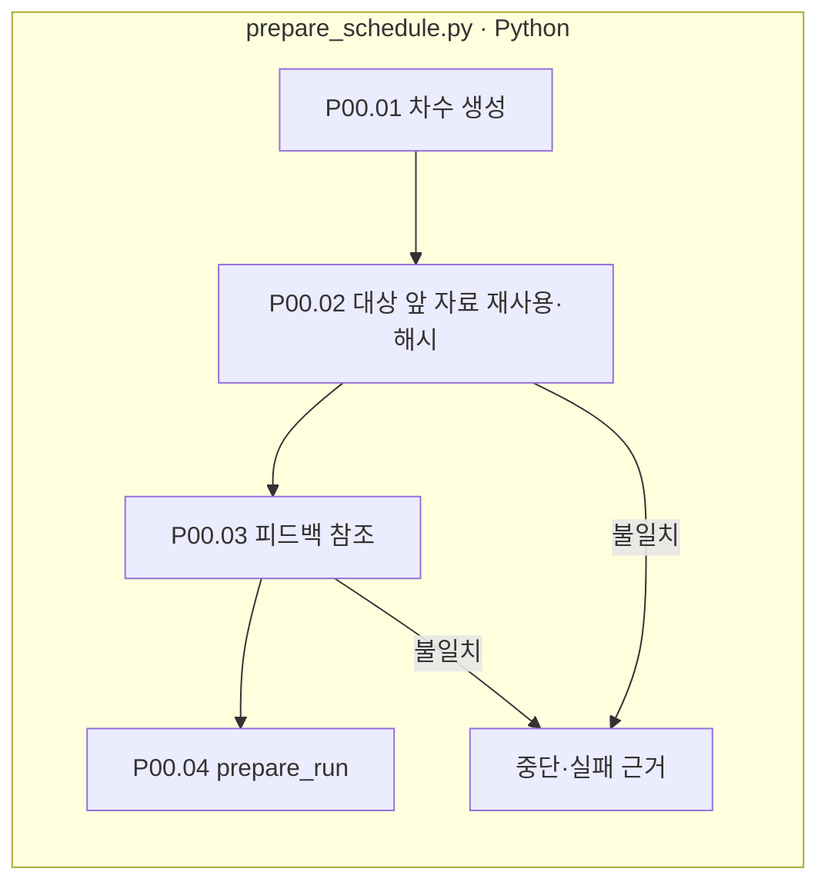

# 00-round-input — 차수 입력과 재사용 근거

[상위: Preparation](../README.md) · 다음: [01-source](../01-source/README.md)

실제 run의 각 차수 맨 앞에 있는 폴더입니다. 첫 시도 또는 이전 실패에서 넘어온 수정 대상·피드백을 기록합니다. 본문을 새로 생성하는 단계가 아닙니다.

|진행 순서|담당 처리|기록|
|---|---|---|
|1|prepare_schedule.run_case_rounds|문항·차수·reuse_before를 결정|
|2|수정 대상 앞 자료 복사·해시 대조|seed.json의 artifacts에 REUSED·원본 경로·해시|
|3|동일 문항·대상 차수 피드백 검사|feedback/역할/answer.json의 feedback_refs|
|4|prepare_run 호출|01-source부터 구조를 유지하고 재사용 구간 건너뜀|

파일 상자는 실제 책임, 분홍 확장 노드는 없습니다. LLM 호출은 없습니다. 첫 차수는 재사용 목록이 비어 있을 수 있습니다. 원본 피드백의 본문을 새 피드백인 것처럼 복사하지 않습니다. [차수·피드백 규칙](../../90-operations/01-execution.md)을 함께 확인합니다.
