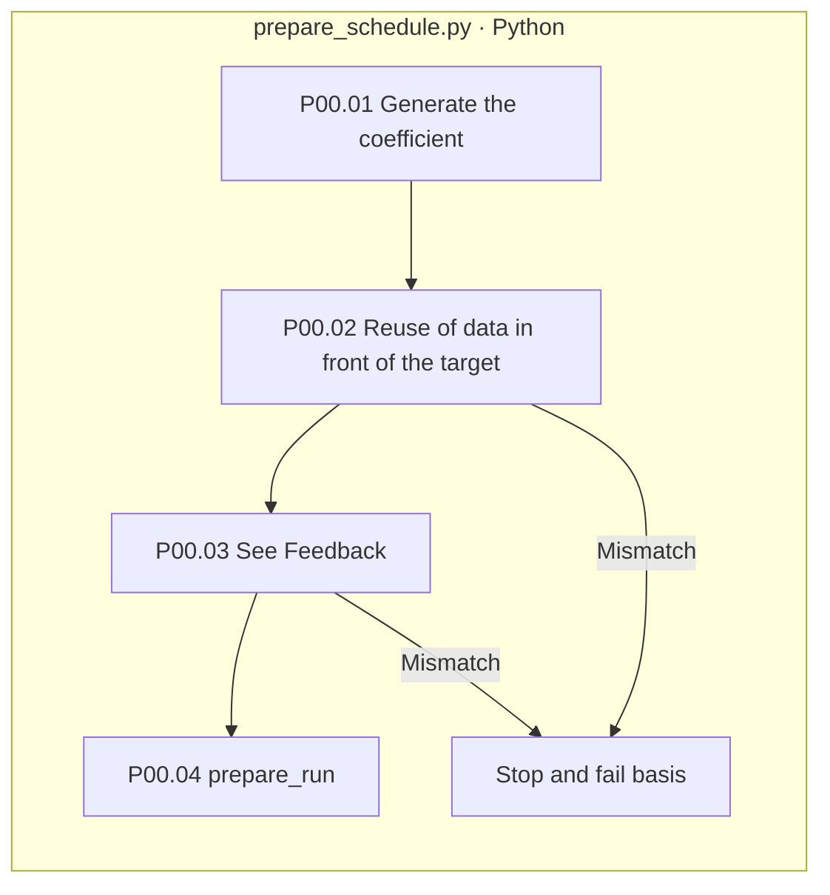

# 00-round-input - input and reuse basis

[Up: Preparation](../README.md) · The following:01-source](../01-source/README.md)

It's the folder at the top of each of the real run's parameters, recording the modified object and feedback that went past the first attempt or previous failure, not the step of creating a new text.

|The order of the moves.|Responsible processing|The record.|
|---|---|---|
|1|prepare_schedule.run_case_rounds|Decide the case.|
|2|Copy of the original data before the subject of correction|REUSED source trajectory to the artifacts of seed.json|
|3|Same case: response variable feedback test|feedback_refs from reply.json|
|4|Call prepare_run|01- From source to structure and reuse.|

The file box has no real responsibility, no pink extension nodes, no LLM calls, the first dimension may be empty, the reuse list may be empty. It doesn't copy the text of the original feedback as if it were new feedback.](../../90-operations/01-execution.md)Check it out together.
