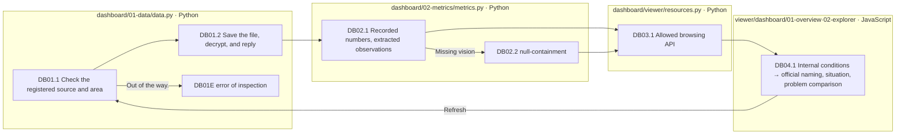
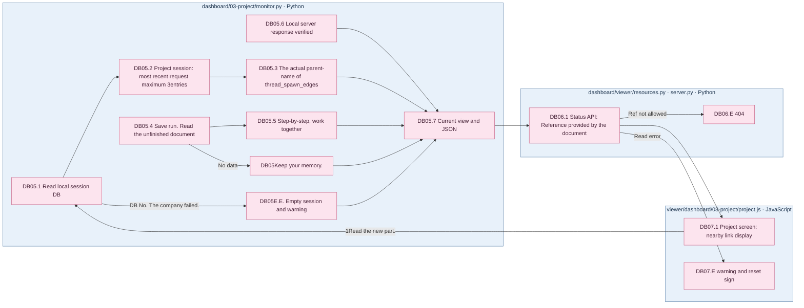

# Save run from the dashboard to the taskbar in the project scenario

[Full article in German](../README.md) · [Source structure](../01-dataset/90-operations/05-source-layout.md) · [screen run](../../viewer/dashboard/README.md)

Display name: **Unguided Solving / Criteria-Guided Solving**, **Reasoning OFF / Reasoning ON**and does not include an abbreviated name.

The dashboard consists of a project screen that reads the local session, a cache run, and a document, and two screen numbers stored in the experiment.006 is the baseline and is not combined with other rounds.

|Stage|Responsibility file|Input → output|
|---|---|---|
|DB01 Data connection|[01-data/data.py](../../src/finarch/dashboard/01-data/data.py)|Registered report, request, conclusion, hash, problem connection, meeting cache|
|DB02 Figure extraction|[02-metrics/metrics.py](../../src/finarch/dashboard/02-metrics/metrics.py)|Primary records → processing time, perception, token cost, unrecorded is null|
|DB03 Server|[viewer/resources.py](../../src/finarch/dashboard/viewer/resources.py), [server.py](../../src/finarch/dashboard/viewer/server.py)|Allow URL; trial ID; see the documented source code → JSON or screen file|
|DB04 Showing|[Some of the events](../../viewer/dashboard/01-overview/README.md)[Problem analysis](../../viewer/dashboard/02-explorer/README.md)|Internal conditions stored: number → official name mark; filter; chart; answer chart; question detail|
|DB05 Collecting projects|[03-project/monitor.py](../../src/finarch/dashboard/03-project/monitor.py)|Local Codex session DB; directory run/text → session; parent child; most recent request; incomplete; status JSON|
|DB06 Project visit|[viewer/resources.py](../../src/finarch/dashboard/viewer/resources.py), [server.py](../../src/finarch/dashboard/viewer/server.py)|`/api/project/status`Allow the original. `ref` → JSON or text, misused 404|
|DB07 Project sign|[03-project](../../viewer/dashboard/03-project/README.md)|JSON → Left full session signal list; Right progress stage/unfinished/in operation/actions/section by session recent 3Build and actual create a relationship pop-up-round link|

Each box is a real liability file, and this stream has no automatic recoveries of LLM calls, credits, failures. 0The denominator of the operating index is the source log link to the [existing detailed operating document](../02-experiments/README.md#%EB%B7%B0%EC%96%B4%EC%99%80-%EB%AC%B8%EC%84%9C-%EA%B4%80%EB%A6%AC)Check it together.

## The actual order of the project's progress.

The pink color is the actual detail of this document.5~DB07 And the color of the blue file box represents the boundary of code ownership.`subgraph`So this is the file limit. `In progress`The codex is in a conversational turn and does not interpret it as a running model call.](../../src/finarch/dashboard/03-project/session-map.json)And the screen classification is, **The actual parent-child relationship is a creation record.** It reads in the open issues, after-conference, and save run mode, and does not make a complete judgment as a user message. The session or pre-saving tasks of other hosts may not be visible.
