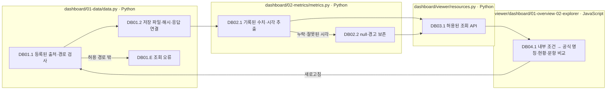
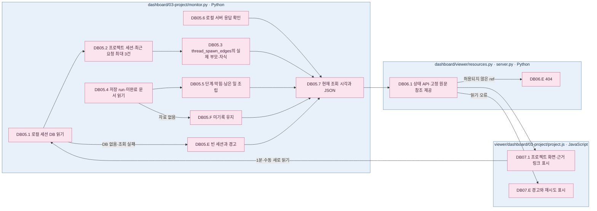

# 대시보드 — 프로젝트 현황에서 저장 실행·문항으로

[전체 문서](../README.md) · [소스 구조](../01-dataset/90-operations/05-source-layout.md) · [화면 실행](../../viewer/dashboard/README.md)

표시명은 **Unguided Solving / Criteria-Guided Solving**, **Reasoning OFF / Reasoning ON**이며 약칭을 병기하지 않습니다.

대시보드는 로컬 세션·저장 실행·문서를 읽는 프로젝트 화면과 저장된 실험 숫자 두 화면으로 구성됩니다. 데이터셋 제작이나 대상 모델 호출을 수행하지 않습니다. 숫자 두 화면의 등록 출처는 exp-006 기준선이며 다른 회차와 합산하지 않습니다.

|단계|책임 파일|입력 → 출력|
|---|---|---|
|DB01 자료 연결|[01-data/data.py](../../src/finarch/dashboard/01-data/data.py)|등록된 보고서·요청·결과 → 해시·문항 연결·조회 캐시|
|DB02 수치 추출|[02-metrics/metrics.py](../../src/finarch/dashboard/02-metrics/metrics.py)|원기록 → 처리 시간·시각·토큰·비용, 미기록은 null|
|DB03 서버|[viewer/resources.py](../../src/finarch/dashboard/viewer/resources.py), [server.py](../../src/finarch/dashboard/viewer/server.py)|허용된 URL·trial ID·고정 원문 참조 → JSON 또는 화면 파일|
|DB04 표시|[종합 현황](../../viewer/dashboard/01-overview/README.md), [문항 분석](../../viewer/dashboard/02-explorer/README.md)|저장된 내부 조건·수치 → 공식 명칭 표시·필터·차트·응답표·문항 상세|
|DB05 프로젝트 수집|[03-project/monitor.py](../../src/finarch/dashboard/03-project/monitor.py)|로컬 Codex 세션 DB·저장 run/문서 → 세션·부모 자식·최근 요청·미완료·상태 JSON|
|DB06 프로젝트 조회|[viewer/resources.py](../../src/finarch/dashboard/viewer/resources.py), [server.py](../../src/finarch/dashboard/viewer/server.py)|`/api/project/status`, 허용 원문 `ref` → JSON 또는 텍스트, 미허용은 404|
|DB07 프로젝트 표시|[03-project](../../viewer/dashboard/03-project/README.md)|JSON → 왼쪽 전체 세션 신호 목록·오른쪽 진행 단계/미완료/작업 중/실행·세션별 최근 3건 및 실제 생성 관계 팝업·근거 링크|

각 상자는 실제 책임 파일이며 이 흐름에는 LLM 호출·재채점·실패 자동 복구가 없습니다. 누락 자료를 0으로 채우지 않고, 허용되지 않은 조회는 오류로 종료합니다. 운영 지표의 분모·원기록 연결은 [기존 상세 운영 문서](../02-experiments/README.md#뷰어와-문서-관리)를 함께 확인합니다.

## 프로젝트 현황의 실제 조회 순서

분홍색은 이 문서가 실제 상세도로 펼친 DB05~DB07 단계이고, 파란 파일 상자 색은 코드 소유 경계를 뜻합니다. 현재 상세도의 바깥 상자(`subgraph`)가 파일 경계입니다. `작업 중`은 Codex 대화 턴 상태이며 실행 중인 모델 호출로 해석하지 않습니다. 업무 분류는 [session-map.json](../../src/finarch/dashboard/03-project/session-map.json)의 화면 분류이고, **실제 부모·자식은 생성 기록만** 사용합니다. 미완료는 open issues·회의 후속·저장 run 상태에서 읽으며, 사용자 메시지만으로 완료 판정을 만들지 않습니다. 다른 호스트의 세션이나 저장 전 작업은 보이지 않을 수 있습니다.
