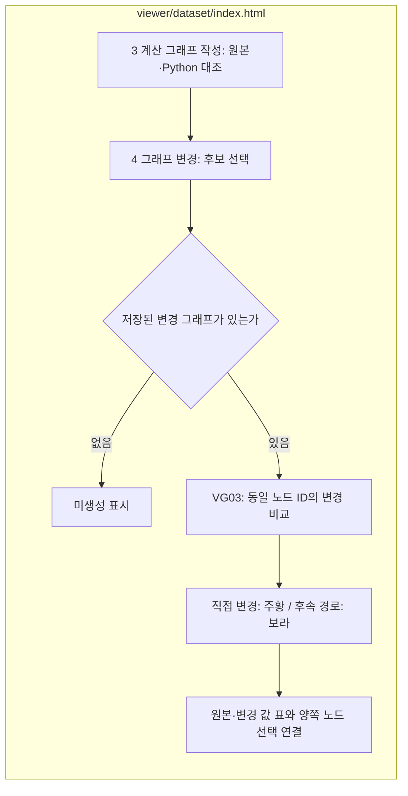
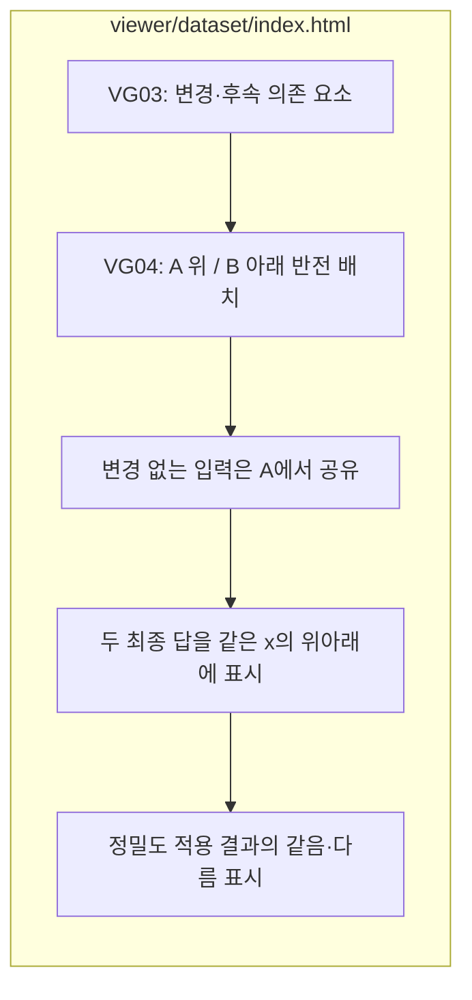
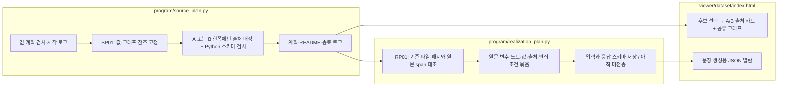
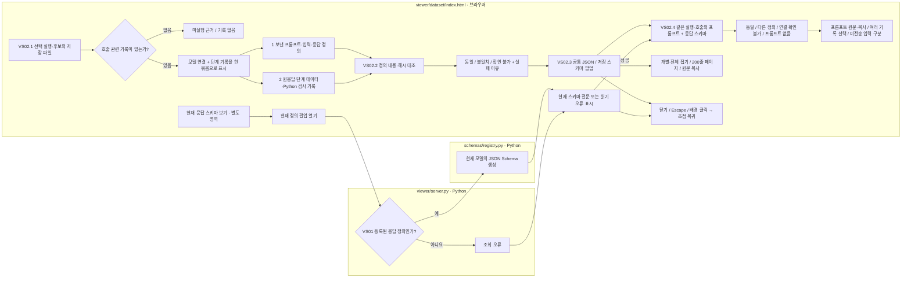
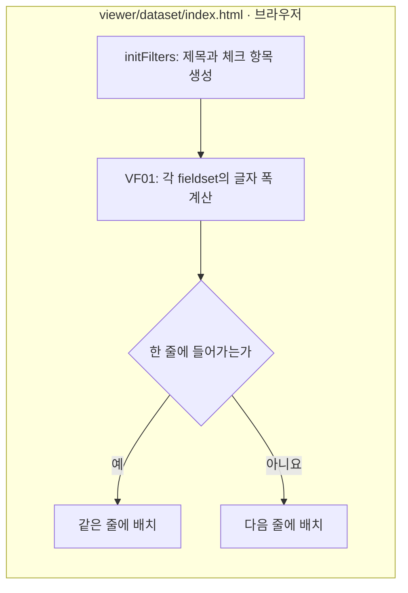

# 데이터셋 화면 실행

[전체 서버 안내](../README.md) · [서버 코드](../../src/finarch/dataset/viewer/README.md)

`./viewer/dataset/start.command`로 실행합니다. 브라우저 코드는 이 폴더의 `shell.html`·`common`·`prepare`·`reports`에서 수정하고, `PYTHONPATH=src .venv/bin/python -m finarch.dataset.viewer.assets`로 `index.html`을 조립합니다. 기본 주소는 http://127.0.0.1:8893/ 입니다.

아래 기능별 확인 기록은 작성 당시의 이력입니다. 특히 `first-10-pot-validated-v3` 자료는 현재 작업 공간에 없으므로 해당 기록을 현재 검증 결과로 읽지 않습니다. 이번 소스 이동의 실제 확인 결과는 [작업 기록](../../log/source-layout-20260924/README.md)에 있습니다.

> 2026-09-15: Preparation 01–05 / Generation 01–04의 맨 위에서 처리 설명과 파일 미리보기를 확인합니다. 아래에는 기존 비교 화면과 결과 파일 트리가 이어집니다. [메뉴별 소스·구현 안내](../../docs/01-dataset/90-operations/04-viewer.md).

## 용도별 로그

상단 **용도별 실행 로그** 또는 [/logs](http://127.0.0.1:8893/logs)에서 새 JSON Lines 로그를 확인합니다. [기록 구조](../../docs/01-dataset/90-operations/03-artifacts.md).

# 결과 뷰어

**이 폴더의 `start.command`를 더블클릭**하면 브라우저에 뷰어가 열립니다. 터미널을 닫거나 Ctrl+C를 누르면 서버가 종료됩니다. 이미 실행 중이면 같은 뷰어를 엽니다.

1. 상단의 **실행 기록 선택**에서 원하는 실행을 고릅니다.
2. 선택한 실행의 전체 요약·README와 문항 목록이 나타납니다.
3. 문항을 선택해 원문, 풀이 코드, 정답 대조, 변경 내용, 전체 로그를 확인합니다.

뷰어 화면은 `viewer/dataset/index.html` 하나입니다. `reports/run/<실행 이름>/`에서 실제 기록을 읽고 3초마다 변경을 확인합니다. 결과 폴더마다 HTML을 생성하지 않습니다. 검색과 필터는 유지되며 사람 판정 탭은 입력 보호를 위해 내용 자동 갱신을 잠시 멈춥니다.

## JSON을 읽기 편하게 보기 · Humanize

JSON 도구 모음의 **Humanize**를 누르면 별도 팝업이 열립니다. `stdout` 안에 문자열로 저장된 JSONL 이벤트와 모델의 JSON 응답을 풀어서 실행 정보, 이벤트, 검사 항목별 판정과 근거 문장으로 보여줍니다. 실패 판정은 붉게 표시하며, 진단 메시지와 최종 실행 결과는 구분합니다.

이벤트를 접고 펼칠 수 있고, 긴 목록은 25개씩 넘겨 봅니다. **원본 그대로 보기**와 **원본 복사**로 입력 내용을 확인할 수 있습니다. 닫기 또는 Esc를 누르면 원래 로그 창으로 돌아갑니다. 해석할 수 없는 내용은 원문으로 남깁니다. 추가 LLM 호출이나 원본 파일 변경은 없습니다. [처리 흐름과 확인 범위](../../archive/20260923-documentation-reorganization/docs/12-pipeline-code-guide.md#VS03).

아직 생성되지 않은 코드나 비교 결과는 없다고 표시합니다. 종료 기록이 없으면 실행 중인지 강제 종료됐는지를 임의로 확정하지 않습니다. 과거 여섯 문항 기록과 첫 열 문항 실행은 별개의 실행으로 선택합니다.

서버 코드는 `src/finarch/dataset/viewer/server.py`에 있습니다. 이 컴퓨터에서만 접속하며, 뷰어 실행은 모델 호출이나 데이터 제작을 시작하지 않습니다.

원문 비교에는 전체 raw 레코드와 준비 입력의 색상 diff, 동기 스크롤, 관련 준비 파일 보기가 있습니다. 계산 탭은 원문 숫자·코드·실행값·정답 대조를 연결합니다. 실패한 문항은 상단과 해당 탭에 붉은 실패 표시 및 중단 이유가 나오며, 실패 위치 버튼으로 바로 이동할 수 있습니다.

## Python 코드 복사

‘계산과 정답’의 **전체 코드 복사**를 누르면 필요한 임포트, 키별 숫자 데이터, fact 함수, 생성 계산 코드와 결과 출력이 함께 복사됩니다. Python 3에 붙여 넣어 실행할 수 있고 프로젝트 설치나 파일 경로 지정은 필요 없습니다. ‘모델이 생성한 부분만 보기’로 원래 계산 본문만 볼 수도 있습니다. 원문 위치 검사·정답 비교의 기존 기록은 계산 실행과 별도로 표시합니다.

### 계산 그래프 배치 보완 · VG02
계산 노드는 입력 노드들의 세로 위치 평균에 배치한다. 단일 입력의 변수·함수 노드는 입력 높이를 이어받고, 여러 값을 차례로 합치는 경우 중간 결과가 입력 사이로 이어져 계단식 흐름을 만든다. 같은 단계에서 원과 이름이 겹치는 경우에만 최소 간격 155를 확보하도록 가까운 노드를 조정한다. 축소된 그림은 표시 영역의 세로 중앙에 둔다. 코드·그래프의 수치와 연결은 바꾸지 않는 viewer/dataset/index.html의 화면 배치다.

최종 답에는 원본 정답의 자릿수가 적용됩니다. POT·그래프 모두 같은 Python 정답 비교 규칙을 사용합니다.
그래프의 최종 답 노드는 적용 후 값이며, 선택한 변수 표와 상세 기록에는 적용 전 값이 남습니다.
복사용 계산 코드는 원래 계산을 재현하므로 출력은 자릿수 적용 전 값입니다.

계산 그래프를 처음 열거나 문항을 바꾸면 기본으로 전체 맞춤을 적용합니다. 필요하면 확대 또는 원래 크기로 전환할 수 있습니다.

### 그래프 작성과 변경 비교 분리 · VG03

|번호|실제 파일|입력과 결과|
|---|---|---|
|VG03|`viewer/dataset/index.html`|원본 DAG와 저장된 후보 그래프 → 직접 변경 요소 및 후속 의존 경로를 양쪽에서 색상으로 표시|

파일 박스는 실제 뷰어 파일이며 이 상세도에는 분홍색 확장 노드가 없다. 화면 순서는 원문 비교 → 계산과 정답 → 계산 그래프 작성 → 그래프 변경 → 문장과 답변 → 사람 판정 → 동결·실험 → 전체 기록이다. 실패 위치 이동과 사람 판정 입력 중 자동 갱신 보류도 새 순서에 맞춘다. 비교는 저장된 동일 ID를 기준으로 하므로 생성기는 보존 요소의 ID를 유지해야 한다. 후속 의존 경로 표시가 실제 결과 변경을 보증하지 않으며 저장 계산값을 함께 확인한다. 아직 실제 변형 후보는 미생성이며 뷰어가 후보나 계산값을 만들어내지 않는다.

검사: 관련 Python 검사 21개 통과. `node src/finarch/dataset/checks/test_graph_delta.js`로 직접 변경·영향 없는 입력·후속 경로·삭제·결과 불변과 설명용 비교 렌더링을 검사했다. 실제 실행 화면에서 새 탭과 미생성 상태를 확인했다. 변경 그래프를 실제 데이터로 생성·검증한 결과는 아니다.

VG03 배치 보완: 원본 A를 위, 변경 B를 아래에 배치하여 각 그래프가 전체 화면 너비를 사용한다. 동일 요소 선택 연결과 변경 경로 색상은 유지한다.

VG03 보기 선택: 기본 위아래 배치에 좌우 보기 옵션을 추가했다. 직접 변경 노드는 진한 주황과 ‘변경’, 후속 경로는 보라와 ‘연결 경로’ 글자로 구분한다.

### 원본 아래에서 올라오는 변경 경로 · VG04

|번호|실제 파일|역할|
|---|---|---|
|VG04|`viewer/dataset/index.html`의 meetingLayout/drawMeeting|원본 A와 변경 B의 후속 경로를 한 SVG에 배치하고 최종 답을 가운데에서 비교|

파일 박스는 실제 파일이고 분홍색 확장 노드는 없다. 기본은 합쳐 보기이며 위아래·좌우 보기를 선택할 수 있다. 아래의 추가 값에서 보라색 계산 경로가 위로 올라온다. 공유 입력은 점선으로 표시한다. 결과 비교 기호는 계산 엣지가 아니다. 첫 실제 후보의 두 결과 170000/180000, B 입력의 아래 배치, 출력 정렬, 원형 노드 간 비겹침을 확인했다. 그래프를 반전하여 배치하는 것이며 역산 계산을 수행하는 것은 아니다.

VG05 · `viewer/dataset/index.html`의 `mountComparisonZoom`은 합쳐 보기·위아래 보기·좌우 보기의 SVG에 공통 확대/축소/전체 맞춤/원래 크기 도구를 붙인다. 기본은 가로·세로 모두 들어오는 전체 맞춤이며 확대 후 스크롤할 수 있다. 실제 첫 후보에서 네 버튼을 눌러 작동을 확인했다.

IC-value 결과 표시는 A→B 정답 교체가 아니라 A/B를 각각 채택한 두 조건부 계산 결과다. 원본 정답을 덮어쓰지 않는다.

### 출처 조건과 문장 생성 자료 · SP01 / RP01

|번호|실제 파일|책임|
|---|---|---|
|SP01|`src/finarch/dataset/02-generation/01-perturbation/source_plan.py`|검증된 값 계획 경로·해시를 공유하고 A_ONLY/B_ONLY의 출처 속성을 별도 저장|
|RP01|`src/finarch/program/realization_plan.py`|원문 인용·위치, Python 코드 줄, 그래프 노드, A/B 값, 출처를 문장 생성용 입력에 연결|
|SP01 검사|`src/finarch/dataset/schemas/source_plan.py`|추가 키 거절, 지정한 A 또는 B에만 출처 하나, 직접 확인 조건·고정 순서 검사|

파일 박스는 실제 파일 단위이며 분홍색 확장 노드는 없다. 출처를 붙인 쪽은 담당자가 해당 거래 원자료를 직접 대조한 설정이며, 반대쪽에는 출처 설명을 추가하지 않는다. 브랜드/직함 차이로 참·거짓을 확정하지 않는다. 모두 생성할 출처 조건이며 원문에서 발견한 사실이 아니다. A/B 순서는 이번 첫 family에서 고정하며 A_ONLY/B_ONLY 두 위치 조건을 미리 배정한다.

첫 문항 두 계획 생성·스키마 검사 완료, 그래프 복사와 새 LLM 호출은 없다. 문장용 입력 파일은 이후 실제 호출 때 프롬프트·응답 스키마와 함께 전달할 준비자료이며 아직 실제 호출 경로와 연결하지 않았다. 원응답/완성 본문은 아직 없다. 기존 12번의 일반 반례 검사와 실제 후속 연결은 여전히 남아 있다.

현재 첫 문항의 출처 후보 두 행을 누르고 **4 그래프 변경**을 열면, A만 출처 기재 또는 B만 출처 기재 조건과 동일한 두 계산 경로를 볼 수 있습니다. 다른 쪽 카드의 “출처 기재 없음”은 화면 안내이며 최종 문장에 삽입할 문구가 아닙니다.

문제 목록의 행 이름은 ANSWER, IC-VALUE, IC-SOURCE, IC-RELATION, EA로 표시합니다. 상태·출처 배정 설명 등 나머지 문구는 한국어를 유지합니다.

최신 목록: 문항 ID당 한 줄입니다. 상세 화면에서 ANSWER / IC-VALUE / IC-SOURCE Type 1(A 출처) / Type 2(B 출처)를 선택합니다. IC-RELATION·EA는 실제 후보가 없으면 비활성·미생성으로 표시합니다. 유형 전환 시 열어둔 단계 탭을 유지합니다. 유형·상태 필터는 후보에 적용하며, 조건에 맞는 후보가 하나 이상인 문항만 표시합니다.

첫 문항의 5번 문장과 답변에는 원문과 로컬 편집 예시를 나란히 표시합니다. 추가 문구는 초록색이며 실제 생성 결과와 구분합니다. text-preview.json과 TEXT-PREVIEW.md가 후보별 저장 파일입니다.

화면 배치: 왼쪽은 문항 목록·검색, 오른쪽 위는 필터, 아래는 선택 문항 상세입니다. 유형 버튼은 작게 표시하며 전체 글자·버튼 높이·여백을 줄였습니다. 좁은 화면에서는 세로 배치합니다.

실행 기록 선택은 왼쪽 문항 목록 바로 위에 배치합니다. 실행 선택 → 문항 검색·선택 → 오른쪽 유형·단계 전환 순서입니다.

실패한 유형이 하나라도 있는 문항은 목록에서 작은 “● 오류” 표시와 옅은 붉은 배경으로 표시합니다. 필터로 실패 유형을 숨겨도 같은 문항의 실제 실패 기록은 표시에서 누락하지 않습니다. 세부 실패 위치는 문항 상세에서 확인합니다.

TP01 미리보기 색상: `text-preview-v2.json`은 추가 구간을 VALUE(초록), SOURCE_A(분홍), SOURCE_B(보라)로 저장합니다. 이전 미리보기 문구는 변경하지 않고 표시 구간만 분리했습니다. 뷰어의 본문·카드·제목·버튼·표 여백과 줄 간격을 검수용으로 줄였습니다.

## VS02 · 호출별 LLM 디버그와 공통 JSON 보기

각 단계 하단의 **LLM 디버그**에서 한 호출에 연결된 모델 연결(provider) 기록과 단계(handler) 기록을 한 묶음으로 표시합니다. 두 층을 두 번의 실제 모델 호출로 세지 않습니다. 실행·후보·시도 경로가 다른 기록은 합치지 않으며, 현재 선택한 실행의 저장 파일만 읽습니다.

1. **무엇을 보냈는지**: 실제 프롬프트, 모델 입력 컨텍스트·페이로드, 요청에 담긴 응답 스키마와 저장 정의의 버전·해시, 역할·모델·추론·시도 정보를 읽습니다. 시도는 요청 또는 연결된 단계 시작 로그가 있을 때만 표시합니다.
2. **무엇을 받았는지**: 모델 원응답, 단계 반환 데이터, Python 응답 검사 상태·실패 이유, 전송·검증 스키마의 동일 여부를 읽습니다. 원응답과 단계 처리 결과는 구분합니다.
3. **준비 자료·현재 정의**: 미전송 입력·스키마와 현재 레지스트리를 별도 영역에서 봅니다. 로컬 편집 미리보기와 준비 파일은 실제 LLM 생성 결과가 아닙니다.

### 저장 파일 역할과 읽는 순서

|순서|실제 파일|확인하는 내용|
|---|---|---|
|1|`02-calculation/01-generate-code/03-LLM-call/01-request.json`|실제 prompt, model, effort, response_schema|
|2|`02-calculation/01-generate-code/02-prepare-request/04-model-input.json`|role, input, schema_mode, response_schema; 프롬프트 파일과 구별|
|3|`02-calculation/01-generate-code/02-prepare-request/02-response-schema.json`|schema_id/version/sha256/schema가 든 저장 정의|
|4|`02-calculation/01-generate-code/04-receive-response/04-raw-response.json`|text에 보관된 실제 모델 원문|
|5|`02-calculation/01-generate-code/05-validate-response/01-response-check.json`|저장된 Python 검사 상태·실패 이유·schema_sha256|
|6|`02-calculation/P01-author.*.json`|같은 묶음의 단계 입력·응답 정의, raw-result.data, 재검사·최종 결과|
|7|`events.jsonl`|연결된 단계의 시도·호출 ID·시작 기록|

동일 정의 표시는 **요청 스키마와 저장 정의의 내용 비교 → 저장 정의 sha256과 수신 검사 schema_sha256 비교**를 따릅니다. 모델 요청과 단계 응답 정의의 내용도 비교합니다. 현재 레지스트리로 과거 기록을 대체하거나 화면에서 Python 검증을 다시 수행하지 않습니다. 비교할 기록이 없으면 확인 불가입니다. CLI_PROCESS_FAILED만 있고 원응답·검증 해시가 없으면 호출 실패이며, 응답 형식 불일치나 해시 불일치로 단정하지 않습니다. 검사 PASS는 의미 정답 판정이 아닙니다.

### JSON·스키마 팝업 조작

키·문자열·숫자·boolean·null을 다른 색으로 표시합니다. 각 객체·배열의 화살표와 전체 접기/펼치기 버튼을 사용할 수 있습니다. 닫힌 JSON은 처음 펼칠 때 그리며, 전체 펼치기 후에도 한 번에 최대 200줄만 표시합니다. 긴 내용은 내부 스크롤과 이전/다음 200줄 버튼으로 읽습니다.

**원본 JSON 복사**는 접힌 상태·현재 페이지와 관계없이 전체 내용을 복사합니다. 원응답 text 같은 문자열은 공백·줄바꿈·이스케이프·큰 숫자의 원문을 유지합니다. 서버에서 이미 객체로 읽어 온 JSON 파일은 전달된 값을 들여쓰기해 복사하므로 디스크 파일의 원래 공백·숫자 표기까지 복원하는 기능은 아닙니다. JSON이 아닌 프롬프트·오류 원문은 원문 보기와 복사를 제공합니다. 출력은 textContent로 넣고 외부 패키지·CDN을 사용하지 않습니다.

저장 스키마의 **팝업** 버튼과 **현재 응답 스키마 보기**를 누르면 **왼쪽 프롬프트 / 오른쪽 응답 스키마**가 함께 나옵니다. 좁은 화면에서는 위아래로 표시합니다. 저장 팝업은 해당 호출의 프롬프트를 바로 보여주며, 프롬프트 원문 복사와 같은 호출의 입력 컨텍스트도 제공합니다. 여러 기록이 있으면 선택 목록에서 바꿀 수 있습니다.

현재 응답 스키마는 로컬 서버의 현재 레지스트리에서 읽고, 프롬프트는 선택한 실행의 실제 저장 요청에서 읽습니다. 프롬프트를 보관한 요청에 담긴 스키마와 오른쪽 정의의 내용을 대조하여 **동일 스키마 / 다른 스키마 / 연결 확인 불가**를 표시합니다. 과거의 다른 정의를 사용한 프롬프트에는 차이를 명시하고 당시 스키마도 따로 열어볼 수 있습니다. 실제 프롬프트가 없으면 기록 없음으로 표시합니다. 현재 코드의 프롬프트 템플릿 자체를 실시간 조회하는 기능은 기존 서버에 없으며 이번 변경에 포함하지 않았습니다. 미전송 준비 입력은 프롬프트로 취급하지 않습니다.

팝업은 닫기 버튼, Escape, 배경 클릭으로 닫히고 열기 버튼으로 초점이 돌아갑니다. Tab과 Enter/Space로 버튼을 조작할 수 있으며 개별 접기 버튼은 펼침 상태를 전달합니다.

| 단계 | 책임 파일 | 처리 |
|---|---|---|
| VS02.1 | `viewer/dataset/index.html` · llmCallRecords / stageProcessing | 선택 실행·후보의 기록을 묶고 전송/수신/준비·현재 정의 구분 |
| VS02.2 | `viewer/dataset/index.html` · schemaEvidence / renderLlmCall | 저장 정의·해시 대조, 검사 결과·실패·확인 불가 표시 |
| VS02.3 | `viewer/dataset/index.html` · jsonBox / jsonViewer / showSchemaDialog | 지연 렌더·200줄 페이지·색상·접기·복사·팝업·초점 처리 |
| VS02.4 | `viewer/dataset/index.html` · schemaPromptEntries / renderSchemaPair | 같은 실행의 실제 요청 프롬프트와 스키마를 나란히 표시, 연결 대조·기록 선택·원문 복사 |
| VS02 확인 | `src/finarch/dataset/checks/test_viewer_llm_debug.js` | 실제 저장 파일 및 합성 경계 사례의 오프라인 JS 검사; 터미널에 JSON 결과 출력 |
| 기존 VS01 | `src/finarch/dataset/viewer/server.py` | 등록된 응답 스키마만 로컬 조회 허용; 이번 작업에서 수정 없음 |
| 기존 SC01 | `src/finarch/dataset/schemas/registry.py` | 현재 응답 모델에서 정의 제공; 이번 작업에서 수정 없음 |

박스는 실제 파일별 처리를 나타내며 이 상세도에는 분홍색 확장 노드가 없습니다. LLM 호출·재시도는 이 뷰어 경로에서 실행하지 않습니다.

### 확인 로그 · 2026-09-08

`node src/finarch/dataset/checks/test_viewer_llm_debug.js`: 14개 검사 묶음 통과. 성공·호출 실패·새 호출 없음의 실제 저장 파일, 합성 시도 분리·불일치·사전 중단, Unicode·이스케이프·큰 정수·중복 키, 6,000개 항목의 렌더 상한, 3,000단계 중첩, 복사 대체 경로, 팝업 이벤트·초점 복귀를 확인했습니다. 추가 4개 묶음은 전송/수신/단계/현재 스키마 팝업의 실제 프롬프트 표시·복사, 현재 정의와의 차이·기록 없음·준비 입력 구분, 여러 기록 선택, 조회 오류·닫힌 팝업의 늦은 응답 처리를 검사합니다. 실제 네트워크 대신 조회 대역을 사용합니다. 기존 `test_relation_formula.js`와 `test_graph_delta.js`도 이전 변경에서 통과했습니다. 이 결과는 JS 로직 확인이며 실제 브라우저 배치·접근성 확인은 사용자 검토 대기입니다.

사용자 UI 확인 순서:

|실행 선택 → test-0001 → 2 계산과 정답 하단|기대하는 표시|
|---|---|
|first-10-pot-stepwise-v1|한 묶음의 프롬프트·입력·원응답, 전송/수신 동일 정의·PASS. 스키마 팝업 왼쪽에 실제 프롬프트와 원문 복사|
|first-10-pot|호출 실패 CLI_PROCESS_FAILED, 원응답 없음·검증 정의 확인 불가. 저장 스키마 팝업에는 당시 프롬프트, 현재 스키마 팝업에는 다른 정의 사용 표시|
|first-10-pot-validated-v3|새 P01 호출 미실행. 팝업의 프롬프트 기록 없음, 다른 실행의 프롬프트·응답을 혼합하지 않음|

각 사례에서 저장/현재 스키마 팝업과 JSON 접기·전체 복사·닫기를 확인하시면 됩니다. 5번의 로컬 편집 미리보기와 RP02 관계 속성 표시는 기존 구현을 유지합니다.

IC-RELATION 첫 후보: 첫 문항에서 IC-RELATION → 그래프 변경을 선택합니다. 원본 170000, 판매 수수료와 관계를 채택한 180000, 서비스 수수료와 관계를 채택한 165000을 모두 표시합니다. 각 그래프는 실제 분기 코드와 연결되며 주황색은 추가 관계 계산입니다. 서로 다른 코드의 임시 노드 ID를 같은 요소로 비교하지 않습니다. 문장과 답변에는 추가할 관계 문장과 삽입 계획만 표시하고 실제 생성 미실행을 명시합니다.

한 줄 수식 비교: 그래프 변경·문장과 답변의 관계 계획에서 원본식과 두 관계 적용식을 봅니다. 저장 DAG를 따라 변수를 펼치며 연산 순서·함수·괄호를 유지합니다. 분홍은 원래 관계 대상 관측, 주황은 관계를 적용한 항입니다. 실행 코드는 변경하지 않습니다. formula-review.json은 수식 재계산값과 저장 결과의 일치·화면 확인 기록입니다.

### RP01 현재 범위 개정 · 한 방향만 사용

사용자 결정에 따라 원본 A와 관계 적용 B만 활성화합니다. 생성기의 기본 방향은 B이고, select_single_direction은 이전 plan.json과 C/를 보존한 채 plan-v2.json을 활성 후보 목록에 연결합니다. 역방향을 숨긴 것을 모든 답 검증 완료로 기록하지 않습니다. graphFormula·relationPlanView는 활성 계획의 분기 목록으로 표시합니다. 현재 원본 170000, 관계 적용 180000입니다. 관계 선택·문장 초안은 에이전트가 했으며 프로그램의 model_calls=0은 파이프라인의 추가 LLM 호출이 없다는 뜻입니다. 작업 전체에서 LLM을 쓰지 않았다는 뜻이 아닙니다.

IC-RELATION 5번은 이제 원본식·관계 적용식 한 방향을 먼저 보여주고, 바로 아래에 IC-VALUE/IC-SOURCE와 같은 원문/편집 미리보기 비교를 보여줍니다. 추가 관계 문장은 초록색입니다. 현재 A 170000/B 180000은 조건부 계산값이며 별도 모델 응답이 아닙니다. `text-preview-v2.json`과 자동 생성되는 `TEXT-PREVIEW-v2.md`를 읽습니다.

IC-RELATION의 현재 계획은 plan-v3.json입니다. 4번 ‘관계 적용 속성’과 5번 ‘문장·Python 코드·그래프 연결’에서 대상 수량·연산·배율·적용 위치를 확인합니다. 미리보기 본문과 계산은 유지되고, 최신 속성은 활성 계획에서 함께 읽습니다.

### 실제 브라우저 후속 확인

당시 생성 성공·최초 호출 실패·새 호출 없는 재계산을 각각 열어 전송/수신 기록과 스키마 구분을 확인한 이력이 있습니다. 당시 화면 확인 안내 경로는 `reports/run/first-10-pot-validated-v3/test-0001/viewer/LLM-DEBUG-UI-REVIEW.md`이며 현재 작업 공간에는 없습니다.

## EA · 값이 삭제된 계산 그래프

`first-10-pot-validated-v3` → `test-0001` → `EA` → `4 그래프 변경`에서 실제 EA_01를 봅니다. 붉은 점선 원은 삭제된 서비스 수수료 입력, 주황색은 해당 입력이 필요한 연산·변수·최종 답입니다. 다른 세 입력값은 남아 있습니다. 전체 맞춤·확대·축소와 코드 줄/노드 선택을 지원합니다.

2 계산과 정답에서도 같은 EA 입력 비교와 코드를 표시합니다. 3 계산 그래프 작성은 원본 그래프입니다. 4의 원문 삭제 표시는 아직 편집 계획이고, 최종 컨텍스트는 생성하지 않았습니다. 그래프가 생성된 것과 수치 답이 계산된 것은 별도입니다. EA 최종 답에 원본 170000을 재사용하지 않습니다. 기록/자동 안내는 `04-perturbation/04-plan-ea/01-delete-earlier-input`와 문제별 events.jsonl에 있습니다. [구현 책임·흐름](../../archive/20260923-documentation-reorganization/docs/02-architecture.md#EA01)을 참조하십시오.

EA → 5 문장과 답변: 원문 수치를 붉게 표시하고, 같은 위치를 제작용 삭제 태그로 바꾼 중간 본문, 태그 없이 다듬은 수정본을 차례로 비교합니다. 다듬은 문장은 진한 색이며 ‘수정본 본문 복사’는 태그/검토 안내를 제외한 본문만 복사합니다. 현행 자료는 EA_01/05-text-input-preview.json 및 TEXT-PREVIEW-v2.md입니다. 이전 미리보기는 보존합니다. 추가 문장 생성용 LLM 호출·최종 의미 검사는 미실행입니다.

EA 표시 최신 조정: 1·2·3을 위에서 아래로 쌓아 각 칸이 전체 너비를 씁니다. 1·2는 전체 본문을 유지하고, 2는 태그가 들어 있는 문장 전체를 연한 청록색으로 강조합니다. 3은 다듬은 문장 하나만 진하게 표시하며 ‘변경 문장 복사’도 이 문장만 복사합니다. 저장된 전체 수정본 사본은 유지합니다. 그래프 노드와 선택 상세의 ‘계산 불가·근거 없음’은 붉고 굵은 글씨입니다.

TP03 문장 비교 최신 표시: eaTextPreview의 3번 안에 2번에서 강조한 태그 포함 문장과 다듬은 문장을 위아래로 함께 표시합니다. 시작 위치·본문 글꼴을 맞추고 변경 전의 제거 구간을 붉게 강조합니다. 1·2의 전체 본문과 세로 배치는 유지합니다. 문장·그래프 데이터 생성 없이 표시만 바뀌었습니다.

### 필터 묶음의 내용 기준 폭 · VF01

`viewer/dataset/index.html`의 `#filters`는 글자 길이에 맞는 fieldset을 가로로 배치하고 공간이 부족하면 다음 줄로 넘깁니다. 각 묶음은 제목과 가장 긴 항목에 필요한 폭만 사용하며, 화면보다 긴 묶음은 화면 폭 안에서 줄바꿈합니다. 체크박스는 줄어들지 않습니다.

|단계|담당 파일|입력 → 표시|
|---|---|---|
|VF01|`viewer/dataset/index.html` · initFilters / #filters CSS|기존 필터 제목·항목 → 내용 기준 폭과 자동 줄바꿈|

파일 박스는 실제 뷰어 파일이며 분홍색 확장 노드는 없습니다. 화면 배치만 변경하며 LLM 호출·계산·후보 저장·검사 판정에는 관여하지 않습니다.

확인 기록(2026-09-08): 첫 열 문항 실행을 실제 브라우저에서 다시 불러왔습니다. 변경 전 일곱 묶음은 각각 약 156px이었으며, 변경 후 문제 유형 95px, 처리 상태 92px, 출처 조건 135px, 원문 자료 118px, 도달 단계 74px, 자료 구분·사람 판정 각각 71px이었습니다. 모든 묶음에 가로 넘침이 없음을 확인했습니다. 수치는 해당 화면의 글꼴·배율 기준이며 고정 폭 설정이 아닙니다.

## 현재 16·17번 실제 결과 보기 · 2026-09-09

위의 단계별 미리보기 설명은 해당 구현 당시 기록입니다. 현재 첫 문항의 7개 유형은 실제 v3 생성 본문을 표시하고, 원본 ANSWER를 포함한 8개는 실제 17번 의미 검사가 있습니다. 실행 `first-10-pot-validated-v3` → `test-0001` → 유형 → **5 문장과 답변**에서 확인합니다.

상단은 원본 본문/변경 후 전체 본문, 아래 발췌는 추가한 값·출처·관계 문장입니다. 그 아래 17번 표는 8개 항목의 판정·이유·실제 본문 인용과 관찰한 상태를 표시합니다. IC-SOURCE A/B의 CONFLICT/RESOLVED 판단 차이를 그대로 남기며, EA는 선택 입력 부재만 확인합니다. 역산·18번·사람 승인은 미실행입니다.

판정은 `latest-audit.json`의 실제 기록을 읽습니다. 본문·질문·계획이 바뀌면 과거 PASS를 현재 판정으로 표시하지 않습니다. 필터·문제 오류 표시·유형 버튼도 현재 감사 상태를 반영합니다. 응답의 인용/형식 오류는 본문 의미 실패와 구별합니다. LLM 디버그에서 각 시도의 당시 프롬프트·전달 스키마·원응답을 보고 스키마 팝업과 접기·펼치기를 사용합니다. 이전 실패 기록은 보존합니다.

당시 실행 안내 `reports/run/first-10-pot-validated-v3/test-0001/05-text/STAGE17-README.md`는 현재 작업 공간에 없습니다. [보관된 R17 입력/분기/로그 흐름](../../archive/20260923-documentation-reorganization/docs/02-architecture.md#R17).
# 단계별 로그 팝업

각 화면의 **로그 보기**를 누르면 본문 밖의 팝업에서 해당 단계 기록을 읽습니다. 8 전체 기록에서는 문항의 모든 단계·유형·시도를 조회합니다. 팝업의 단계·역할 선택으로 범위를 바꿀 수 있습니다.

- **LLM·Python 처리 보기:** LLM 호출별 시작·종료 시각, 프로세스 소요시간, 입력/출력 토큰, 프로세스와 응답 검사 상태를 표시합니다. Python 처리도 시작과 종료를 한 행으로 연결합니다. 종료가 없으면 미완료 기록으로 남습니다.
- **LLM 호출만 보기:** Python 처리 표를 제외하고 호출별 기록만 표시합니다. 이벤트 표에서도 ‘LLM 호출·응답만 표시’를 선택하면 실제 CLI 실행 시작·종료와 원응답 저장 지점만 남습니다. 파랑은 LLM, 옅은 주황은 Python, 초록은 원응답 저장이며 행에 처리 주체 글자도 표시합니다.
- **이벤트 시간순 보기(기본):** 원래 이벤트를 순서·시각·종류·단계·처리·결과·시간 열로 표시합니다. 열 제목으로 정렬하며 100건씩 넘겨 봅니다. 원본 JSON은 개별 행에서 펼칩니다. `events.jsonl` 파일을 선택해도 먼저 이 표가 열립니다.
- **재사용한 POT · 이전 호출 로그 보기:** `replay-source.json`의 같은 문항 연결을 따라 이전 실제 생성 기록을 별도로 읽습니다. POT 단계 팝업에서는 자동으로 펼쳐 읽고, 8 전체 기록에서는 버튼으로 선택합니다. 계산 탭의 ‘LLM · 재사용 연결’ 표시와 하단 이전 생성 로그 버튼도 이 팝업으로 연결합니다. 과거 호출은 현재 호출 수·시간에 더하지 않습니다. 파일이 없거나 연결이 순환하면 조회 오류를 표시합니다.

한국 시간으로 표시하며 원본 타임스탬프는 보존합니다. CLI 실행시간 합계에는 프로세스 준비·응답 대기가 포함되어 순수 추론 시간이 아닙니다. 중첩 함수 시간은 합산하지 않고, 미기록 시간·토큰을 0으로 만들지 않습니다. 조회는 기존 로컬 읽기 API만 이용하며 새 모델 호출이나 결과 수정은 하지 않습니다.

역할 필터는 실제 이벤트·호출 파일에 나온 역할에서 자동 구성합니다. 호출의 단계·세부 단계도 원본 ARTIFACT 연결에서 읽습니다. `원본 로그 대조`는 모든 이벤트와 CLI 시작·종료·원응답·실행 폴더 수를 원본 단계별로 대조합니다. 필터로 숨긴 건수를 표시하며 `원본 이벤트 전체 보기`는 미분류·UI 점검을 포함한 모든 원본 행을 표시합니다. 기존 시작/종료 묶음과 원본 펼치기는 처리 보기에서 유지합니다.

2026-09-09 결정: 18번은 데이터 확정 뒤로 이동했습니다. 이미 수신한 8개 응답은 원본 파일과 8번 전체 기록에 보존합니다. 5번 본문·상태·LLM 디버그·단계 로그에서는 독립 답변을 표시하지 않습니다. 제작 검토는 17번 이후 6번 사람 판정으로 이어지며 독립 답변을 필수 체크로 요구하지 않습니다. 현재 첫 문항의 사람 검토 묶음 연결은 다음 19번 작업입니다.

그래프 조작(VG06): 3번 계산 그래프와 4번 변경 그래프(통합·개별·EA)에 **Command+스크롤**로 마우스 위치를 기준으로 확대·축소하고 **Option+왼쪽 드래그**로 이동합니다. 전체 맞춤 상태에서도 이동할 수 있으며 Option을 누르면 손 모양 커서가 표시됩니다. 전체 맞춤은 이동·스크롤을 초기화합니다. 일반 스크롤·노드 클릭·코드 선택은 유지합니다.

### 실시간 로그와 오류 원인 · VL03 / VL04

메인 화면 상단과 필터 도구 모음의 **실시간 제작 로그 ↗**는 선택한 실행의 별도 로그 창을 엽니다. 문항 목록의 **오류 원인**은 현재 연결된 정답 대조·문장 생성·의미 검사 실패 사유를 바로 표시합니다.

실시간 창은 원본 `events.jsonl`을 2초마다 읽습니다. **전체 / LLM / Python / 실패**를 선택하고 문항·시간 범위로 좁힐 수 있습니다. LLM은 하늘색, Python은 주황색이며 실패 행은 빨간색을 우선 적용합니다. 원본은 수정하지 않습니다. 로그의 실패 횟수는 과거 시도와 중첩 검사 기록을 포함하므로 현재 실패 문항 수가 아닙니다. 호출 처리 통과 역시 의미 검사 통과가 아닙니다.

실패 행의 **실패 원인** 또는 문항의 **최근 원인**은 시각·단계·함수·이유·원본 행과 같은 처리에서 다음으로 저장된 파일을 팝업으로 보여줍니다. 후속 파일이라는 관계만 표시하며 무조건 오류 원인 파일이라고 단정하지 않습니다. 원본 JSON은 접혀 있습니다. 필터 결과는 500행씩 더 읽을 수 있으며 기간·소요시간 열은 정렬됩니다.

`human-review`는 화면에서 **사람 검토 자료 준비**로 표시합니다. Python이 제작 산출물과 감사 결과를 다시 연결하는 처리입니다. 사람이 승인·수정 요청·제외한 기록과 다릅니다. 검토 가능 수는 최신 검토 묶음에서 읽고 과거 실패 로그도 그대로 보존합니다.

## VF03 · 문항 선택 직후 실패 위치

문항 선택 시 상단에 현재 실패 유형·단계·검사 항목·실제 인용문을 표시합니다. 인용문이 실제 본문/질문에 정확히 있는 경우에만 행·글자 위치를 표시하며, 위치를 잘못 지정한 감사 응답은 본문 의미 실패와 구별합니다. 오류 버튼은 해당 유형의 단계로 이동합니다. 17번의 관찰 설명은 실패 사유와 분리했습니다. 실시간 로그 팝업은 같은 호출에서 종료 직전에 저장된 03-result.json의 실패 항목을 읽고 원본 이벤트를 보존합니다.

EA ③의 ‘사용한 프롬프트·입력 보기’ 팝업 맨 위에는 해당 수정본에 연결된 Request(`01-input.json.prompt`)와 Response(`02-raw-response.json.text`)가 펼쳐져 표시됩니다. 원문 복사 버튼으로 각 문자열을 그대로 복사합니다. 응답은 문장 전체가 아닌 편집 patch일 수 있으며, 변경 문구는 그 응답 안에서 확인합니다. 아래에는 입력 JSON·스키마·CLI 매개변수와 검사 기록을 유지합니다. 기록이 없으면 없다고 표시하며 현재 지침이나 처리 결과로 대체하지 않습니다.

5번의 EA ③에는 16번 생성 모델의 raw 응답을 접지 않고 표시합니다. 17번 의미 검사 상단에도 검증 모델의 raw 응답(실패 이유 포함)을 표시하며 ‘검증 Request · Response 원문 보기’에서 당시 요청과 응답을 나란히 확인합니다. 빈 text 편집은 삭제 결과이며 생성 응답과 검증 판단을 구분합니다.

서버 연결 안내: HTML 직접 열기(file://)에서는 빈 비교 화면 대신 로컬 실행 명령, 명령 복사, 서버 링크를 표시합니다. 서버에서 실행 기록 읽기가 실패하면 상단에 같은 복구 안내와 마지막 저장 화면이라는 경고가 표시됩니다. 서버가 내려가 최초 페이지 자체가 로드되지 않는 경우는 브라우저 자체 연결 오류 화면이 나타납니다.

5번 화면 최상단의 ‘실제 LLM 응답 · 생성과 검증’에서 현재 문항의 두 원응답을 먼저 읽습니다. 긴 원문 비교를 지나갈 필요 없이 검증 실패 이유와 당시 Request / Response 팝업을 확인할 수 있습니다.

검증 실패는 파란 LLM 색상보다 우선해 붉은 배경·테두리와 ‘검증 실패 · LLM 판정’ 문구로 표시합니다. 최상단 검증 응답, 17번 검사 카드, 두 경로의 요청·응답 팝업에 적용합니다. 생성 성공 영역까지 실패로 칠하지 않습니다. 이전 본문 판정이면 이전 실패·재검사 필요를 명시합니다.

값·출처 비교 본문 바로 아래 ‘표시 문장과 실패 응답 · 출처 확인’은 표시 파일 경로와 실패 원응답 경로를 별도로 보여줍니다. 실패한 실제 LLM 응답 원문 보기에서 해당 실패 revision의 요청·응답을 열며, 계획 미리보기를 실패 응답으로 대신 취급하지 않습니다.

## Preparation / Generation 새 구조

Preparation은 원문 비교·문장 검사·계산·그래프·사람 검토 순서입니다. 사람 판정은 검토자와 이유를 입력하여 저장합니다. 화면을 연 뒤 자료가 바뀌었으면 저장을 거절하므로 최신 내용을 다시 확인해야 합니다. 승인에 필요한 자료가 없으면 이유를 표시합니다.

Generation은 선택한 차수의 실제 유형 폴더를 읽고, 그래프 변경·문장 생성·검증·사람 검토 순서로 표시합니다. 기록이 없는 항목은 미실행으로 보이며 이전 런 결과를 대체 표시하지 않습니다. 각 파일 버튼은 원본 내용을 열고, 실패 판정이 있는 파일만 붉게 표시합니다. 전체 실행기 연결의 남은 범위는 docs/31-whole-run-order-plan.md를 따릅니다.

## 2026-09-14 속도 개선과 파이투

상단 **파이투 검토**에서 실행을 선택하고 데이터셋 체크 필터·문항 검색을 사용합니다. 목록은 50개씩 표시하며 문항을 펼칠 때 상세 파일을 읽습니다. 질문·본문·외부 정보·출처·수식·후보 코드·검증과 파일 위치를 확인할 수 있습니다. 그래프는 NOT_EXECUTED로 구분합니다. 별도 HTML은 생성하지 않습니다.

일반 실행 목록 갱신은 15초, 선택 자료 확인은 3초입니다. 변경이 없으면 화면 데이터 재전송·브라우저 재분석을 건너뜁니다. [구현 문서](../../docs/01-dataset/90-operations/04-viewer.md) · [5회 측정 보고서](../../reports/run/viewer-speed-20260914/README.md).
