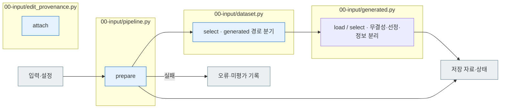

# 00 Input

[소스 전체](../README.md) · [실험 문서](../../../../docs/02-experiments/README.md) · [설정](../../../../config/experiments/README.md)

run 대응: `00_input`.

I00.01 결과 전달 → I00.02 무결성 확인 → E01에 선정 결과 전달.

모델 호출 없이 입력을 준비합니다. 해시·상태·ID 불일치는 오류로 남기고 E02 진행을 막습니다. public은 풀이 입력, private는 평가·분석 참조입니다.
원본 외부지식 분류를 요구한 실행은 전달 결과의 `external_knowledge`를 확인해 private에 `original_external_knowledge`로 보존합니다. 변형에는 원본의 분류와 적용 범위를 연결하지만 변형 자체의 판정으로 사용하지 않습니다. `used=false`는 확인 조건 미충족입니다.

## 사용법

다음 명령은 프로젝트 루트에서 실행합니다. `RUN_PATH`는 `prepare`가 출력한 실험 폴더입니다. 이미 생성한 실험을 이어갈 때는 같은 경로를 사용합니다.

```sh
PYTHONPATH=src .venv/bin/python -u -B -m finarch.experiments.pipeline config --config config/experiments/config.toml
PYTHONPATH=src .venv/bin/python -u -B -m finarch.experiments.pipeline prepare --config config/experiments/config.toml
```

`evaluation.schedule.dataset.generated_path`에 `data/generated/<제작 run-id>`를 지정합니다. 실제 입력은 `dataset.jsonl`과 `manifest.json`이며 제작 run의 조각 파일을 다시 읽지 않습니다. 준비하면 `00_input/public.jsonl`, `private.jsonl`, `selection.json`과 E02 요청이 함께 생성됩니다. `prepare`는 대상 모델을 호출하지 않습니다.

이번 TAT-QA 실행은 합본 717원본 중 원본과 7변형이 모두 자동 PASS이고 Reject가 없는 291원본을 선정했습니다. 원본 291 + 변형 2,037 = 2,328입력입니다. 선정 조건과 실제 제외 이유는 `selection.json`에서 확인합니다. 사람의 검토 완료와는 구별합니다. 분석용 메타 누락도 이 파일의 `analysis_metadata_status`와 `analysis_metadata_gaps`에서 확인합니다.

## 파일 책임과 읽는 순서

|파일|입구|입력 → 처리 → 출력|
|---|---|---|
|[pipeline.py](pipeline.py)|`prepare`|설정 → 전달 자료 선정·ID 정합 확인 → public/private/selection|
|[dataset.py](dataset.py)|`select`|generated 전달본 또는 구형 results·외부사용 분류 → 원본·7변형 선정 → public 모델 입력과 private 평가·분석 참조|
|[generated.py](generated.py)|`load / select`|dataset.jsonl·manifest → 제작 run 없이 무결성·선정 → public/private/selection|
|[edit_provenance.py](edit_provenance.py)|`attach`|기존 자료·편집 로그 → 변경 위치 연결 → private의 편집 근거|



회색은 입력·출력 파일, 파랑은 파일의 Python 함수입니다. 표의 함수는 해당 책임을 담당합니다. 세부 실행 순서·LLM 분기는 [실험 문서](../../../../docs/02-experiments/README.md)의 같은 번호 단계를 읽습니다.

이 README는 `src/finarch/documentation/templates/source-layout/experiments/00-input.md`에서 생성합니다.
