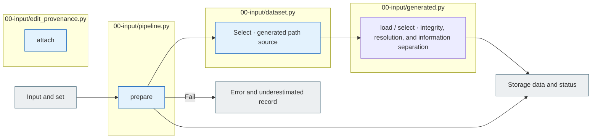

# 00 Input

[The whole sauce](../README.md) · [Experimental documentation](../../../../docs/02-experiments/README.md) · [Setting up](../../../../config/experiments/README.md)

Run is a response: `00_input`.

I00.01 The result is delivered → I00.02 Check the integrity → E01Deliver the selected results.

Prepare the input without the model call. Leave the hash, status, ID inconsistency error and E02 Public is the input of the pool, private is the evaluation and analysis reference.
The execution that required the original external knowledge classification was to deliver the results of the `external_knowledge`Check the private. `original_external_knowledge`The variation links the classification and scope of the original, but it doesn't use the variation itself as a judgment. `used=false`The condition of verification is insufficient.

## Usage

The next command runs from the project root. `RUN_PATH` `prepare`It's an experimental folder that G.O.A. has created, and it uses the same path as the experiment that he's already created.

```sh
PYTHONPATH=src .venv/bin/python -u -B -m finarch.experiments.pipeline config --config config/experiments/config.toml
PYTHONPATH=src .venv/bin/python -u -B -m finarch.experiments.pipeline prepare --config config/experiments/config.toml
```

`evaluation.schedule.dataset.generated_path`in `The data generated`The actual input is the `dataset.jsonl`and `manifest.json`And you don't read the slice file of the production run again. `00_input/public.jsonl`, `private.jsonl`, `selection.json`and E02 So the request is generated together. `prepare`It doesn't call the object model.

This TAT-QA execution is a copy of the 717The original of the original. 7All the variations are automatic PASS and there is no Reject. 291I picked the original. 291 + the transformation 2,037 = 2,328The reason for this is that the selection conditions and the actual exclusion `selection.json`The metaphysics of the analysis is also missing from the file. `analysis_metadata_status`and `analysis_metadata_gaps`Check it out.

## File responsibility and reading order

|File|Get in there.|Input → process → output|
|---|---|---|
|[pipeline.py](pipeline.py)|`prepare`|Setup → Select the transmitted data|
|[dataset.py](dataset.py)|`select`|generated delivery copy or formatting results; external use classification → originals;7Variation selection → public model input and private evaluation; see analysis|
|[generated.py](generated.py)|`load / select`|Dataset.jsonl·manifest → Unfinished without a run → public/private/selection|
|[edit_provenance.py](edit_provenance.py)|`attach`|The existing data, editing logs, changing location, linking, editing basis of private|



The gray is the input-output file, and the blue is the Python function of the file. The function in the table is responsible for that.](../../../../docs/02-experiments/README.md)Read the same number of steps.

This README is generated from `src/finarch/documentation/templates/source-layout/experiments/00-input.md`.
