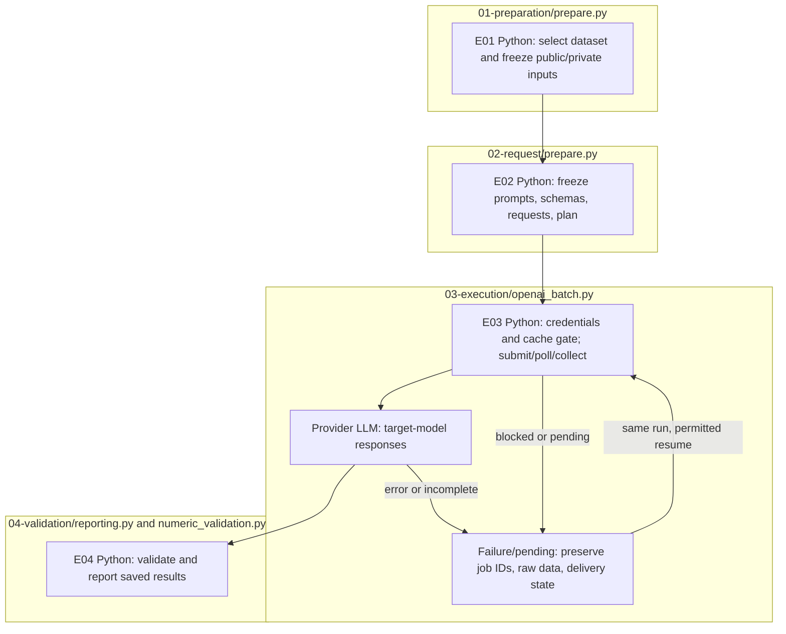

# Evaluation runbook

This stage evaluates target models on original and generated questions. It does not construct new variants. Complete [installation and credentials](../../../../README.md#installation-and-credentials), then run every command from the repository root.

## 1. Choose an input and inspect the configuration

The supplied [final release](../../../../data/final/README.md) is accepted directly by the generated-data loader: 1,354 families, each with one original and seven variants. The [reviewer smoke configuration](../../../../config/experiments/reviewer-smoke.toml) selects one family. Keep the dataset JSONL, schema, and manifest together; the loader checks hashes, IDs, counts, and required selection metadata.

```sh
PYTHONPATH=src .venv/bin/python -B -m finarch.experiments.pipeline config \
  --config config/experiments/reviewer-smoke.toml
```

Inspect the resolved dataset path/count, models, transports, reasoning modes, output limits, concurrency, key-file path, and separate Analysis backend. No model is called. For a new construction run, make a separate config with `evaluation.schedule.dataset.generated_path = "data/generated/<run-id>"`; do not point to an arbitrary Q/C/A JSONL.

The smoke example preserves the existing Evaluation profiles: `gpt-6-luna`, Reasoning OFF=`none`, ON=`medium`. There are two prompt conditions, Unguided Solving and Criteria-Guided Solving. Profile names/model IDs are code settings, not confirmation that your account can use them. The example is not the complete paper experiment matrix.

## 2. Freeze inputs and requests without model calls

```sh
PYTHONPATH=src .venv/bin/python -B -m finarch.experiments.pipeline prepare \
  --config config/experiments/reviewer-smoke.toml
```

Save the printed `reports/experiments-run/<new-id>` path. On the supplied configuration this prepares 8 public inputs, 8 corresponding private records, and **32 requests**: one family × 8 items × 2 prompts × 2 reasoning modes × 1 model. The resulting state is `PREPARED`; the model is `PENDING`. This is not an executed experiment.

Read these files before any dispatch:

1. Run `README.md`, `config.json`, `manifest.json`, `state.json`: frozen definition and integrity/status.
2. `00_input/selection.json`, `public.jsonl`, `private.jsonl`: selection and public/private boundary. Private reference/provenance/production metadata must not be merged into the target-model Q/C prompt. The public rows have `item_id`, `question`, `context`, and `answer_format`; each frozen request sends only `question`, `context`, and `answer_format` inside its `input`. Inspect the manifest for the exact prompt, schema, condition, and call settings.
3. `01_evaluation/02_request/plan.json`: model, request counts, concurrency, transport, and estimated usage/cost. Character-based token estimates and embedded prices are not a billing quote; actual cost remains null before execution.
4. `01_evaluation/02_request/<model-key>/manifest.jsonl`, saved prompts, and `response.schema.json`: exact frozen model requests and answer contract.

The prepare command checks input/definition integrity, not API-key validity, model access, or provider payload support. Re-running prepare creates a new experiment. Keep the existing path to resume it.

## 3. Execute Evaluation only

This step makes billable API calls. Fill in your root `.env` as described in the [credential guide](../../../../config/README.md). Review the request plan, model access, output budgets, and cache requirements before running:

```sh
RUN_PATH=reports/experiments-run/REPLACE_WITH_PRINTED_RUN_ID
PYTHONPATH=src .venv/bin/python -u -B -m finarch.experiments.pipeline run \
  --evaluation-only --run "$RUN_PATH"
```

For the supplied profile-based config, E03 uses the native OpenAI Batch transport. The coordinator submits, polls, collects, checks IDs, and runs E04 validation. It stops before Analysis. Progress remains in `pipeline.log`, `events.jsonl`, `state.json`, and per-model execution folders under `01_evaluation/03_execution/`. Preserve wire requests, provider job IDs, raw outputs/errors, normalized results, and usage. An HTTP success, a completed provider job, and a valid answer are separate states.

The current cache policy requires verified cache-disable controls and explicit cache counters. Missing counters are unknown, not zero. Do not bypass a policy failure or count it as an evaluated answer. Inspect provider errors and saved usage records when collecting a live run.

## 4. Inspect, resume, and hand off to Analysis

Read `01_evaluation/04_validation/summary.json`, each model's `results.jsonl` and `summary.json`, and the generated report. E04 validates response shape/execution state; numeric comparison is a separate derived record. Keep errors, refusals, incomplete outputs, and unevaluated rows in their proper counts.

Open the [experiment viewer](../../../../viewer/experiments/README.md), select the printed run, then choose Evaluation and its E01–E04 stages. Compare the selected Q/C, prompt/reasoning condition, actual response, validation, usage, and saved logs. A prepared-only run has no model answer to display.

After interruption, rerun the same `run --evaluation-only --run "$RUN_PATH"` command; existing manifests and durable job state govern reuse/collection. Do not run two coordinators concurrently. Terminal cache failures, ambiguous delivery, or output-budget limits may require diagnosis and the explicit retry controls shown by `--help`; do not delete attempts or silently submit them again.

Start [Analysis](../02-analysis/README.md) only when all selected model states are `FINISHED` and the saved Evaluation artifacts pass integrity checks.

## Code flow



E01/E02 prepare files locally. E03 calls the selected provider; E04 checks its saved responses.
