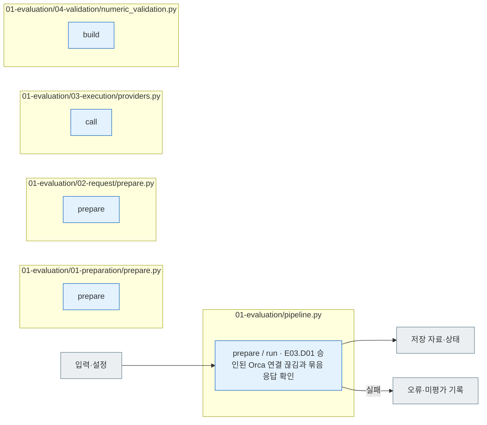

# 01 Evaluation

[소스 전체](../README.md) · [실험 문서](../../../../docs/02-experiments/README.md) · [설정](../../../../config/experiments/README.md)

run 대응: `01_evaluation`.

E01 준비 → E02 요청 동결 → E03 LLM 풀이 → E04 평가.

일시 중지된 run은 새 호출 없이 상태를 반환합니다. Batch 대기는 동일 작업 ID로 이어가고, 전송 여부가 불명확한 시도는 자동 재전송하지 않습니다. 실패·미실행도 결과 목록에 남깁니다.

## 사용법

다음 명령은 프로젝트 루트에서 실행합니다. `RUN_PATH`는 `prepare`가 출력한 실험 폴더입니다. 이미 생성한 실험을 이어갈 때는 같은 경로를 사용합니다.

```sh
RUN_PATH=reports/experiments-run/20261003-exp-004-tatqa-luna
PYTHONPATH=src .venv/bin/python -u -B -m finarch.experiments.pipeline run --evaluation-only --run "$RUN_PATH"
tail -f "$RUN_PATH/pipeline.log"
```

이 명령은 E03 Batch 제출·조회·수집과 E04 검사를 이어가며 Analysis 전에 끝납니다. `evaluation --run "$RUN_PATH"`는 한 번의 제출/조회/수집 사이클만 수행하므로, 완료까지 계속 확인할 때는 위 `run --evaluation-only`를 사용합니다. 이미 같은 pipeline이 실행 중이면 추가로 띄우지 않습니다.

API Evaluation은 Native Batch입니다. 기존 Batch ID가 있으면 그 ID로 조회·수집합니다. 새 실험을 만들려는 경우에만 `prepare`를 사용합니다. 준비한 원본·변형 입력 × 풀이 지시 2종 × 추론 설정 2종이 계획 요청 수이며 이번 실행은 291 × 8 × 4 = 9,312건입니다.

## 파일 책임과 읽는 순서

|파일|입구|입력 → 처리 → 출력|
|---|---|---|
|[pipeline.py](pipeline.py)|`prepare / run`|설정 또는 run → E01~E04 실행·재개 → 상태·평가 자료. run별 승인된 Orca 연결 끊김은 해당 시도를 보존하고 같은 묶음의 응답 수신이 확인될 때만 미전송 요청을 계속 처리|
|[01-preparation/prepare.py](01-preparation/prepare.py)|`prepare`|설정·입력 → 실행 폴더·기록 생성 → 동결 manifest|
|[02-request/prepare.py](02-request/prepare.py)|`prepare`|public·prompt·schema → 모델별 요청 → manifest|
|[03-execution/providers.py](03-execution/providers.py)|`call`|고정 요청 → 제공자 실행 → 원응답|
|[04-validation/numeric_validation.py](04-validation/numeric_validation.py)|`build`|저장 응답·기준 → 숫자 비교 → E04 숫자 평가|

Native Batch의 제공자 제출 거절은 `BATCH_REJECTED`, 처리 실패는 `BATCH_FAILED`, 조회 오류는 `BATCH_POLL_ERROR`로 루트 상태에도 기록합니다. 미실행 `INCOMPLETE`와 구별하며 다른 모델로 자동 재전송하지 않습니다.



회색은 입력·출력 파일, 파랑은 파일의 Python 함수입니다. 표의 함수는 해당 책임을 담당합니다. 세부 실행 순서·LLM 분기는 [실험 문서](../../../../docs/02-experiments/README.md)의 같은 번호 단계를 읽습니다.

이 README는 `src/finarch/documentation/templates/source-layout/experiments/01-evaluation.md`에서 생성합니다.

`models.<key>.disconnect_recovery`의 `continue_unsubmitted=true`와 승인 문구가 모두 있어야 연결 끊김 후 계속 실행할 수 있습니다. OFF/ON 선행 검사가 끝나야 하며, 같은 묶음에 수신 응답이 하나도 없으면 중단합니다. 해당 요청은 `UNKNOWN_DELIVERY`로 남고 자동 재전송하지 않습니다. 인증·계정 한도·캐시·다른 제공자 오류의 중단 조건은 유지합니다.
