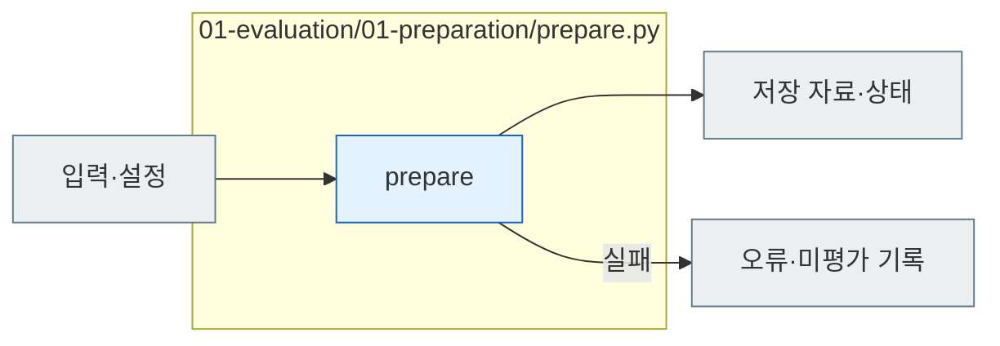

# E01 Preparation

[소스 전체](../../README.md) · [실험 문서](../../../../../docs/02-experiments/README.md) · [설정](../../../../../config/experiments/README.md)

run 대응: `01_evaluation/01_preparation`.

E01.01 문항 선정 → E01.02 public/private 분리 → E01.03 설정 동결.

설정이나 전달 자료가 유효하지 않으면 실행 전에 중단합니다. 폴더 예약과 기존 정의 검증을 거쳐 요청을 동결하며, 실제 모델 호출은 하지 않습니다.

## 사용법

다음 명령은 프로젝트 루트에서 실행합니다. `RUN_PATH`는 `prepare`가 출력한 실험 폴더입니다. 이미 생성한 실험을 이어갈 때는 같은 경로를 사용합니다.

```sh
PYTHONPATH=src .venv/bin/python -u -B -m finarch.experiments.pipeline config --config config/experiments/config.toml
PYTHONPATH=src .venv/bin/python -u -B -m finarch.experiments.pipeline prepare --config config/experiments/config.toml
```

`config`는 모델·effort·입력 경로를 읽어 출력합니다. `prepare`는 00 Input 선정, E01 설정 동결, E02 prompt/schema와 요청 작성까지 함께 수행하고 새 run 경로를 출력합니다. 출력 경로를 다음 실행에 전달하십시오. 이 단계는 모델 호출 0건입니다.

`config.json` → `00_input/selection.json` → `01_evaluation/02_request/plan.json` 순으로 대상·조건·요청 수·비용 추정을 확인합니다. 이후 프로젝트 TOML을 바꿔도 준비된 run의 Evaluation 설정은 바뀌지 않습니다.

## 파일 책임과 읽는 순서

|파일|입구|입력 → 처리 → 출력|
|---|---|---|
|[prepare.py](prepare.py)|`prepare`|JSON/TOML → Input pipeline·실행 폴더·E02 요청 준비 → config·manifest·state·events|



회색은 입력·출력 파일, 파랑은 파일의 Python 함수입니다. 표의 함수는 해당 책임을 담당합니다. 세부 실행 순서·LLM 분기는 [실험 문서](../../../../../docs/02-experiments/README.md)의 같은 번호 단계를 읽습니다.

이 README는 `src/finarch/documentation/templates/source-layout/experiments/01-evaluation/01-preparation.md`에서 생성합니다.
