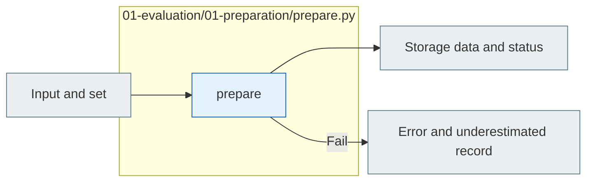

# E01 Preparation

[The whole sauce](../../README.md) · [Experimental documentation](../../../../../docs/02-experiments/README.md) · [Setting up](../../../../../config/experiments/README.md)

Run is a response: `01_evaluation/01_preparation`.

E01.01 Select the case → E01.02 Public/private separation → E01.03 Set the lock.

If the settings or the transmission data are not valid, it stops before running, and then it synchronizes the request with the folder reservation and the existing definition verification, and the actual model calls are not made.

## Usage

The next command runs from the project root. `RUN_PATH` `prepare`It's an experimental folder that G.O.A. has created, and it uses the same path as the experiment that he's already created.

```sh
PYTHONPATH=src .venv/bin/python -u -B -m finarch.experiments.pipeline config --config config/experiments/config.toml
PYTHONPATH=src .venv/bin/python -u -B -m finarch.experiments.pipeline prepare --config config/experiments/config.toml
```

`config`And then the model reads the input path, the input path and the output path. `prepare` 00 Select the input, E01 Set the equation, E02 Run the new run path and run the output path to the next run. This step calls the model 0entries.

`config.json` → `00_input/selection.json` → `01_evaluation/02_request/plan.json` I'll check the subject, condition, request, and cost estimates in order, and then change the project TOML, and the Evaluation settings of the run that's ready won't change.

## File responsibility and reading order

|File|Get in there.|Input → process → output|
|---|---|---|
|[prepare.py](prepare.py)|`prepare`|JSON/TOML → Input pipeline; action folder; E02 Request ready → config. manifest. state events|



The gray is the input-output file, and the blue is the Python function of the file. The function in the table is responsible for that.](../../../../../docs/02-experiments/README.md)Read the same number of steps.

This README is generated from `src/finarch/documentation/templates/source-layout/experiments/01-evaluation/01-preparation.md`.
