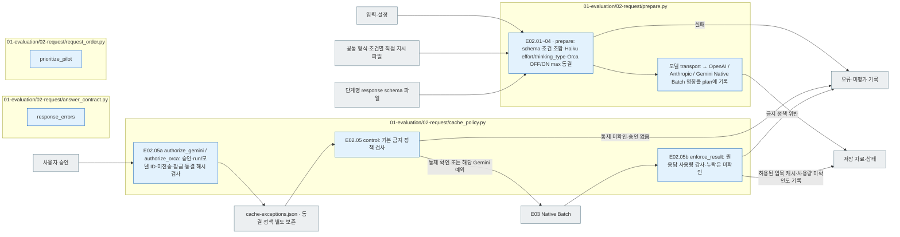

# E02 Request

[소스 전체](../../README.md) · [실험 문서](../../../../../docs/02-experiments/README.md) · [설정](../../../../../config/experiments/README.md)

run 대응: `01_evaluation/02_request`.

E02.01 prompt/schema → E02.02 공개 입력 → E02.03 조건별 요청 → E02.04 검증·동결.

응답 schema가 없거나 비어 있으면 호출 전에 차단합니다. private 정답·분석 메타는 대상 모델 입력에 포함하지 않습니다. 파일 해시와 요청 manifest로 변경 여부를 확인합니다.

## 사용법

E02는 상위 `pipeline.py prepare --config config/experiments/config.toml`에서 E01과 함께 실행됩니다. 이 폴더의 Python 파일을 따로 실행해 기존 요청을 다시 만들지 않습니다.

읽는 순서는 `plan.json` → `common.md`·`prompt-unguided.md`·`prompt-guided.md` → `response.schema.json` → `<model>/manifest.jsonl`입니다. manifest 한 행이 실제 요청 하나이며 `item_id`, `prompt_condition`, `reasoning`과 전송할 입력을 연결합니다.

TAT-QA 291문항 실행의 네 조건은 각각 2,328건입니다. Unguided/Guided는 서로 다른 prompt입니다. Reasoning OFF/ON은 Luna에서는 `none`/`medium`, Gemini 2.5 Flash에서는 `thinkingBudget=0`/`1024`로 전달합니다. 제공자별 설정은 실행의 동결 config와 요청에서 확인합니다. `evaluation.run.seed`는 로컬 요청 순서용이며 제공자 생성 seed가 아닙니다. 요청과 스키마는 생성 후 동결합니다.

## 파일 책임과 읽는 순서

|파일|입구|입력 → 처리 → 출력|
|---|---|---|
|[prepare.py](prepare.py)|`prepare`|설정·public → prompt/schema 복사·조건 조합·Gemini thinking_level 또는 Haiku 5.5 effort·adaptive/disabled 동결 → 제공자별 Native Batch 명칭을 기록한 plan·모델 manifest|
|[공통·조건별 프롬프트](../../prompts/README.md)|`assets.prompt_path`|공통 형식 안내와 조건별 직접 분류 지시 → E02 동결용 common·unguided·guided 사본|
|[풀이 응답 스키마](../../schemas/json/01-evaluation.02-request.solver.response.schema.json)|`assets.schema_path`|두 풀이 조건의 공통 형식 → E02 동결용 response.schema.json|
|[answer_contract.py](answer_contract.py)|`response_errors`|공통 응답 정의 → 필드·조건 제약 → 오류 목록|
|[cache_policy.py](cache_policy.py)|`control / authorize_gemini / authorize_orca / enforce_result`|기본 캐시 금지·해당 run의 사용자 승인 → 전송 전 검사·사용량 감사 → 차단 또는 승인된 run·모델만 자동 캐시 허용. 원응답 재사용은 금지, 누락 사용량은 미확인|
|[request_order.py](request_order.py)|`prioritize_pilot`|모든 요청 → 선행 확인용 요청 순서 → 같은 전체 요청 집합|

회색은 입력·출력 파일, 파랑은 파일의 Python 함수입니다. 표의 함수는 해당 책임을 담당합니다. 세부 실행 순서·LLM 분기는 [실험 문서](../../../../../docs/02-experiments/README.md)의 같은 번호 단계를 읽습니다.

이 README는 `src/finarch/documentation/templates/source-layout/experiments/01-evaluation/02-request.md`에서 생성합니다.
