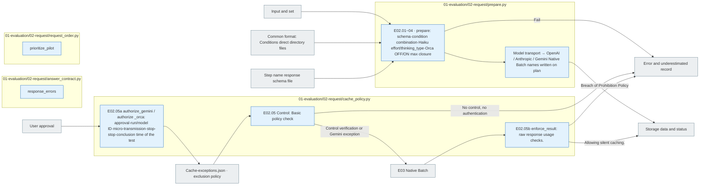

# E02 Request

[The whole sauce](../../README.md) · [Experimental documentation](../../../../../docs/02-experiments/README.md) · [Setting up](../../../../../config/experiments/README.md)

Run is a response: `01_evaluation/02_request`.

E02.01 prompt/schema → E02.02 Open input → E02.03 Requested by condition → E02.04 Verification and confirmation.

If there is no response schema or it is empty, it blocks before calling. private correct response: analytics metadata is not included in the object model input. Check if the file has been changed to hash and request manifest.

## Usage

E02is the top `pipeline.py prepare --config config/experiments/config.toml`E0 from1Run the Python file in this folder separately and you don't re-create the existing request.

The order in which you read it. `plan.json` → `common.md`·`prompt-unguided.md`·`prompt-guided.md` → `response.schema.json` → `<model>/manifest.jsonl`So, if you have a line of manifest, you have one real request. `item_id`, `prompt_condition`, `reasoning`And connect the input to be transmitted.

TAT-QA 291The four conditions of the case execution are each 2,328Unuided/Guided is a different prompt. `none`/`medium`, Gemini 2.5 In Flash, `thinkingBudget=0`/`1024`Provider-specific settings are verified in the execution of the synchronization configuration and request. `evaluation.run.seed`The request and the schema are synchronized after the creation.

## File responsibility and reading order

|File|Get in there.|Input → process → output|
|---|---|---|
|[prepare.py](prepare.py)|`prepare`|Setup public → prompt/schema copy condition combination Gemini thinking_level or Haiku 5.5 effort·adaptive/disabled syntax → Native Batch name recorded by provider plan·model manifest|
|[General: Conditions by Prompt](../../prompts/README.md)|`assets.prompt_path`|Common format instructions and conditions direct classification instructions → E02 Common;unguided;guided copies for the same|
|[Flowers reply scheme](../../schemas/json/01-evaluation.02-request.solver.response.schema.json)|`assets.schema_path`|The common form of the two root conditions → E02 The answer.schema.json|
|[answer_contract.py](answer_contract.py)|`response_errors`|Common response definition → Fields → Conditions restrictions → List of errors|
|[cache_policy.py](cache_policy.py)|`control / authorize_gemini / authorize_orca / enforce_result`|Basic cache ban; user approval of run per pass → transmission pre-checking; usage verification → blocking or authorized run; only model automatic cache allowed. raw response reuse is prohibited, missing usage is uncertain|
|[request_order.py](request_order.py)|`prioritize_pilot`|All requests → Forward verification order of requests → the same complete request set|

The gray is the input-output file, and the blue is the Python function of the file. The function in the table is responsible for that.](../../../../../docs/02-experiments/README.md)Read the same number of steps.

This README is generated from `src/finarch/documentation/templates/source-layout/experiments/01-evaluation/02-request.md`.
