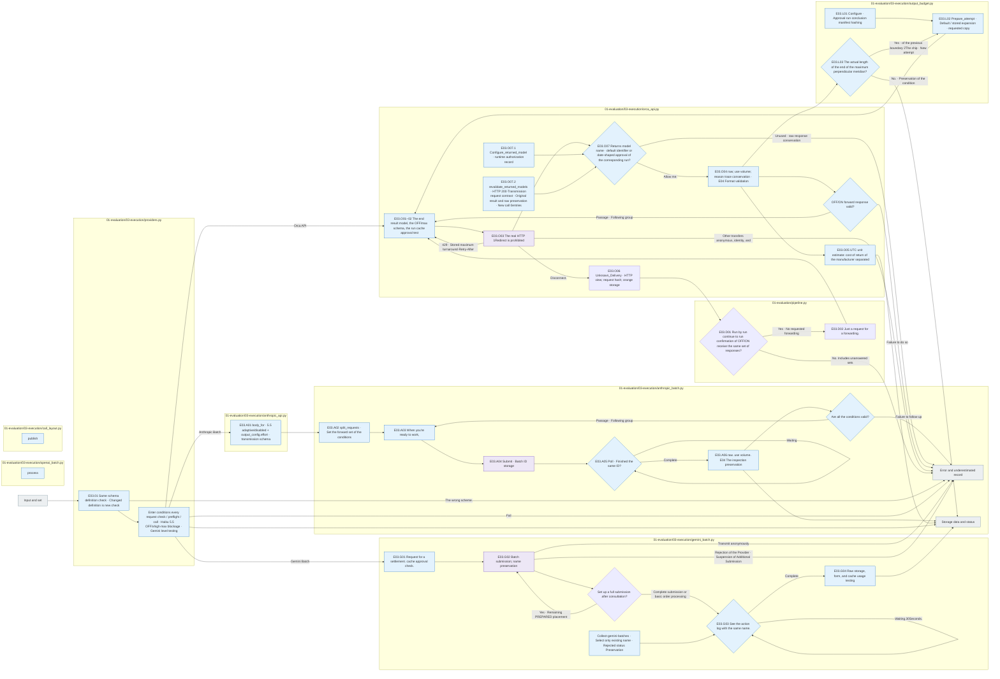

# E03 Execution

[The whole sauce](../../README.md) · [Experimental documentation](../../../../../docs/02-experiments/README.md) · [Setting up](../../../../../config/experiments/README.md)

Run is a response: `01_evaluation/03_execution`.

E03.01 Check the run conditions → E03.02 LLM grass → E03.03 Try to preserve.

First verify the small response and usage, then submit a follow-up batch. Separate the status, failure, or transmission anonymity, and save the raw response and error when it fails. Separately verify the provider process completed; locally collected completed; format validation.

## Usage

The next command runs from the project root. `RUN_PATH` `prepare`It's an experimental folder that G.O.A. has created, and it uses the same path as the experiment that he's already created.

```sh
RUN_PATH=reports/experiments-run/20261003-exp-004-tatqa-luna
PYTHONPATH=src .venv/bin/python -u -B -m finarch.experiments.pipeline run --evaluation-only --run "$RUN_PATH"
tail -f "$RUN_PATH/pipeline.log"
```

E03 Instead of starting a new dedicated CLI, we use the top pipeline. `I'm going to be working on this.`Batch ID of the public status, completed/failed tooth check, and collect `calls/`Read the raw response and attempt records. Do not submit duplicates of the same running process or existing batch.

`OPENAI_BATCH_SUBMITTED`is submitted, `OPENAI_BATCH_PROGRESS`The process of handling the provider, `OPENAI_BATCH_VALIDATION_PROGRESS`The dryer completed the dryer is not going to be a local format dryer. `PIPELINE_EXIT`The entire end of the cycle is the root of the `full_pipeline.status`Check both the cache settings and the actual usage check and check the usage gap. 0It's not considered.

## File responsibility and reading order

|File|Get in there.|Input → process → output|
|---|---|---|
|[providers.py](providers.py)|`preflight / validate_request / call`|Request, set up, and check conditions, Haiku 5.5The effort·thinking_type·output limit and OFF/xhigh·max unchecked → provider selection·raw response ·form state|
|[orca_api.py](orca_api.py)|`validate_model / body_for / call / parse_response / accepted_returned_models / configure_returned_model / revalidate_returned_models`|DeepSeek V4 is coming.1 Flash request → R− disabled / R+ enabled·max, run-by-run cache; half-replacement model name authorization check; HTTP 1Retransmission → raw·reference trace·cache usage·semi-repayment cost. Only approved date-type response names are allowed to be added on the respective run and the request model and raw response are maintained.4 Re-check and not re-record. Unknown_DELIVERY·usage is stored as uncertain and not automatically retransmitted.|
|[anthropic_api.py](anthropic_api.py)|`body_for / call`|Request for a settlement 4.5 budget or 5.5 effort·adaptive/disabled·JSON schema for transmission → actual Messages body· raw response|
|[openai_batch.py](openai_batch.py)|`process`|Fixed requests → OpenAI Batch submission; syndication; collection → Batch ID; raw response|
|[anthropic_batch.py](anthropic_batch.py)|`split_requests / process_chunk / process`|Fixed request → set set set of conditions;2/4Verify all conditions are valid → Subsequent batch submission; such as ID inspection; collection; raw response retention.|
|[gemini_batch.py](gemini_batch.py)|`process / collect / collect_submitted`|Fixed request; cache inspection → Native Gemini Batch submission;30Secondary search; collection → Batch name; movement log; raw response ·use volume. `submit_all_before_poll=true`is collected by storing the split assignment in sequence after submitting it to the ID. `collect_submitted`The new ID is not re-filled.|
|[call_layout.py](call_layout.py)|`publish`|Try out the result → case → condition by path → raw response link|
|[output_budget.py](output_budget.py)|`configure / policy_for / prepare_attempt / retry_truncated`|Run-by-run approval, confirmation request, previous attempt, default default default, only the actual length end 2Ship expansion → attempt cap-out. Common form failure; transmission unnamed does not re-emerge and terminates at maximum limit|



The gray is the input-output file, and the blue is the Python function of the file. The function in the table is responsible for that.](../../../../../docs/02-experiments/README.md)Read the same number of steps.

This README is generated from `src/finarch/documentation/templates/source-layout/experiments/01-evaluation/03-execution.md`.

In the authorized Orca run. `configure-output-budget --model-key <key> --authorization '< real instructions>' --base-output-tokens 8194`And then, after writing down the policy, `run --evaluation-only --resume-limits`I'm going to restart the evaluation that was stopped. `runtime-overrides.json`It separates the actual cap-source request from the synchronized configuration and saves it to the request-started-result of the new attempt. `publish`The actual request for the latest attempt is displayed. `OUTPUT_BUDGET_INCREASED`The next length is also infinite, and the actual transmission is `OUTPUT_BUDGET_ATTEMPT`Check it out at provider-request-wire.json.
