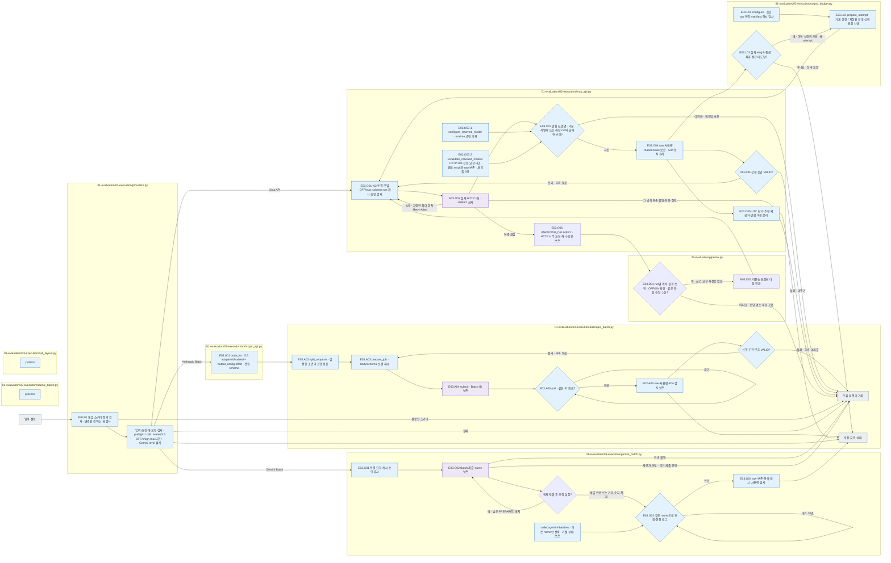

# E03 Execution

[소스 전체](../../README.md) · [실험 문서](../../../../../docs/02-experiments/README.md) · [설정](../../../../../config/experiments/README.md)

run 대응: `01_evaluation/03_execution`.

E03.01 실행 조건 확인 → E03.02 LLM 풀이 → E03.03 시도 보존.

먼저 소량의 응답과 사용량을 확인한 후 후속 묶음을 제출합니다. 대기·실패·전송 여부 불명을 분리하고, 실패 시 원응답과 오류를 보존합니다. 제공자 처리 완료·로컬 수집 완료·형식 검사를 분리해 확인합니다.

## 사용법

다음 명령은 프로젝트 루트에서 실행합니다. `RUN_PATH`는 `prepare`가 출력한 실험 폴더입니다. 이미 생성한 실험을 이어갈 때는 같은 경로를 사용합니다.

```sh
RUN_PATH=reports/experiments-run/20261003-exp-004-tatqa-luna
PYTHONPATH=src .venv/bin/python -u -B -m finarch.experiments.pipeline run --evaluation-only --run "$RUN_PATH"
tail -f "$RUN_PATH/pipeline.log"
```

E03 전용 CLI를 새로 띄우는 대신 상위 pipeline을 사용합니다. `batches/<묶음>/job.json`의 Batch ID·제공자 상태·완료/실패 건수를 확인하고, 수집 후 `calls/`의 원응답과 시도 기록을 읽습니다. 동일 실행 중 프로세스나 기존 Batch를 중복 제출하지 않습니다.

`OPENAI_BATCH_SUBMITTED`는 제출, `OPENAI_BATCH_PROGRESS`는 제공자의 처리 현황, `OPENAI_BATCH_VALIDATION_PROGRESS`는 수집한 응답의 로컬 검사입니다. 제공자가 완료한 건수가 곧 로컬 형식 통과 건수는 아닙니다. `PIPELINE_EXIT`는 Evaluation의 한 조회 사이클 반환 기록이므로 전체 종료는 루트 `full_pipeline.status`로 확인합니다. 캐시 설정과 실제 usage 검사를 모두 확인하며 사용량 누락을 0으로 간주하지 않습니다.

## 파일 책임과 읽는 순서

|파일|입구|입력 → 처리 → 출력|
|---|---|---|
|[providers.py](providers.py)|`preflight / validate_request / call`|요청·설정 → 스키마 정의·입력·조건 검사, Haiku 5.5의 effort·thinking_type·출력 상한과 OFF/xhigh·max 불가 검사 → 제공자 선택·원응답·형식 상태|
|[orca_api.py](orca_api.py)|`validate_model / body_for / call / parse_response / accepted_returned_models / configure_returned_model / revalidate_returned_models`|동결 DeepSeek V4.1 Flash 요청 → R⁻ disabled / R⁺ enabled·max, run별 캐시·반환 모델명 승인 검사·HTTP 1회 전송 → raw·추론 trace·캐시 사용량·반환 비용. 승인된 날짜형 응답 이름만 해당 run에서 추가 허용하며 요청 모델과 원응답은 유지. 저장된 모델명 검사 오류는 원래 result를 보존하고 E04 재검사하며 재호출하지 않음. 연결 끊김은 UNKNOWN_DELIVERY·usage 미확인으로 보존하며 자동 재전송하지 않음|
|[anthropic_api.py](anthropic_api.py)|`body_for / call`|동결 요청 → 4.5 budget 또는 5.5 effort·adaptive/disabled·전송용 JSON schema → 실제 Messages body·원응답|
|[openai_batch.py](openai_batch.py)|`process`|고정 요청 → OpenAI Batch 제출·조회·수집 → Batch ID·원응답|
|[anthropic_batch.py](anthropic_batch.py)|`split_requests / process_chunk / process`|고정 요청 → 설정된 조건의 선행 묶음·2/4조건 모두 유효한지 검사 → 후속 Batch 제출·같은 ID 조회·수집·원응답 보존. 선행 실패는 후속 제출 중단|
|[gemini_batch.py](gemini_batch.py)|`process / collect / collect_submitted`|고정 요청·캐시 검사 → Native Gemini Batch 제출·30초 조회·수집 → Batch name·진행 로그·원응답·사용량. `submit_all_before_poll=true`는 분할 배치를 순차 제출한 뒤 저장된 ID로 수집. `collect_submitted`는 이미 접수된 ID만 수집하며 새 제출·거절 재시도를 하지 않음|
|[call_layout.py](call_layout.py)|`publish`|시도 결과 → 문항·조건별 경로 → 원응답 연결|
|[output_budget.py](output_budget.py)|`configure / policy_for / prepare_attempt / retry_truncated`|run별 승인·동결 요청·이전 시도 → 기본 상한 / 실제 length 종료만 2배 확대 → 시도별 cap·출처 해시. 일반 형식 실패·전송 불명은 재호출하지 않으며 최대 상한에서 종료|



회색은 입력·출력 파일, 파랑은 파일의 Python 함수입니다. 표의 함수는 해당 책임을 담당합니다. 세부 실행 순서·LLM 분기는 [실험 문서](../../../../../docs/02-experiments/README.md)의 같은 번호 단계를 읽습니다.

이 README는 `src/finarch/documentation/templates/source-layout/experiments/01-evaluation/03-execution.md`에서 생성합니다.

승인된 Orca run에서 `configure-output-budget --model-key <key> --authorization '<실제 지시>' --base-output-tokens 8194`로 정책을 기록한 뒤, `run --evaluation-only --resume-limits`로 중단된 Evaluation을 재개합니다. `runtime-overrides.json`은 동결 config와 분리하며 실제 cap·원본 요청 해시는 새 attempt의 request·started·result에 저장합니다. `publish`는 최신 시도의 실제 요청을 표시합니다. `OUTPUT_BUDGET_INCREASED`는 다음 length 재시도 상한이며, 실제 전송은 `OUTPUT_BUDGET_ATTEMPT`와 provider-request-wire.json에서 확인합니다.
