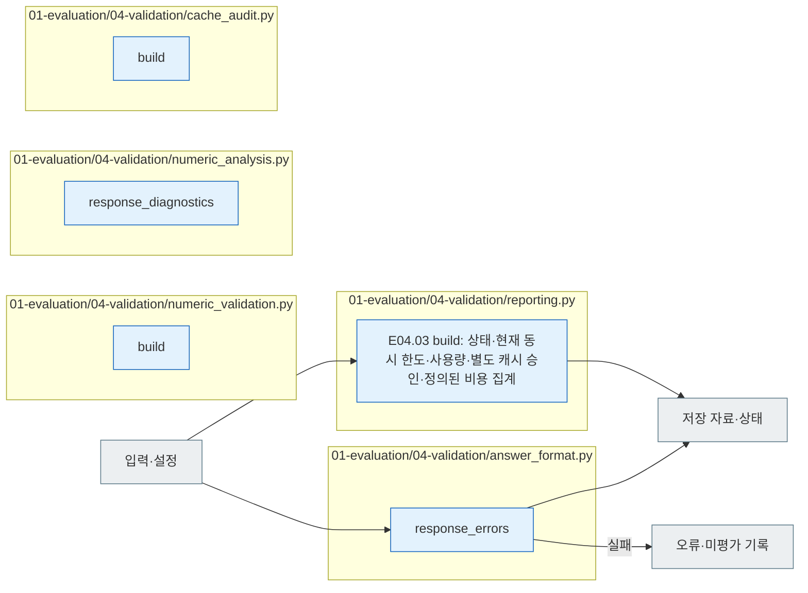

# E04 Validation

[소스 전체](../../README.md) · [실험 문서](../../../../../docs/02-experiments/README.md) · [설정](../../../../../config/experiments/README.md)

run 대응: `01_evaluation/04_validation`.

E04.01 파싱 → E04.02 형식 검사 → E04.03 결과 기록 → E04.04 숫자 비교.

형식 통과와 숫자 일치, 의미적 정답은 구분합니다. 신규 run의 숫자 비교 산출물은 E04에 저장하고, 과거 run의 기존 경로는 읽기 호환으로 유지합니다. 응답 없음·오류·숫자 비교 불가는 미평가 이유로 남깁니다.

## 사용법

다음 명령은 프로젝트 루트에서 실행합니다. `RUN_PATH`는 `prepare`가 출력한 실험 폴더입니다. 이미 생성한 실험을 이어갈 때는 같은 경로를 사용합니다.

```sh
RUN_PATH=reports/experiments-run/20261003-exp-004-tatqa-luna
PYTHONPATH=src .venv/bin/python -u -B -m finarch.experiments.pipeline report --run "$RUN_PATH"
```

`report`는 저장된 시도·응답으로 수집 보고서와 상태 집계를 다시 생성하며 모델 호출은 하지 않습니다. 새 원본 숫자 비교까지 진행하는 정상 경로는 `run --evaluation-only --run "$RUN_PATH"`의 수집 완료 후 E04입니다. `report`만 실행했다고 숫자 비교까지 새로 계산되었다고 판단하지 않습니다.

`REPORT.md`·`summary.json` → `<model>/results.jsonl` → `numeric-comparisons.jsonl` → 개별 `calls/` 원응답 순으로 확인합니다. 미수집, 형식 실패, 숫자 비교 불가를 별도로 읽습니다. `EVALUATION_COMPLETE`는 수집·검사 경로 완료이며 모든 응답의 형식 통과나 의미 정답을 뜻하지 않습니다.

## 파일 책임과 읽는 순서

|파일|입구|입력 → 처리 → 출력|
|---|---|---|
|[answer_format.py](answer_format.py)|`response_errors`|응답·schema → 형식 검사 → 오류 목록|
|[reporting.py](reporting.py)|`build`|모든 요청·결과·별도 캐시 승인·현재 모델 상태 → 상태·실제 동시 한도·사용량·승인 범위 집계 → REPORT·summary·results. 최초 동결 한도와 현재 운영 한도를 구별하며 미설정 캐시 할인은 추정하지 않음|
|[numeric_validation.py](numeric_validation.py)|`build`|저장 결과·private → 기존 기준 숫자 비교 → numeric-comparisons|
|[numeric_analysis.py](numeric_analysis.py)|`response_diagnostics`|과거 run 응답·기준 → 형식·숫자 진단 → 과거 진단 자료|
|[cache_audit.py](cache_audit.py)|`build`|저장 사용량 → 캐시 적용 흔적 집계 → 캐시 감사 자료|



회색은 입력·출력 파일, 파랑은 파일의 Python 함수입니다. 표의 함수는 해당 책임을 담당합니다. 세부 실행 순서·LLM 분기는 [실험 문서](../../../../../docs/02-experiments/README.md)의 같은 번호 단계를 읽습니다.

이 README는 `src/finarch/documentation/templates/source-layout/experiments/01-evaluation/04-validation.md`에서 생성합니다.
