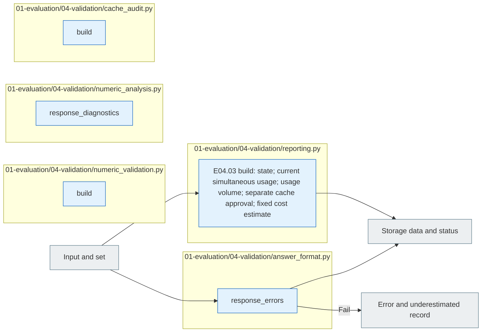

# E04 Validation

[The whole sauce](../../README.md) · [Experimental documentation](../../../../../docs/02-experiments/README.md) · [Setting up](../../../../../config/experiments/README.md)

Run is a response: `01_evaluation/04_validation`.

E04.01 Passing → E04.02 format validation → E04.03 The result record → E04.04 The numbers are comparison.

The difference between the form pass and the numerical match, the meaningful exact answer.4The previous run keeps the existing paths in the reading compatible.

## Usage

The next command runs from the project root. `RUN_PATH` `prepare`It's an experimental folder that G.O.A. has created, and it uses the same path as the experiment that he's already created.

```sh
RUN_PATH=reports/experiments-run/20261003-exp-004-tatqa-luna
PYTHONPATH=src .venv/bin/python -u -B -m finarch.experiments.pipeline report --run "$RUN_PATH"
```

`report`The normal path to proceed to the new original number comparison is to generate the data and the status statistics as a saved attempt. `run --evaluation-only --run "$RUN_PATH"`After completion of the collection of E04. `report`It's not just that we're running a new calculation until we compare the numbers.

`REPORT.md`·`summary.json` → `<model>/results.jsonl` → `numeric-comparisons.jsonl` → Individual `calls/` I check the raw response sequence, and I read the subset, the formatting failure, the numerical comparison failure separately. `EVALUATION_COMPLETE`The collection-test pathway is complete and does not mean that all responses pass through the form or mean the correct answer.

## File responsibility and reading order

|File|Get in there.|Input → process → output|
|---|---|---|
|[answer_format.py](answer_format.py)|`response_errors`|Reply·schema → format validation → list of errors|
|[reporting.py](reporting.py)|`build`|All requests; results; separately cache approval; current model status → status; actual concurrent cache; usage volume; authorization range aggregate → REPORT; summary; results. First unfinished cache and current operating cache are not estimated|
|[numeric_validation.py](numeric_validation.py)|`build`|Results stored·private → existing reference numbers compared → numeric-comparisons|
|[numeric_analysis.py](numeric_analysis.py)|`response_diagnostics`|Past run response, setting, form, numerical diagnosis, past diagnostic data|
|[cache_audit.py](cache_audit.py)|`build`|Storage usage → Cache application trace data → Cache audit data|



The gray is the input-output file, and the blue is the Python function of the file. The function in the table is responsible for that.](../../../../../docs/02-experiments/README.md)Read the same number of steps.

This README is generated from `src/finarch/documentation/templates/source-layout/experiments/01-evaluation/04-validation.md`.
