# 02 Analysis

[소스 전체](../README.md) · [실험 문서](../../../../docs/02-experiments/README.md) · [설정](../../../../config/experiments/README.md)

run 대응: `02_analysis`.

A01 결과 취합 → A02 관계 비교·LLM 해석 → 승인된 실패 재시도·검사 → A03 연구 해석 → A04 연구 발견 사분면 정리.

기본 분석 설정은 config/hyperparameter.json과 codex-profiles.toml에서 선택하며, 명시한 과거 TOML도 읽습니다. A01은 Python만 사용하고 A02/A03는 선택한 모델을 사용합니다. Codex는 첫 1건 대기를 거치지 않고 설정된 동시 한도로 바로 시작하며 모든 응답을 같은 계약으로 검사합니다. 진행한 분석의 모델·입력 변경은 차단합니다. 동시 호출 수·CPU 증설·호출 시간 제한은 별도 운영 기록으로 바꿀 수 있습니다. 일시 중지·미완료 Evaluation은 새 분석 호출을 시작하지 않습니다.

## 사용법

다음 명령은 프로젝트 루트에서 실행합니다. `RUN_PATH`는 `prepare`가 출력한 실험 폴더입니다. 이미 생성한 실험을 이어갈 때는 같은 경로를 사용합니다.

```sh
RUN_PATH=reports/experiments-run/20261003-exp-004-tatqa-luna
PYTHONPATH=src .venv/bin/python -u -B -m finarch.experiments.pipeline configure-analysis --run "$RUN_PATH" --config config/experiments/config.toml
PYTHONPATH=src .venv/bin/python -u -B -m finarch.experiments.pipeline run --run "$RUN_PATH"
```

분석을 실행하기로 정한 뒤 사용합니다. 첫 명령은 Analysis 설정만 동결하며 모델 호출 0건입니다. 두 번째 명령은 Evaluation 완료를 확인한 뒤 A01 → A02 → A03를 이어갑니다. `analysis --run "$RUN_PATH"`는 분석 한 사이클을 수행하고 API Batch 대기는 반환할 수 있으므로 지속적인 재개에는 상위 `run`을 사용합니다.

### A02 실패 재시도 후 A03 진행

```sh
RUN_PATH=reports/experiments-run/20261003-exp-004-tatqa-luna-sol-low
PYTHONPATH=src .venv/bin/python -u -B -m finarch.experiments.pipeline configure-analysis-retries --run "$RUN_PATH" --authorization '<실제 사용자 재시도 지시>'
PYTHONPATH=src .venv/bin/python -u -B -m finarch.experiments.pipeline analysis-sequence --run "$RUN_PATH"
```

첫 명령은 해당 run의 동결 Analysis 설정에 결합한 `02_analysis/retry-policy.json`만 기록합니다. Codex A02는 미전송 요청과 실행 중 요청이 모두 0이 된 뒤 서버 혼잡 오류와 프로세스 종료가 확인된 TIMEOUT을 골라 60·120·240초 대기 후 최대 3회 재시도합니다. 성공 응답과 기존 시도는 보존합니다. 사용자 중지·인증·계정 한도·종료 미확인 요청은 자동 재호출하지 않습니다. `retry-rounds/round-*.json`에 대상 ID·기존 시도·대기 시간·실제 결과를 저장하며 명령 재시작으로 횟수를 초기화하지 않습니다. A02 응답을 다시 검사·취합한 후 전부 유효해야 A03를 시작합니다. 제한 소진·응답 확인 불가이면 중단 상태와 이유를 남깁니다. Evaluation은 재호출하지 않습니다.

특정 검사 실패만 한 번 추가 시도하도록 승인받았다면 `configure-analysis-retries --retry-validation-failures --stage 02_comparison --trial-id <ID> --authorization <지시>`를 사용합니다. 여러 ID는 `--trial-id`를 반복합니다. `validation_retry_claims`는 해당 단계의 종료된 INVALID_RESPONSE와 기존 시도 횟수에 결합합니다. 한 번 추가 결과를 저장하면 승인을 소비하며, 다른 ID·다음 단계의 검사 실패에는 적용하지 않습니다. 기존 최대 3회 회차와 policy_id는 유지합니다.

승인된 Codex 재시도는 직전 `INVALID_RESPONSE`의 검사 오류를 실제 prompt에 추가합니다. A02 `decision_grounding` 등의 잘못된 인용은 응답 ID·필드 위치·실패 인용·대응 저장 원문을 함께 전달하여 LLM이 이전 문제를 확인하도록 합니다. 이전 전체 응답도 함께 전달하여 기존 판단·이유·관찰·findings를 유지하고 오류 부분만 보정하도록 지시합니다. 동결 원요청과 기존 응답은 보존하고 새 응답에는 같은 검사를 적용합니다. 진단은 재시도 승인이나 횟수를 늘리지 않습니다. 상세 파일 역할·한도는 [Codex 실행 안내](backends/README.md)를 읽습니다.

검사 실패·출력 잘림·일시 오류도 재시도하고 A03에 같은 복구 흐름을 적용하기로 정했다면, 설정 명령에 `--retry-validation-failures --retry-research`를 추가합니다. 기존 정책은 명시적으로 확장하며 `retry-policy-extension-*.json`에 이전 정책과 지시를 보존합니다. 이미 사용한 A02 회차를 초기화하지 않습니다. A03는 자기 단계의 최대 3회 예산을 사용하고, 검사에 실패한 응답을 통과한 것처럼 넘기지 않습니다. 이 정책이 관리하는 오류는 기존 즉시 재시도를 건너뛰고 단계 종료 후 대기·재시도로 통일합니다. 따라서 A02 전부 통과 → A03 실행 → A03 실패 분류·대기·재시도 → 최종 보고 순서입니다.

개별 TIMEOUT·서버 오류·검사 실패·응답 미확인은 별도로 모으며 다른 미전송 요청의 접수를 막지 않습니다. 동시 한도 100건이면 실행 중 요청이 끝날 때마다 빈 슬롯을 먼저 채우고, 전체 결과 취합은 별도 Python 작업으로 수행합니다. 관리되는 단계는 개별 즉시 재시도를 건너뛰고 미전송·실행 중 요청이 모두 끝난 뒤 승인된 실패만 기존 최대 3회 복구 회차에서 처리합니다. `scheduler.json`의 `active_calls`·`queued_calls`와 `deferred_failure_count`·`deferred_trial_ids`·`deferred_statuses`를 구분합니다. 인증·계정 한도·로컬 설정/동결 오류는 전체 접수를 중단합니다. 사용자가 중지했던 `INTERRUPTED` 요청은 자동 복구 대상이 아닙니다. 사용자가 재실행을 지시한 경우 `authorize-analysis-retry --run "$RUN_PATH" --stage 02_comparison --trial-id <ID> --authorization '<실제 사용자 지시>'`로 특정 ID의 한 번 재호출만 승인합니다. 저장된 중지 기록과 PID 종료를 확인하며, 살아 있는 프로세스·종료 미확인 요청은 승인하지 않습니다. 원래 실패 기록은 보존합니다.

A04까지 복구하기로 승인한 실행은 `configure-analysis-retries`에 `--retry-quadrant`를 추가합니다. A04도 종료 후 같은 실패 분류·대기·최대 3회 정책을 사용하며 기존 예산은 초기화하지 않습니다. `pause`, `authorize-analysis-retry`, `retry-analysis-requests`는 `04_quadrant` 단계도 지원합니다. 중지·재전송 전에 실제 해당 run 프로세스와 요청의 종료를 확인하며, 정상 진행 중인 호출은 모니터링 주기가 지났다는 이유만으로 종료하지 않습니다.

특정 미확인 요청만 다시 실행하려면 기존 프로세스를 `pause`로 종료하고 `resume-analysis`로 Analysis 대기만 해제한 다음, `retry-analysis-requests --run "$RUN_PATH" --stage 02_comparison --trial-id <ID> --authorization '<실제 사용자 지시>'`를 사용합니다. 여러 ID는 `--trial-id`를 반복합니다. 이 명령은 manifest와 종료 기록을 검사하고 지정한 각 ID에 한 번 추가 호출만 허용합니다. 정상 완료·다른 오류·미전송 요청은 실행하지 않으며 결과와 미완료 범위를 전체 상태에 기록합니다.

현재 호출 전체 시간 제한은 `schedule.timeout_seconds`이며 Python이 프로세스 그룹을 종료합니다. Codex CLI의 SSE 무응답 제한과 구별합니다. TIMEOUT이나 강제 종료는 제공자 처리 취소 확인이 아니므로 원기록을 보존하며 다음 호출은 명시 승인에 따릅니다.

분석 모델은 `analysis.run.backend`와 해당 프로필로 선택합니다. 이번 TOML 기본값은 Codex `gpt-6.1-sol` / `low`이며 과거 실행의 `gpt-6-sol` / `max`와 구별합니다. 실제 실행은 `02_analysis/config.json` 또는 루트의 동결 설정을 읽습니다. A01은 모델 호출이 없고, A02는 원본별 요청, A03는 관찰 주제별·입력 크기별 분할 요청입니다. A03 호출 수는 고정 26건이 아닙니다.

먼저 `00_input/selection.json`의 분석용 메타 누락을 확인합니다. 이번 TAT-QA 준비에서 기록된 누락이 해결되기 전에는 Evaluation 완료만으로 Analysis 준비 완료라고 판단하지 않습니다. 진행은 단계별 `state.json`·`scheduler.json`, 시간은 `timing.json`·`timing.md`에서 확인합니다. 일시 중지된 run은 명령만 다시 입력해도 해제되지 않으며, `configure-analysis`는 중지 해제 명령이 아닙니다.

미검토(`NOT_REVIEWED`)·검토 실패(`REVIEW_FAILED`)는 재검토 대상으로만 선택하고 해결 전에는 A03 진입 및 최종 완료를 막습니다. 검토 불가(`NOT_REVIEWABLE`)·입력 원문 없음(`SOURCE_MISSING`)은 사유를 보존한 채 한계로 전달합니다. Analysis 호출 실패 때문에 이미 형식 실패한 대상 응답을 검토 실패로 바꾸지 않습니다. A02 실패 진단 자료는 취합 때 Python이 생성하며 대상 모델의 원래 explanation·evidence와 질문·문맥, Evaluation 형식 오류 및 Analysis 사유를 실험 뷰어에 연결합니다. 기존 동결 A03 요청은 다시 쓰지 않습니다.

## 파일 책임과 읽는 순서

|파일|입구|입력 → 처리 → 출력|
|---|---|---|
|[pipeline.py](pipeline.py)|`run / comparison_requests / research_requests`|완료 Evaluation → 응답·집계와 필드 설명을 묶은 분석 요청 → 응답 행·비교·findings|
|[04-quadrant/pipeline.py](04-quadrant/pipeline.py)|`prepare / run`|완료 A03 연구 발견 F → 의미별 그룹·네 조건 요약 LLM 호출·전체 F 대응과 인용 검사 → D01 사분면 자료; 토의·관찰 그룹 제외|
|[configuration.py](configuration.py)|`freeze / read / configure_schedule / authorize_unknown_delivery_retry`|프로젝트 TOML·사용자 재호출 승인 → 분석 방식 동결·별도 운영 설정·응답 미확인 ID와 기존 시도 횟수 기록 → config.json·runtime-schedule.json·차수별 unknown-delivery-retry 파일|
|[llm_backend.py](llm_backend.py)|`request / run / mark_running / write_state`|공통 prompt/schema → Codex 병렬 실행 → 개별 실패 축적·빈 슬롯 우선 보충·별도 Python 취합 → manifest·calls·results·미확인 ID 보존 / API는 Native Batch|
|[recovery.py](recovery.py)|`configure / allowed_statuses / reason / recover`|사용자 승인·A02/A03/A04 종료 상태 → 혼잡·종료 TIMEOUT과 명시적으로 추가한 검사 실패 분류·60/120/240초 대기·단계별 최대 3회 재호출 → retry-policy·retry-rounds; 유효 응답 재호출 없음|
|[retry_feedback.py](retry_feedback.py)|`build / citation_errors / prompt`|동일 원요청의 직전 검사 실패 → 이전 전체 응답·추가 오류·인용 위치·해당 원문 진단 → Codex 재시도 prompt와 별도 기록; 원요청·검사·승인 불변|
|[contracts.py](contracts.py)|`validate_response`|분석 응답·저장 근거 → schema·ID·정확 인용 검사 → 오류 목록|
|[02-comparison/response_assessments.py](02-comparison/response_assessments.py)|`collect / recheck_trials / apply_gate`|실제 검토 상태 → 미검토·검토 실패만 재검토 대상으로 선택, 검토 불가·원문 없음은 사유 보존 → 상태별 모수·A03 진행 기준|
|[failure_analysis.py](failure_analysis.py)|`build`|A02 검토·동결 원문·대상 응답·Evaluation 검사 오류 → Python으로 사유와 원응답 연결 → 실패 진단 summary·상세 페이지; 새 모델 호출 없음|
|[timing.py](timing.py)|`measure / summarize / refresh`|단계·모델 호출 시작과 종료 → 병렬 중복 제외·진행 상태 구분 → timing-events.jsonl·timing.json·timing.md|
|[scheduler.py](scheduler.py)|`Controller.tick / publish`|설정 한도·실행 중 건수 기준 슬롯 보충 / 전체 CPU 증가 판단 → 실행·미전송·누적 실패를 분리한 scheduler.json·scheduler.md·events.jsonl|
|[03-research/editorial_grouping.py](03-research/editorial_grouping.py)|`build`|저장된 A03 F와 현행 논문 RQ/SQ → 명시적으로 검토한 주 그룹 1개·보조 연결·출처 해시 검사 → rq-review·rq-sq-review 색인·전체 F 대응표|
|[source_type_review.py](source_type_review.py)|`build`|완료된 exp-001-luna와 동결된 원천 계보 → 유형별 응답·A02 관찰 재집계, 전체 A03 연결 범위 표시 → source-types 아래 네 보고서·색인·검사 로그|

```mermaid
flowchart LR
 IN["입력·설정"]
 subgraph F0["02-analysis/pipeline.py"]
  N0["run / comparison_requests / research_requests: 입력과 필드 설명 구성"]
 end
 subgraph F1["02-analysis/configuration.py"]
  N1["freeze / read"] --> N6["재호출 승인: 종료 TIMEOUT / 중지 PID 종료 확인·ID·기존 시도 횟수 고정"]
 end
 subgraph F2["02-analysis/llm_backend.py"]
  N2["B01 request / run: 설정 한도까지 미전송 접수"] --> B2["B02 LLM 응답 검사·원응답 보존"]
  B2 --> B3{"B03 전체 인증·계정·설정 차단?"}
  B3 -->|예| BSTOP["B04 새 접수 중지·기존 실행 종료 대기"]
  B3 -->|아니오| BDEFER["B05 개별 실패만 별도 축적"]
  BDEFER --> BREFILL["B06 빈 슬롯 우선 보충 → 별도 Python 결과 취합"]
  BREFILL --> BDONE{"B07 미전송=0·실행 중=0?"}
  BDONE -->|아니오| B2
 end
 subgraph F3["02-analysis/contracts.py"]
  N3["validate_response"]
 end
 subgraph F4["02-analysis/timing.py"]
  N4["T01 measure: 시작·종료·실패 기록"] --> N5["T02 summarize / refresh: 겹친 시간 제외·보고"]
 end
 subgraph F5["02-analysis/scheduler.py"]
  S1["S01 초기 한도·운영 설정"] --> S2["S02 60초 전체 CPU 평균"]
  S2 --> S3{"60% 이하이며 대기 요청 있음?"}
  S3 -->|예| S4["S03 한도 10% 증가·정수 올림"]
  S3 -->|초과·측정 실패| S5["S04 한도 유지"]
  S4 --> S6["S05 한도·CPU·진행 건수 기록"]
  S5 --> S6
 end
 subgraph F6["03-research/editorial_grouping.py · A03 완료 후 편집 색인"]
  E1["E01 저장된 F·논문 질문·해시 확인"] --> E2["E02 모든 F를 주 그룹 하나에 배정·보조 연결"]
  E2 --> E3["E03 RQ/SQ별 색인·전체 대응표·검사 기록 생성"]
 end
 subgraph F7["source_type_review.py · 완료 후 원천 유형별 검토"]
  P1["P01 동결 원천 해시·1,080문항·34,560응답 확인"] --> P2["P02 source_id별 분할·네 조건과 변형 집계"]
  P2 --> P3["P03 A02 관찰·A03 연결 범위·README와 검사 로그 생성"]
 end
 subgraph F8["02-analysis/recovery.py · Python 재시도 제어"]
  R1["R01 미전송=0·실행 중=0·정책·동결 설정 확인"] --> R2{"R02 단계·ID·기존 시도 횟수와 승인된 재시도 대상 확인"}
  R2 -->|없음| R5{"R05 미검토·검토 실패가 남았는가?"}
  R2 -->|혼잡·TIMEOUT 또는 승인된 검사 실패| R3{"R03 남은 재시도 회차?"}
  R3 -->|있음| R4["R04 60/120/240초 대기·대상 ID만 재호출"]
  R3 -->|소진| RFAIL["실패 이유 보존·A03 시작 대기"]
  R4 --> H1
  RCALL["LLM: Codex 호출·원응답 보존·Python 검사"]
  RCALL --> R1
  R5 -->|없음| R6["R06 A02 해석·응답 검토 재취합; 불가·원문 없음은 한계로 보존"]
  R6 --> R7["LLM: A03 연구 해석"]
  R6 --> F9A["A02 진단 Python: 실패·불가 원문과 explanation·evidence·검사 사유 취합"]
  R7 --> R8["R07 A03 같은 실패 분류·대기·재시도·검사"]
  R8 --> R9{"R08 A03 전부 유효?"}
  R9 -->|예| R10["R09 A03 보고 취합"]
  R9 -->|소진·복구 불가| RFAIL
  R5 -->|남음| RFAIL
 end
 subgraph F11["02-analysis/retry_feedback.py · Python 진단"]
  H1{"H01 같은 원요청의 직전 INVALID_RESPONSE?"}
  H1 -->|예| H2["H02 오류 코드·인용 위치·응답 ID·대응 원문 추출·크기 제한"]
  H2 --> H3["H03 이전 전체 판단 유지·추가 오류 전달; retry-feedback.json·실제 prompt 기록"]
  H1 -->|아니오| RCALL
  H3 --> RCALL
 end
 subgraph F10["04-quadrant/pipeline.py / 01-findings/grouping.py"]
  Q1["A04.01 F만 추출·조건 계보·동결 해시 확인"] --> Q2["A04.02 LLM 의미별 그룹·조건 요약"]
  Q2 --> QR["Python: 승인된 A04 실패 분류·대기·최대 3회; 종료 미확인 보존"]
  QR --> Q3{"A04.03 F 전체 대응·인용 검사"}
  Q3 -->|유효| Q4["A04.04 D01 summary·state·README → 실험 뷰어"]
  Q3 -->|실패| QFAIL["원응답 보존·제한된 기술 재시도 / 미확인은 중단"]
 end
 R10 --> Q1
 IN --> N0
 N0 --> OUT["저장 자료·상태"]
 BDONE -->|예: 승인된 실패만 재시도| R1
 BSTOP --> ERR
 N0 -->|실패| ERR["오류·미평가 기록"]
 N0 -.->|단계 실행 시간| N4
 N2 -.->|개별 호출·상태 저장 시간| N4
 N2 --> S1
 N6 -->|승인된 TIMEOUT만 한 번 추가 호출| N2
 S6 --> N2
 S6 --> SOUT["scheduler.json·scheduler.md·events.jsonl / 실험 뷰어"]
 N5 --> TIMES["timing-events.jsonl·timing.json·timing.md / 실험 뷰어"]
 OUT -->|A03 완료 자료| E1
 E3 --> INDEX["rq-review.json·rq-sq-review.json·rq-review-audit.md / 실험 뷰어"]
 OUT -->|전체 완료 자료| P1
 P3 --> TYPE["source-type-index.json·네 유형별 review.md·build.log / 실험 뷰어"]
 classDef python fill:#e3f2fd,stroke:#1565c0;
 classDef file fill:#eceff1,stroke:#607d8b;
 classDef llm fill:#fff3e0,stroke:#ef6c00;
 class N0,N1,N2,N3,N4,N5,N6,B3,BSTOP,BDEFER,BREFILL,BDONE,S1,S2,S3,S4,S5,S6,E1,E2,E3,P1,P2,P3,R1,R2,R3,R4,R5,R6,R8,R9,R10,F9A python;
 class B2 llm;
 class RCALL,R7 llm;
 class Q1,Q3,Q4 python;
 class Q2 llm;
 class QFAIL file;
 class IN,OUT,ERR,TIMES,SOUT,INDEX,TYPE file;
```



회색은 입력·출력 파일, 파랑은 파일의 Python 함수입니다. 표의 함수는 해당 책임을 담당합니다. 세부 실행 순서·LLM 분기는 [실험 문서](../../../../docs/02-experiments/README.md)의 같은 번호 단계를 읽습니다.

주황색은 실제 LLM 호출이며 R01–R06은 Python 제어·검사입니다. 사용자 중지 시 대기 중에도 종료하고, 아직 종료 여부를 확인하지 못한 요청은 재시도 대상에 넣지 않습니다.

E01–E03은 A03 모델 응답을 모두 저장한 뒤 별도로 수행하는 편집 색인입니다. 새 LLM 호출 없이 F 원본과 논문 질문을 읽고, 각 F의 주 그룹을 한 번만 지정합니다. 출처 해시나 F 대응이 맞지 않으면 색인 생성을 중단하고 기존 원본을 보존합니다. SQ에 직접 연결할 근거가 없으면 비어 있다고 명시하며, 생성한 색인은 해당 run의 뷰어에서 읽습니다.

P01–P03은 완료된 `20260928-exp-001-luna`의 후속 읽기 전용 집계입니다. 원천 준비 자료의 해시, 원본 1,080개와 응답 34,560개의 일대일 조건 행렬을 확인한 뒤 FinQA·TAT-QA·FinanceMath·FinanceReasoning 계보로 나눕니다. 검사가 실패하면 새 보고서를 만들지 않고 원본을 보존합니다. 유형별 숫자 응답과 형식 상태, 해당 문항 ID 및 A02 관찰 예시를 기록하고 A03 주제는 연결된 관찰 수로만 표시합니다. 뷰어 A02 관계 비교에서 유형을 고르면 유형별 8변형×4조건 표와 실제 문항으로 이동하는 목록을 화면 안에서 읽습니다. 새 모델 호출·재점수·의미 판정은 하지 않습니다.

점선은 실행 시간을 기록하는 연결입니다. 단계 경과 시간과 병렬 모델 호출 시간 합계를 구분합니다. 모델 호출에는 네트워크와 제공자 처리가 포함되며 제공자 내부의 대기·추론 시간을 따로 측정했다고 표시하지 않습니다. 시작만 남은 처리는 진행 또는 중단으로 구분하고, 실패·재시도도 기록합니다.

Codex 동시 호출 초기값과 CPU 기반 증설 여부는 해당 run의 분석 설정을 따릅니다. 복구 구간에는 입력·모델을 바꾸지 않고 별도 운영 설정으로 동시 호출 수와 호출 시간 제한을 바꿀 수 있습니다. 한 건이 끝나면 빈 자리에 다음 요청을 넣습니다. 제공자 오류로 중지한 경우 새 호출을 추가하지 않고 이미 진행 중인 응답을 저장합니다. 종료가 확인된 과거 TIMEOUT은 미확인 응답으로 보존하고 자동 재전송하지 않으며, 미요청 문항은 진행할 수 있습니다. 사용자가 재호출을 승인하면 해당 ID와 승인 당시 시도 횟수를 차수별로 기록하고 승인 차수마다 정확히 한 번만 추가 호출합니다. 이 미완료 건이 남으면 전체 분석 완료로 표시하지 않습니다.

`state.json.unresolved_trial_ids`는 과거와 이번 실행의 응답 미확인 요청을 모두 포함합니다. 중지 후 미요청 문항을 재개하더라도 기존 요청·원응답·종료 기록은 보존합니다.

모델에 전달하는 프롬프트는 내부 단계 번호를 알아야 이해할 수 있는 표현을 사용하지 않습니다. 원본 점수는 `numeric_comparison.matches`의 숫자 일치 의미로 설명하고, `VALID`는 형식 검사 통과로 구분합니다. 조건·변형 이름, 원본과 변형의 연결, 집계 분모, 연구 해석 입력의 분할 범위도 함께 설명합니다. [변경 전후 프롬프트와 로컬 확인 기록](../../../../reports/run/20260927-experiment-source-layout/prompt-clarity/README.md)을 확인할 수 있습니다.

이 README는 `src/finarch/documentation/templates/source-layout/experiments/02-analysis.md`에서 생성합니다.
