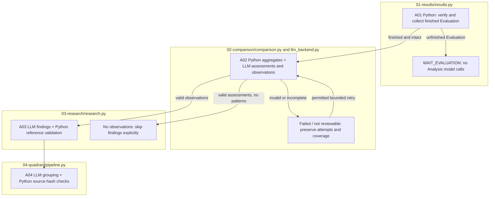

# Analysis runbook

Analysis reads saved Evaluation responses. It must not re-solve source questions, reconstruct missing target-model answers, or re-run Evaluation to fill gaps. Finish the [Evaluation runbook](../01-evaluation/README.md) first and keep its exact experiment path.

**Configuration compatibility:** the supplied API Analysis profile (`gpt-6.1-sol`, `low`) and Codex CLI backend are rejected by the current cache policy. Model-assisted execution stops with `CACHE_POLICY_BLOCKED`. The aggregate-only command below works with completed Evaluation records without calling a model. See [configuration](../../../../config/README.md).

## 1. Verify prerequisites and freeze Analysis settings

Evaluation inputs, model requests/results, and manifests must exist and remain unchanged. All selected model states must be `FINISHED`. Otherwise Analysis returns `WAITING` / `WAIT_EVALUATION`; it is not complete. First execute Evaluation to create the response records used by Analysis.

Use the same reviewed configuration that defined the experiment, with a separately selected Analysis backend/model. Freeze it before dispatch:

```sh
RUN_PATH=reports/experiments-run/REPLACE_WITH_FINISHED_RUN_ID
PYTHONPATH=src .venv/bin/python -B -m finarch.experiments.pipeline configure-analysis \
  --run "$RUN_PATH" --config config/experiments/reviewer-smoke.toml
```

This writes `02_analysis/config.json` with its configuration hash and makes no model calls. An already frozen different Analysis definition is rejected; changing the target-model Evaluation definition in place is not supported.

## 2. Refresh deterministic saved-result aggregates

```sh
PYTHONPATH=src .venv/bin/python -B -m finarch.experiments.pipeline analysis \
  --aggregate-only --run "$RUN_PATH"
```

With completed Evaluation, this collects/verifies A01 responses and refreshes Python comparison aggregates and derived outcomes without new model calls. It cannot manufacture missing semantic assessments. It preserves existing execution state, backs up an existing comparison aggregate before refreshing it, and rejects changed saved sources. A prepared-only run returns `WAITING` until Evaluation finishes.

## 3. Model-assisted Analysis

```sh
PYTHONPATH=src .venv/bin/python -u -B -m finarch.experiments.pipeline analysis \
  --run "$RUN_PATH"
```

This command can make billable A02/A03/A04 model calls. `run --run "$RUN_PATH"` is the broader coordinator that may continue Evaluation first; use the Analysis command above when the intended scope is Analysis only.

| Stage / code | Processing | Saved material under `02_analysis/` |
| --- | --- | --- |
| A01 `01-results/results.py` | Python: verify frozen Evaluation, collect actual saved responses/scores | `01_results/responses.jsonl`, `state.json`, source hashes |
| A02 `02-comparison/comparison.py`, `pipeline.py`, `llm_backend.py` | Python counts and paired comparisons; LLM response assessment/pattern interpretation; schema and evidence checks | `02_comparison/comparisons.json`, request manifest, raw attempts/results, `interpretations.jsonl`, `coverage.json`, `response-assessments.jsonl`, `response-assessment-summary.json` |
| A03 `03-research/research.py`, `pipeline.py` | LLM research findings based on validated A02 observations; Python trace checks | `03_research/manifest.jsonl`, raw results, `findings.json`, `findings.md`, `state.json` |
| A04 `04-quadrant/pipeline.py` | LLM grouping of completed A03 findings; Python checks and evidence links | `04_quadrant/manifest.jsonl`, source hashes, results, state and grouped outputs |
| A05 `05-outcomes/semantic_answerability.py` | Python derivation from saved assessments/production metadata | Derived outcome records and summaries; not new target-model answers |

A03 input partitioning depends on actual observations and payload sizes. A04 requires completed A03 and consistent source hashes. The number of calls and cost cannot be inferred from the 32 Evaluation requests alone. Count manifests and retry attempts separately, record provider usage, and retain unknown cost as unknown.

If valid exhaustive assessments produce no pattern observations, the implementation records `ASSESSMENTS_COLLECTED_NO_PATTERNS` and skips A03 findings. It must not invent research findings to make every stage appear populated.

## 4. Inspect evidence, incomplete coverage, and resumption

Read the run's state/log/events, frozen Analysis config, A01 source hashes, A02 aggregate and assessment coverage, then individual saved request/response/evidence records. Read A03/A04 findings only after their prerequisite stages are complete. A valid JSON result is not independently established semantic truth. Distinguish reference/numeric match, answerability, response grounding, construction labels, and LLM assessments; never treat a missing or non-reviewable assessment as a negative answerability label.

In the [experiment viewer](../../../../viewer/experiments/README.md), select the same run and Analysis, then A01/A02/A03/A04. Follow a finding back to its case, item, response ID, literal evidence, and original Q/C. Check coverage and failed/incomplete requests before interpreting charts.

To resume, rerun the same Analysis command. Frozen manifests, hashes, and saved attempts control continued processing. Do not edit a prior raw response to repair it. Technical retry limits and validation-retry authorizations are separate. `UNKNOWN_DELIVERY`, `NOT_REVIEWABLE`, failed validation, and interrupted calls need their recorded status and bounded recovery rules; `--help` exposes the explicit controls. Adding retry permission or changing model/policy is not an automatic consequence of resuming.

The `analysis-postprocess` command is for a run whose A03 prerequisites are already complete; it does not replace missing Evaluation/A02/A03 artifacts.

## Execution flow



A01 and aggregation use saved files. A02/A03/A04 also use model calls and require compatible credentials, model settings, and cache controls.
