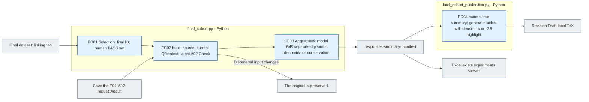
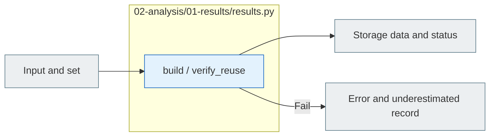

# A01 Results

[The whole sauce](../../README.md) · [Experimental documentation](../../../../../docs/02-experiments/README.md) · [Setting up](../../../../../config/experiments/README.md)

Run is a response: `02_analysis/01_results`.

A01.01 Read the result of the save → A01.02 Production meta link → A01.03 Save the response line.

It only collects the storage results, and the missing response is left in the plan denominator, separating the existing numerical evaluation from the model classification, and when you restart it stops if the source file hash changes.
Private. `original_external_knowledge`If you go, you'll link the original production classification to the response line, which is not whether the grass model uses external knowledge, or whether it's a different label for the variation.

## Usage

A01Silver upper `pipeline.py analysis --run "$RUN_PATH"` Or `run --run "$RUN_PATH"`So this is the first Python set to do this.2/A03 So you can call the model, so A0 is the1It's not just a command to execute.

The input is E0.2 The model manifest, E03 Save raw response, E04 The numerical evaluation, `00_input/private.jsonl`And that's the result. `responses.jsonl` → `state.json` It reads in plain language, connects the request to the response ID, the condition, the source/modifier metadata, the reason for the failure.1 `COLLECTED`is the data collection completed and a02/A03 It's not a complete or meaningful judgment.

## File responsibility and reading order

|File|Get in there.|Input → process → output|
|---|---|---|
|[results.py](results.py)|`build / verify_reuse`|manifest  raw response  E04·private → ID·shared connection → responses.jsonl·state|
|[final_cohort.py](final_cohort.py)|`build / selection / aggregates`|Final PASS: the connection sign: the bottom E04· The latest A02 → identical input verification; sanitary summation; synthetic response; RQ sign; manifest|
|[final_cohort_publication.py](final_cohort_publication.py)|`main / update_review / write_tables / condition`|Certified copy summary → Same denominator · G+R+ form chart → an.|

## Final PASS test results are acquired1~FC04

```sh
PYTHONPATH=src .venv/bin/python -B -m finarch.experiments.02-analysis.01-results.final_cohort --output reports/analysis/<new snapshot>
```

It doesn't change the existing source run and the final dataset. `selection.csv` → `summary.json` → `responses.jsonl` → `manifest.json` I'll check it in order. 20261007 Public cohorts FinanceReasoning 1,071items and TAT-QA. 283I'm going to group the items together. 5The items modification is conditional. 6,770So, IC-v→IC-s pairs are condition-pairs. 1,354Gemini preserve the default conditions and the valid response absence and the ratio denominator. 0So we're going to leave it at N/A.



The gray is the file-screen, the blue is the local Python processing. There are no LLM execution phases. The support rate is calculated from the total dry, not the average per cent per source, and the D/F and the original UNKNOWN are preserved. The gold or raw response of the public and experimental input does not change. `final_cohort_publication.py`The 20261008 Snapshots update the current Han-ing review copy and local LaTeX and don't send it to Overleaf.



The gray is the input-output file, and the blue is the Python function of the file. The function in the table is responsible for that.](../../../../../docs/02-experiments/README.md)Read the same number of steps.

This README is generated from `src/finarch/documentation/templates/source-layout/experiments/02-analysis/01-results.md`.
