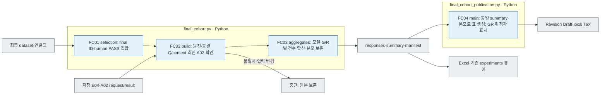
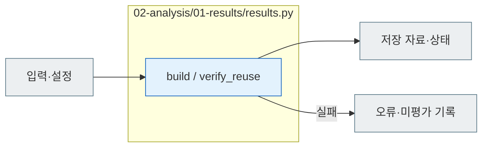

# A01 Results

[소스 전체](../../README.md) · [실험 문서](../../../../../docs/02-experiments/README.md) · [설정](../../../../../config/experiments/README.md)

run 대응: `02_analysis/01_results`.

A01.01 저장 결과 읽기 → A01.02 제작 메타 연결 → A01.03 응답 행 저장.

저장 결과만 취합합니다. 누락 응답도 계획 분모에 남기며, 기존 숫자 평가와 모델 분류를 구분합니다. 재시작할 때 원천 파일 해시가 달라졌으면 중단합니다.
private에 `original_external_knowledge`가 있으면 원본 제작 분류를 응답 행에 연결합니다. 이는 풀이 모델의 외부지식 사용 여부가 아니며 변형의 별도 라벨도 아닙니다.

## 사용법

A01은 상위 `pipeline.py analysis --run "$RUN_PATH"` 또는 `run --run "$RUN_PATH"`가 먼저 수행하는 Python 취합입니다. 이 명령들은 이어서 A02/A03 모델을 호출할 수 있으므로 A01만 수행하는 명령으로 사용하지 않습니다.

입력은 E02 모델별 manifest, E03 저장 원응답, E04 숫자 평가, `00_input/private.jsonl`입니다. 결과는 `responses.jsonl` → `state.json` 순으로 읽습니다. 계획된 요청과 응답 ID, 조건, 원본/변형 메타, 누락/실패 이유를 연결합니다. A01의 `COLLECTED`는 자료 취합 완료이며 A02/A03 완료나 의미 정답 판정이 아닙니다.

## 파일 책임과 읽는 순서

|파일|입구|입력 → 처리 → 출력|
|---|---|---|
|[results.py](results.py)|`build / verify_reuse`|manifest·원응답·E04·private → ID·해시 연결 → responses.jsonl·state|
|[final_cohort.py](final_cohort.py)|`build / selection / aggregates`|final PASS·연결표·저장 E04·최신 A02 → 동일 입력 확인·건수 합산 → 합본 응답·RQ 표·manifest|
|[final_cohort_publication.py](final_cohort_publication.py)|`main / update_review / write_tables / condition`|검증된 합본 summary → 동일 분모·G⁺R⁺ 형식의 표 → 한·영 Revision Draft·로컬 LaTeX|

## 최종 PASS 실험 결과 취합 · FC01~FC04

```sh
PYTHONPATH=src .venv/bin/python -B -m finarch.experiments.02-analysis.01-results.final_cohort --output reports/analysis/<새 스냅샷>
```

기존 source run과 최종 데이터셋을 바꾸지 않습니다. `selection.csv` → `summary.json` → `responses.jsonl` → `manifest.json` 순서로 확인합니다. 20261007 공개 코호트는 FinanceReasoning 1,071개와 TAT-QA 283개를 하나로 집계합니다. 주요 5개 변형은 조건당 6,770건, IC-v→IC-s 쌍은 조건·쌍당 1,354건입니다. Gemini 미설정 조건과 유효 응답 부재를 보존하고 비율 분모 0을 N/A로 남깁니다.



회색은 파일·화면, 파랑은 로컬 Python 처리입니다. LLM 실행 단계는 없습니다. 지원 비율은 원천별 퍼센트의 평균이 아니라 전체 건수에서 계산하며, D/F와 원본 UNKNOWN은 보존합니다. 공개 및 실험 입력의 gold나 원응답을 변경하지 않습니다. `final_cohort_publication.py`는 확인한 20261008 스냅샷으로 현재 한·영 검토본과 로컬 LaTeX를 갱신하며 Overleaf로 전송하지 않습니다.



회색은 입력·출력 파일, 파랑은 파일의 Python 함수입니다. 표의 함수는 해당 책임을 담당합니다. 세부 실행 순서·LLM 분기는 [실험 문서](../../../../../docs/02-experiments/README.md)의 같은 번호 단계를 읽습니다.

이 README는 `src/finarch/documentation/templates/source-layout/experiments/02-analysis/01-results.md`에서 생성합니다.
