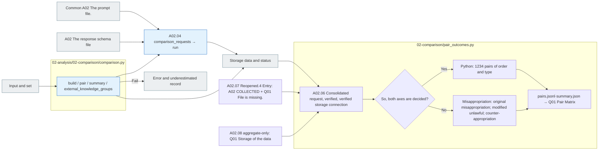

# A02 Comparison

[The whole sauce](../../README.md) · [Experimental documentation](../../../../../docs/02-experiments/README.md) · [Setting up](../../../../../config/experiments/README.md)

Run is a response: `02_analysis/02_comparison`.

A02.01 Condition pair → A02.02 The estimate → A02.03 Type of relationship → A02.04 LLM Interpretation → A02.05 evidence validation.

The statistics are performed by Python, and the response description is requested by the Codex/API chosen by the top pipeline. The interpretation is saved after checking for accurate citations and response_id. Failure-free; the evaluation is left to the denominator and coverage.
If you have an external classification of the original, `comparison.py` `VERIFIED_USE`and `CRITERIA_NOT_MET`And then we're going to divide the technology, `pipeline.py`Go to the original A02 We put the categories and the scope of application into the interpretation request. `CRITERIA_NOT_MET`It's not a nonprofit group.

## Usage

A02The top analysis pipeline is a01 The original request is accompanied by the actual response, condition, and private production metadata of the original and variation, not the step of the pool recalling the model, but the relationship interpretation of the selected analytical model.

`comparisons.json` → `coverage.json` → `interpretations.jsonl` → `manifest.jsonl`·`calls/`·`results.jsonl`·`state.json` The order of the estimates, the interpretation range, the basis and the raw response. `prompt.md`And the answer is, `schema.json`It's stored in.

To update only the stored statistics, we use the following command:

```sh
RUN_PATH=reports/experiments-run/20261003-exp-004-tatqa-luna
PYTHONPATH=src .venv/bin/python -u -B -m finarch.experiments.pipeline analysis --aggregate-only --run "$RUN_PATH"
```

This path identifies the source map and preserves the existing statistics and calls the new model 0So this is A.3It does not start or change the state of completion of the existing interpretation. `analysis` The command can call the model so distinguish.

## File responsibility and reading order

|File|Get in there.|Input → process → output|
|---|---|---|
|[pair_outcomes.py](pair_outcomes.py)|`build / aggregate / quadrant` · A02.06|Equation of the origin: variable pair + E04 Comparison of the original numbers + A0 verified2 Responsive judgment → Q01 Type-by-type quadrant: mi-allocation towel, new model call 0entries|
|[comparison.py](comparison.py)|`build / pair / summary / external_knowledge_groups`|A01 Answer line → conditions·type·origin/modification·origin for external use → comparisons.json|
|[../pipeline.py](../pipeline.py)|`comparison_requests` · A02.04|The actual response by sample, the output metadata, the analysis request configuration|
|[Common A02 Instructions](../../prompts/README.md) · [A02 Response schema](../../schemas/json/02-analysis.02-comparison.response.schema.json)|`assets.prompt_text / schema`|Step name definition → prompt·response_schema of the analysis request|
|[../llm_backend.py](../llm_backend.py)|`run` · A02.04|Request prompt/schema → Codex/API → raw response ·Examination results|
|[../pipeline.py](../pipeline.py)|`collect_interpretations / ensure_pair_outcomes / update` · A02.05|Save interpretation → accurate citation; form verification → interpretations.jsonl·coverage.json; condition|



The gray is the input-output file, and the blue is the Python function of the file. The function in the table is responsible for that.](../../../../../docs/02-experiments/README.md)Read the same number of steps.

This README is generated from `src/finarch/documentation/templates/source-layout/experiments/02-analysis/02-comparison.md`.

### Q01 Pair Matrix storage compilation

`PYTHONPATH=src .venv/bin/python -u -B -m finarch.experiments.pipeline pair-outcomes --run "$RUN_PATH"`is stored at A02 Re-examine and reconcile the verdict. `pair-outcomes/pairs.jsonl`·`summary.json`There is no call for the model of the whole.2 And then we'll do the same after the merger. `?run=<RUN_ID>&tab=pair-matrix`of Q01So you don't read this file and make a new judgment, and you're going to see the four test conditions in each quadrant.

A02 `COLLECTED`and Q01 `summary.json` Or `pairs.jsonl`Without this, A03 And then reopen after completion. `analysis-postprocess`of A04 It supplements the storage before you enter it, and if you have two files, you use them the same way. `analysis --aggregate-only`is Q01It also updates and maintains the existing analysis run status.1When you fill the hole, you're up. `pair-outcomes` I use the command.
