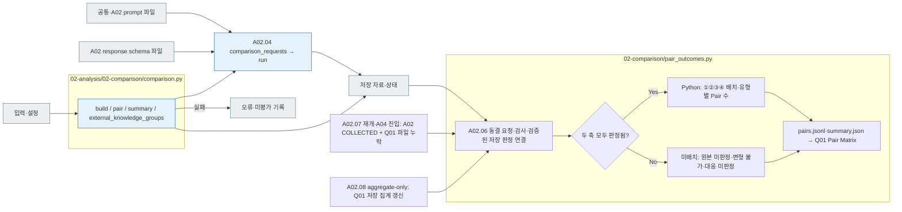

# A02 Comparison

[소스 전체](../../README.md) · [실험 문서](../../../../../docs/02-experiments/README.md) · [설정](../../../../../config/experiments/README.md)

run 대응: `02_analysis/02_comparison`.

A02.01 조건 짝 → A02.02 집계 → A02.03 유형 관계 → A02.04 LLM 해석 → A02.05 근거 검사.

집계는 Python이 수행하고 응답 설명 해석은 상위 pipeline이 선택한 Codex/API에 요청합니다. interpretation은 정확 인용과 response_id를 검사한 뒤 저장합니다. 실패·짝 없음·미평가는 분모와 coverage에 남깁니다.
원본 외부사용 분류가 있으면 `comparison.py`가 `VERIFIED_USE`와 `CRITERIA_NOT_MET`로 기술 집계를 나누고, `pipeline.py`가 원본별 A02 해석 요청에 해당 분류와 적용 범위를 넣습니다. `CRITERIA_NOT_MET`는 비사용 집단이 아닙니다.

## 사용법

A02는 상위 Analysis pipeline이 A01 뒤에 수행합니다. 원본별 요청에는 해당 원본과 변형의 실제 응답·조건·private 제작 메타가 함께 들어갑니다. 풀이 모델을 다시 호출하는 단계가 아니라 선택한 분석 모델의 관계 해석입니다.

`comparisons.json` → `coverage.json` → `interpretations.jsonl` → `manifest.jsonl`·`calls/`·`results.jsonl`·`state.json` 순으로 집계, 해석 범위, 근거와 원응답을 확인합니다. 요청 prompt는 단계의 `prompt.md`, 응답 스키마는 `schema.json`에 저장됩니다.

저장된 수치 집계만 갱신하려면 다음 명령을 사용합니다.

```sh
RUN_PATH=reports/experiments-run/20261003-exp-004-tatqa-luna
PYTHONPATH=src .venv/bin/python -u -B -m finarch.experiments.pipeline analysis --aggregate-only --run "$RUN_PATH"
```

이 경로는 원천 해시를 확인하고 기존 집계를 보존하며 새 모델 호출 0건입니다. A03를 시작하거나 기존 해석의 완료 상태를 바꾸지 않습니다. 일반 `analysis` 명령은 모델을 호출할 수 있으므로 구별하십시오.

## 파일 책임과 읽는 순서

|파일|입구|입력 → 처리 → 출력|
|---|---|---|
|[pair_outcomes.py](pair_outcomes.py)|`build / aggregate / quadrant` · A02.06|동결 원본·변형 쌍 + E04 원본 수치 비교 + 검증된 A02 대응 판정 → Q01 유형별 사분면·미배치 건수, 신규 모델 호출 0건|
|[comparison.py](comparison.py)|`build / pair / summary / external_knowledge_groups`|A01 응답 행 → 조건·유형·원본/변형·원본 외부사용 분류별 비교 → comparisons.json|
|[../pipeline.py](../pipeline.py)|`comparison_requests` · A02.04|원본별 실제 응답·제작 메타 → 분석 요청 구성|
|[공통·A02 지시](../../prompts/README.md) · [A02 응답 스키마](../../schemas/json/02-analysis.02-comparison.response.schema.json)|`assets.prompt_text / schema`|단계명 정의 → 분석 요청의 prompt·response_schema|
|[../llm_backend.py](../llm_backend.py)|`run` · A02.04|요청·prompt/schema → Codex/API → 원응답·검사 결과|
|[../pipeline.py](../pipeline.py)|`collect_interpretations / ensure_pair_outcomes / update` · A02.05|저장 해석 → 정확 인용·형식 확인 → interpretations.jsonl·coverage.json·상태|



회색은 입력·출력 파일, 파랑은 파일의 Python 함수입니다. 표의 함수는 해당 책임을 담당합니다. 세부 실행 순서·LLM 분기는 [실험 문서](../../../../../docs/02-experiments/README.md)의 같은 번호 단계를 읽습니다.

이 README는 `src/finarch/documentation/templates/source-layout/experiments/02-analysis/02-comparison.md`에서 생성합니다.

### Q01 Pair Matrix 저장 집계

`PYTHONPATH=src .venv/bin/python -u -B -m finarch.experiments.pipeline pair-outcomes --run "$RUN_PATH"`는 저장된 A02 판정을 다시 검사·취합하고 `pair-outcomes/pairs.jsonl`·`summary.json`을 생성합니다. 풀이·분석 모델 호출은 없습니다. 일반 A02 취합 후에도 같은 집계를 수행합니다. 뷰어 `?run=<RUN_ID>&tab=pair-matrix`의 Q01은 이 파일을 읽으며 새 판정을 만들지 않습니다. 네 실험 조건은 각각의 사분면으로 표시합니다.

A02가 `COLLECTED`이고 Q01의 `summary.json` 또는 `pairs.jsonl`이 없으면 A03 완료 후 재개와 `analysis-postprocess`의 A04 진입 전에 저장 집계를 보완합니다. 두 파일이 있으면 그대로 사용합니다. `analysis --aggregate-only`는 Q01도 갱신하며 기존 Analysis 실행 상태를 유지합니다. 과거 run의 Q01만 채울 때는 위 `pair-outcomes` 명령을 사용합니다.
