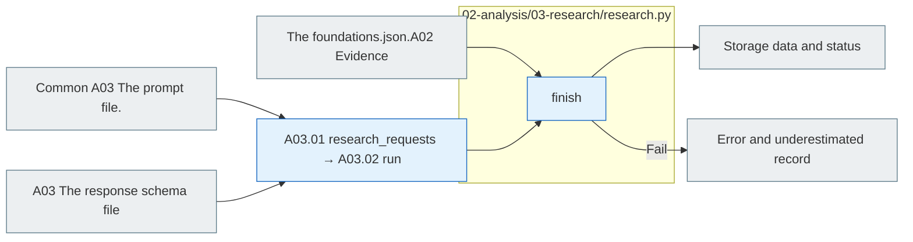

# A03 Research

[The whole sauce](../../README.md) · [Experimental documentation](../../../../../docs/02-experiments/README.md) · [Setting up](../../../../../config/experiments/README.md)

Run is a response: `02_analysis/03_research`.

A03.01 Based on the set of A03.02 LLM complex → A03.03 The first one is A.3.04 Report. Before the user decides, it's marked as a vote.

LLM calls are responsible for the upper pipeline and llm_backend. Interpretation ID, half-pass, change, limit, and subsequent experiments are recorded as a logical proposal.

## Usage

A03is A02 `COLLECTED`And when there's a real interpretation basis, the top analysis pipeline goes on, and it doesn't directly generate results with any Python function or Codex call.

`manifest.jsonl`The subject is the actual LLM request and the `prompt.md`·`schema.json` → `calls/` raw response `results.jsonl` The test `findings.json`·`findings.md` So, we're going to connect it in a row.2 It depends on the distribution of the subject of the observation and the input size, so we check it as the corresponding manifest row count.

`findings.json`The F is the study finding, the discussion is the follow-up argument, the observation/response ID is the raw response basis. `analysis.status=COMPLETE`And if you use a coordinator, `full_pipeline.status=COMPLETE`Check it together. `USER_DISCUSSION_PENDING`The results of the study are stored in the after-hours vacuum and not approved for subsequent experimental run.

## File responsibility and reading order

|File|Get in there.|Input → process → output|
|---|---|---|
|[../pipeline.py](../pipeline.py)|`research_requests` · A03.01|A02 Comparison, analysis, and category-specific research, and interpretation, input and request|
|[Common A03 Instructions](../../prompts/README.md) · [A03 Response schema](../../schemas/json/02-analysis.03-research.findings.response.schema.json)|`assets.prompt_text / schema`|The prompt·response_schema of the request for a step name definition → study interpretation|
|[../llm_backend.py](../llm_backend.py)|`run` · A03.02|Request prompt/schema → Codex/API → raw response ·Examination results|
|[../pipeline.py](../pipeline.py)|`collect_findings` · A03.04|Examined interpretation → findings·discussion summary → findings.json|
|[research.py](research.py)|`finish` · A03.04|Save the findings.json A02 The link is verified. The report is generated.|

The gray is the input-output file, and the blue is the Python function of the file. The function in the table is responsible for that.](../../../../../docs/02-experiments/README.md)Read the same number of steps.

This README is generated from `src/finarch/documentation/templates/source-layout/experiments/02-analysis/03-research.md`.
