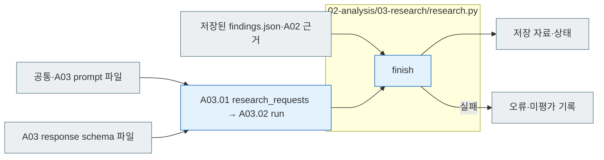

# A03 Research

[소스 전체](../../README.md) · [실험 문서](../../../../../docs/02-experiments/README.md) · [설정](../../../../../config/experiments/README.md)

run 대응: `02_analysis/03_research`.

A03.01 근거 취합 → A03.02 LLM 종합 → A03.03 토의 안건 → A03.04 보고. 사용자 결정 전에는 토의 대기로 표시합니다.

LLM 호출은 상위 pipeline과 llm_backend가 담당합니다. 해석 ID·반례·대안·한계를 보존하고 후속 실험은 토의 제안으로 기록합니다. 실패 응답으로 완료를 표시하지 않습니다.

## 사용법

A03는 A02가 `COLLECTED`이고 실제 해석 근거가 있을 때 상위 Analysis pipeline이 진행합니다. 별도 Python 함수나 Codex 호출로 결과를 직접 만들지 않습니다.

`manifest.jsonl`은 주제·분할별 실제 LLM 요청이며 `prompt.md`·`schema.json` → `calls/` 원응답 → `results.jsonl` 검사 → `findings.json`·`findings.md` 순으로 연결합니다. 요청 수는 A02 관찰의 주제 분포와 입력 크기에 따라 달라지므로 해당 manifest 행 수로 확인합니다.

`findings.json`의 F는 연구 발견, discussion은 후속 토의 안건, observation/response ID는 원응답 근거입니다. 완료는 루트 `analysis.status=COMPLETE`와 coordinator를 사용한 경우 `full_pipeline.status=COMPLETE`를 함께 확인합니다. `USER_DISCUSSION_PENDING`은 연구 결과 저장 후 토의 대기이며 후속 실험 실행 승인이 아닙니다.

## 파일 책임과 읽는 순서

|파일|입구|입력 → 처리 → 출력|
|---|---|---|
|[../pipeline.py](../pipeline.py)|`research_requests` · A03.01|A02 비교·해석 → 카테고리별 연구 해석 입력 → 요청|
|[공통·A03 지시](../../prompts/README.md) · [A03 응답 스키마](../../schemas/json/02-analysis.03-research.findings.response.schema.json)|`assets.prompt_text / schema`|단계명 정의 → 연구 해석 요청의 prompt·response_schema|
|[../llm_backend.py](../llm_backend.py)|`run` · A03.02|요청·prompt/schema → Codex/API → 원응답·검사 결과|
|[../pipeline.py](../pipeline.py)|`collect_findings` · A03.04|검사된 해석 → findings·discussion 취합 → findings.json|
|[research.py](research.py)|`finish` · A03.04|저장 findings.json·A02 근거 → 연결 확인·보고 생성 → findings.md·README·state·events|

회색은 입력·출력 파일, 파랑은 파일의 Python 함수입니다. 표의 함수는 해당 책임을 담당합니다. 세부 실행 순서·LLM 분기는 [실험 문서](../../../../../docs/02-experiments/README.md)의 같은 번호 단계를 읽습니다.

이 README는 `src/finarch/documentation/templates/source-layout/experiments/02-analysis/03-research.md`에서 생성합니다.
