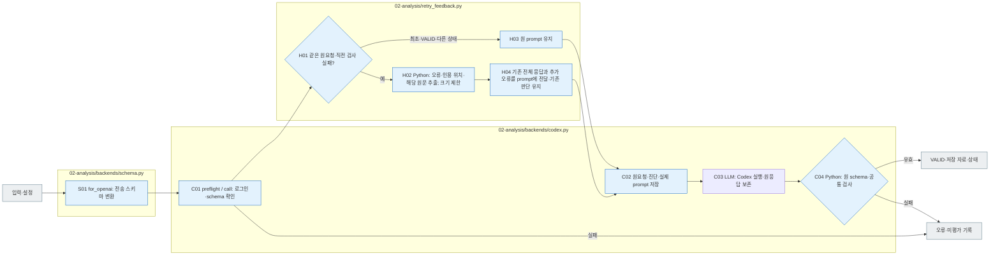

# Analysis Codex 실행

[소스 전체](../../README.md) · [실험 문서](../../../../../docs/02-experiments/README.md) · [설정](../../../../../config/experiments/README.md)

run 대응: `02_analysis/<stage>/calls`.

설정된 모델 → prompt/schema 전달 → 원응답 → 공통 검사.

Codex 로그인과 schema를 확인한 후 tools 없는 분석 실행을 시작합니다. timeout 등 전송 여부 불명은 UNKNOWN_DELIVERY로 보존합니다. API Batch 실행은 상위 llm_backend.py가 담당하며 자동 fallback은 없습니다.

승인된 Codex 재시도에서는 같은 요청의 직전 완료 결과가 `INVALID_RESPONSE`이면 이전 검사 오류를 prompt에 덧붙입니다. 예를 들어 `decision_grounding.citations[0]`의 인용에서 `$`가 빠졌다면 오류 코드·응답 ID·실패한 인용·해당 응답의 저장 원문을 함께 전달합니다. 이전 회차의 전체 응답을 `previous_response`로 함께 전달합니다. 기존 판단·이유·관찰·findings를 바탕으로 유지하고, 추가 오류 정보를 반영하여 오류 필드와 그 수정에 직접 연결되는 부분만 보정하도록 지시합니다. 전체 분석을 처음부터 다시 판단하지 않으며 새 전체 응답을 같은 schema와 정확 인용 검사로 확인합니다. 최초 호출·직전 VALID·전송 오류에는 이 검사 실패 힌트를 추가하지 않습니다. 재시도 승인·대기·횟수는 기존 상위 로직이 결정합니다.

각 시도의 읽는 순서는 `request.json`(동결 원요청) → 재시도 시 `retry-feedback.json`(직전 전체 응답·결과 파일 해시·추가 오류·원문 위치) → `provider-request.json`(실제 전송 prompt·해시·schema) → `raw-response.jsonl`/`stderr.txt`/`process.json` → `result.json`입니다. 원요청·입력·schema·이전 시도 파일을 덮어쓰지 않습니다. 추가 오류 진단은 최대 10개 오류·인용 위치, 원문별 2,000자, 총 약 16,000자로 제한하고 잘림·생략 수를 기록합니다. 기존 판단을 유지할 수 있도록 이전 전체 응답은 이 진단 한도와 별도로 잘림 없이 전달하고 해시를 기록합니다. 전체 원문은 원요청에서 확인합니다. 이 개선은 Codex 경로에 적용하며 API Batch prompt는 변경하지 않습니다.

## 파일 책임과 읽는 순서

|파일|입구|입력 → 처리 → 출력|
|---|---|---|
|[codex.py](codex.py)|`preflight / call`|동결 분석 요청·직전 검사 오류 → 실제 prompt와 schema로 Codex 실행 → 원요청·전송 기록·원응답·같은 Python 검사 결과|
|[../retry_feedback.py](../retry_feedback.py)|`build / citation_errors / prompt`|같은 요청의 직전 INVALID_RESPONSE → 이전 전체 응답 보존·오류 코드·인용 위치·정확 원문을 추가 진단으로 추출 → retry-feedback.json·전송 prompt; 승인·원자료 변경 없음|
|[schema.py](schema.py)|`for_openai`|원본 응답 스키마 → 미지원 배열 중복 금지 키를 설명으로 변환 → 전송용 스키마. Codex/API 공통 사용|

회색은 입력·출력 파일, 파랑은 파일의 Python 함수입니다. 표의 함수는 해당 책임을 담당합니다. 세부 실행 순서·LLM 분기는 [실험 문서](../../../../../docs/02-experiments/README.md)의 같은 번호 단계를 읽습니다.

Luna 분석의 첫 요청은 제공자가 `uniqueItems`를 지원하지 않아 응답 생성 전에 거절했습니다. 원본 스키마·실패 원응답을 보존하고 전송용 스키마에서만 해당 키를 중복 금지 설명으로 바꿉니다. 반환값은 원본 스키마로 검사하므로 중복 ID는 계속 실패합니다. 이 오류가 확인되고 실제 전송 스키마가 보정된 요청만 기존 기술 재시도 한도 안에서 재개하며, `recovery.json`에 근거와 전후 해시를 남깁니다. 전송 여부가 불명확한 요청은 이 복구에 포함되지 않습니다.

제공자의 Structured Outputs는 JSON Schema의 일부를 지원합니다. [공식 지원 범위](https://developers.openai.com/api/docs/guides/structured-outputs)를 확인했습니다.

이 README는 `src/finarch/documentation/templates/source-layout/experiments/02-analysis/backends.md`에서 생성합니다.
