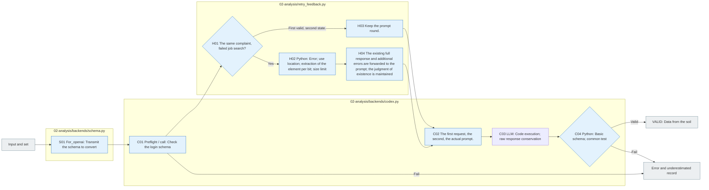

# Analysis of the Codex run

[The whole sauce](../../README.md) · [Experimental documentation](../../../../../docs/02-experiments/README.md) · [Setting up](../../../../../config/experiments/README.md)

Run is a response: `02_analysis/<stage>/calls`.

Set model → prompt/schema delivery → raw response → common test.

After verifying the Codex log and the schema, you start the toolless analysis run. It saves the transmission or unnamed like timeout to UNKNOWN_DELIVERY. API Batch execution is handled by the top llm_backend.py and there is no automatic fallback.

In the approved Codex repository, the results of the same request were immediately completed. `INVALID_RESPONSE`Add the previous scan error to the prompt. `decision_grounding.citations[0]`In the quotation of `$`If you miss it, you send the error code, the response ID, the failed citation, the stored source of the response to the previous iteration. `previous_response`It is based on existing judgments, evaluations, and findings, and instructs you to correct only the portion of the error field and its corrections that directly link to the error field, and not to re-judge the entire analysis from the beginning, and to verify the new entire response with accurate citation checks, such as a schema and a validation check. First call, job, VALID, and transmission errors do not add this check failure hint.

The reading order of each attempt `request.json`(Sighs) → The Cajun `retry-feedback.json`(full response before the result file hash + additional error source location) → `provider-request.json`(Real transmission prompt; hash; schema) `raw-response.jsonl`/`stderr.txt`/`process.json` → `result.json`It doesn't cover the original request, input schema, previous attempt files. 10items error, location of use, by subject 2,000Well, the gun. 16,000To maintain the existing judgement, the previous complete responses are transmitted without cutting, and the hash is recorded without cutting apart from this diagnostic limit. The entire source is verified by the requesting authority. This improvement applies to the Codex trajectory and the API Batch prompt does not change.

## File responsibility and reading order

|File|Get in there.|Input → process → output|
|---|---|---|
|[codex.py](codex.py)|`preflight / call`|The results of the Python test, such as the request for synchronization analysis, the error of the workflow test, the actual prompt and the execution of the Codex as a schema, the request for reference, the transmission record, the raw response, and the|
|[../retry_feedback.py](../retry_feedback.py)|`build / citation_errors / prompt`|Directly before the same request INVALID_RESPONSE → Retrieve the previous full response preservation; current code; use location; correcting principle with additional diagnosis → retry-feedback.json; transmission prompt; no authorization; source change|
|[schema.py](schema.py)|`for_openai`|Original response schema → Subscriber arrays to convert the overwrite ban key to description → Transmission schemes. Codex/API common use|

The gray is the input-output file, and the blue is the Python function of the file. The function in the table is responsible for that.](../../../../../docs/02-experiments/README.md)Read the same number of steps.

The first request for Luna analysis was that the provider `uniqueItems`The original schema: failed raw response is preserved and only in the transmission schema is the key changed to the no-copy description. The return value is checked by the original schema, so the copy ID keeps failing. This error is detected and the actual transmission schema only reopens the correct request within the existing technical setup. `recovery.json`The uncertain request whether or not the transmission is included in this recovery.

Providers' Structured Outputs support some of the JSON Schema.](https://developers.openai.com/api/docs/guides/structured-outputs)I've checked it out.

This README is generated from `src/finarch/documentation/templates/source-layout/experiments/02-analysis/backends.md`.
