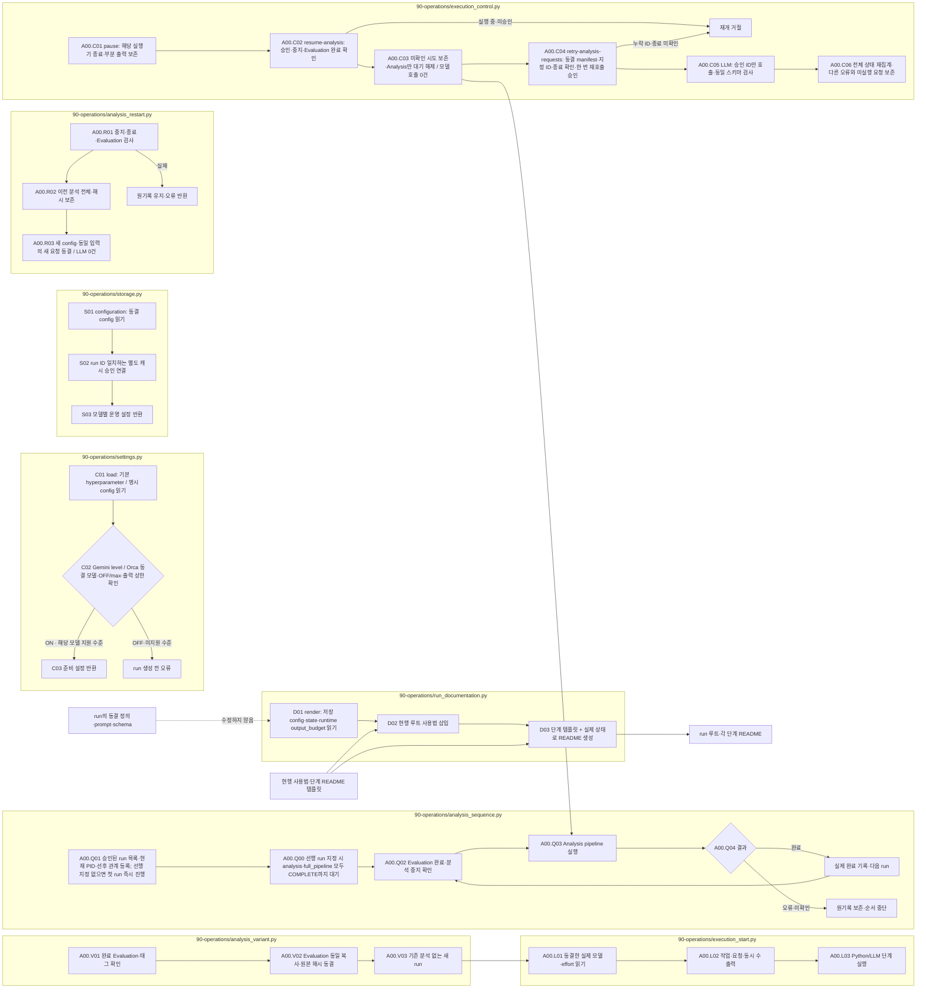

# 실험 저장·운영

[문서의 단계·요구·실행 흐름](../../../../docs/02-experiments/README.md) · [전체 소스 구조](../../../../docs/01-dataset/90-operations/05-source-layout.md)

이 폴더는 위 문서 단계의 실행 코드를 소유합니다. 결과의 물리 경로는 기존 run 계약을 따릅니다.

|파일|역할|
|---|---|
|[label_migration.py](label_migration.py)|Reconcile the delegated EA metadata rename against its original backup.|
|[storage.py](storage.py)|원자적 저장·동결 해시·잠금. `configuration`은 run ID를 확인해 cache-exceptions.json의 모델별 승인을 별도로 읽습니다. 실제 Python 명령과 단계·Batch name·진행 이벤트를 events.jsonl 및 pipeline.log에 기록합니다.|
|[settings.py](settings.py)|기본 hyperparameter.json의 schedule/run과 공통 codex-profiles.toml을 해석해 실행 설정을 고정합니다. Gemini 3.8 Flash와 3.5 Flash-Lite는 추론 OFF를 차단합니다. 3.8은 low/medium/high, 3.5 Lite는 minimal/low/medium/high 중 명시한 ON 수준만 준비합니다.|
|[analysis_variant.py](analysis_variant.py)|완료된 Evaluation의 동일 파일·태그·새 설정 → 기존 분석을 재사용하지 않는 별도 Analysis run 준비. 모델 호출 없음.|
|[execution_start.py](execution_start.py)|동결 설정·실제 단계 → 모델·effort·작업·요청 수·동시 수를 stdout·pipeline.log에 실행 전 출력.|
|[analysis_restart.py](analysis_restart.py)|중지·프로세스 종료·Evaluation 완료 확인 → 이전 분석 전체 보존 → 동일 입력의 새 모델 요청 동결. 모델 호출 없음.|
|[analysis_sequence.py](analysis_sequence.py)|pipeline.py analysis-sequence의 승인된 순서대로 Analysis만 실행·상태 갱신. --after-analysis-run은 선행 analysis·full_pipeline의 COMPLETE를 모두 확인한 뒤 시작. 실패·미확인 선행 건은 자동 재호출하지 않으며 Evaluation 재호출 없음.|
|[execution_control.py](execution_control.py)|선택 run의 A02/A03/A04 실행 중지·부분 출력 보존. resume-analysis는 종료 확인된 중지 요청을 응답 미확인으로 보존하고 Analysis 대기만 해제. 재전송·Evaluation 해제 없음. retry-analysis-requests는 종료 확인·명시 승인된 ID만 한 번 재호출하며 다른 요청은 보존.|
|[run_layout.py](run_layout.py)|새 Input/Evaluation/Analysis 경로와 과거 실행 경로를 구분합니다.|
|[run_documentation.py](run_documentation.py)|단계별 입출력·실행 파일·사용법·읽는 순서를 README 템플릿으로 생성합니다. 루트 사용법과 run별 output_budget의 기본 상한·확대 조건·기록 위치는 현행 안내에서 갱신하며 run에 동결된 정의 템플릿은 보존합니다.|

## README 생성과 갱신

정적 소스·단계 안내는 프로젝트 루트에서 `PYTHONPATH=src .venv/bin/python -B src/finarch/documentation/manage.py refresh` 후 `validate`로 확인합니다. run 안내는 실제 Preparation·수집·보고의 `run_documentation.render()`가 저장 상태와 템플릿으로 생성합니다. 문서 갱신 자체는 모델 호출을 만들지 않습니다.

DOC의 순서는 문서 생성입니다. STARTUP은 실행 직전 정보를 출력하며, Analysis 순서 실행은 해당 pipeline의 LLM 단계를 호출합니다. 이미 실행 중인 Python 프로세스에는 새 함수가 자동으로 로드되지 않으므로 코드 변경을 적용하기 위해 실험을 중복 실행하지 않습니다.
