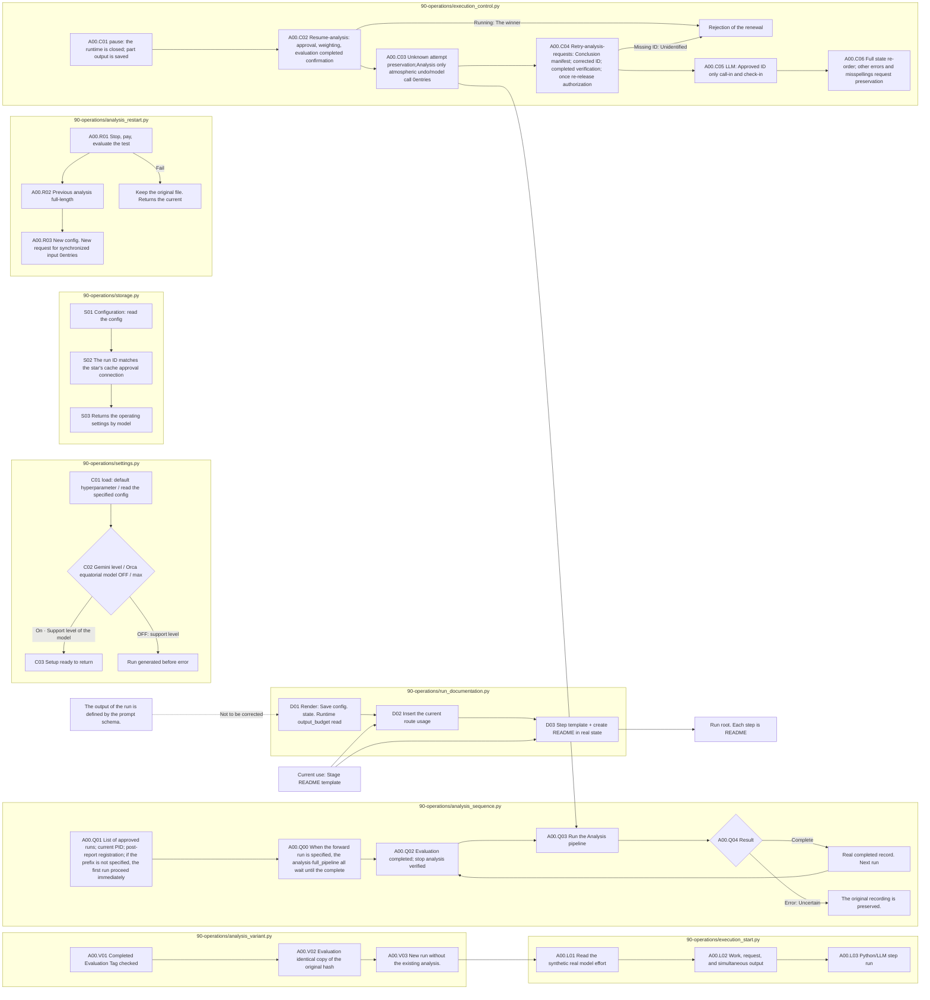

# Experimental storage and operation

[Step of the letter: yoga; action flow](../../../../docs/02-experiments/README.md) · [A whole source structure](../../../../docs/01-dataset/90-operations/05-source-layout.md)

This folder owns the execution code for the documented stage. Output paths follow the existing run contract.

|File|Role|
|---|---|
|[label_migration.py](label_migration.py)|Reconcile the delegated EA metadata rename against its original backup.|
|[storage.py](storage.py)|Atomic storage, fusion, and storage. `configuration`It checks the run ID and reads the cache-exceptions.json model approval separately. It records the actual Python command and step; batch name; action event to events.jsonl and pipeline.log.|
|[settings.py](settings.py)|Interpret the schedule/run of the default hyperparameter.json and the common codex-profiles.toml to fix the run settings. 3.8 Flash and the 3.5 Flash-Lite blocks the OFF of reasoning. 3.8It's low/medium/high, 3.5 Lite only prepares the ON level specified in the minimum/low/medium/high.|
|[analysis_variant.py](analysis_variant.py)|Preparing separate Analysis run that does not reuse existing analysis. No model calls.|
|[execution_start.py](execution_start.py)|Set the synchronous settings; actual steps → model; effort; operation; request number; synchrony number before running to stdout; pipeline.log.|
|[analysis_restart.py](analysis_restart.py)|Stop; process end; evaluation completed; verify → save the entire previous analysis → terminate the request for a new model of the same input. No call for the model.|
|[analysis_sequence.py](analysis_sequence.py)|Analysis only run; state update in the approved order of pipeline.py analysis-sequence. --after-analysis-run starts after all the COMPLETE of the pipeline analysis·full_pipeline has been verified. Failed; uncertain pipeline does not automatically re-open and there is no Evaluation re-open.|
|[execution_control.py](execution_control.py)|Select run of A02/A03/A04 Resume-analysis retains the end-confirmed stop request response as uncertainty and Analysis waits only deactivate. Retry-analyses-requests only deactivates the end-Confirmation; IDs are deactivated only once approved at the time of designation and other requests are retained.|
|[run_layout.py](run_layout.py)|It's a new input/evaluation/analysis path and a previous runway.|
|[run_documentation.py](run_documentation.py)|Create a step-by-step input, output, file, usage, and read order with the README template. The default default settings for the root usage and run output_budget, the extension conditions, and record location are updated in the current guide and the defined template attached to the run is preserved.|

## Readme creation and renewal

In the static source-stage project roots, `PYTHONPATH=src .venv/bin/python -B src/finarch/documentation/manage.py refresh` After. `validate`Check that the actual preparation, collection and reporting that is not running `run_documentation.render()`It's created in a storage state and template, and the document update itself doesn't create a model call.

The DOC's sequence is document creation. STARTUP releases information just before the execution, and the Analysis sequence execution calls the LLM step of the pipeline in question. Python processes that are already running don't automatically load new functions, so they don't override the experiment to apply the code change.
