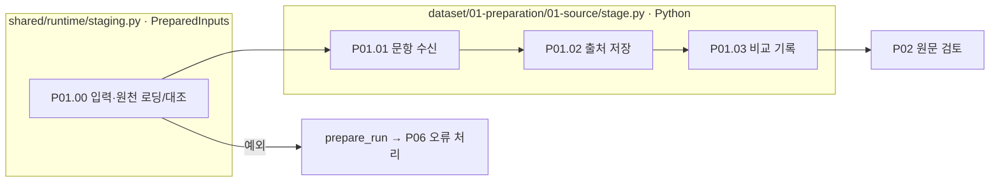

# P01 원문 수신과 출처 대조

[상위: Preparation](../README.md) · 다음: [P02 원문 검토](../02-review/README.md)

준비 입력의 한 문항을 받아 원천 대응과 Q/C/A를 저장합니다. 예를 들어 `test-0001`을 선택해도 원천 연결은 함께 저장한 `raw_id`와 원천 비교 기록으로 확인합니다.

## 사용자 요구와 계약

원천과 작업 입력을 나란히 비교할 수 있어야 합니다. 정답·타입·정밀도·표와 문단 위치를 보존하며 이 단계에서 정답을 고치거나 의미 적격성을 승인하지 않습니다. 입력은 [입력 준비](../../00-input/01-selection.md)의 `PreparedInputs`, 출력은 선택 문항과 원천 비교 기록입니다.

|스텝|함수 / Python 처리|산출물|
|---|---|---|
|P01.01|`pp01_receive_input`: `inputs.case(name)`에서 문항과 비교 자료 수신|`01-source/01-receive-input/01-input.json`|
|P01.02|`pp02_record_source`: 원천 비교 자료 보존|`02-record-source/01-provenance.json`|
|P01.03|`pp03_compare_source`: 수신한 비교 결과 기록|`03-compare-source/01-result.json`|



상자는 파일 책임이며 분홍 확장 노드는 없습니다. `pp03_compare_source`는 저장된 비교 결과를 기록하는 함수입니다. 함수 이름만으로 별도의 원문 검사가 한 번 더 수행된다고 설명하지 않습니다. 앞단 실패 시 후속 단계는 미실행입니다.

구현 근거: [p01_source.py](../../../../src/finarch/dataset/01-preparation/01-source/stage.py), [staging.py](../../../../src/finarch/dataset/90-operations/staging.py). 요구 근거: [원천 내용 보존](../../../../archive/20260923-documentation-reorganization/docs/15-source-content.md).

## 실제 run의 하위 폴더 순서

채번 대조에 사용한 경로: `reports/run/20260917-003/01-preparation/test-0001/01-round/01-source`. 아래는 해당 실행에서 실제 확인한 폴더이며, 미실행 분기까지 모두 존재한다는 뜻은 아닙니다.

```text
01-source/
  01-receive-input/
  02-record-source/
  03-compare-source/
```
