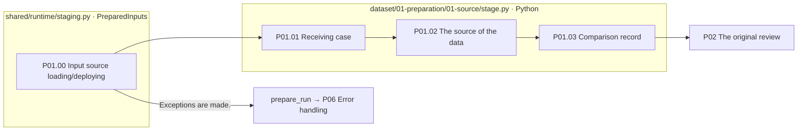

# P01 The contrast between the original receiving and the source

[Up: Preparation](../README.md) · Next: [P0]2 The original review](../02-review/README.md)

You take one case of the pre-entry and you save the source correspondence and Q/C/A. `test-0001`If you select the source connection, you can save it together. `raw_id`And check it out with the source comparison record.

## User requirements and contracts

It should be able to compare the source and the work input in parallel, preserve the correct answer, type, accuracy mark and the position of the bar, and not correct the correct answer or approve meaning negligible at this stage.](../../00-input/01-selection.md) `PreparedInputs`The output is the selection of the cases and the source comparison record.

|Step by step|Function / Python process|Outputs|
|---|---|---|
|P01.01|`pp01_receive_input`: `inputs.case(name)`Receive comparison data from the case|`01-source/01-receive-input/01-input.json`|
|P01.02|`pp02_record_source`: Preserving the source comparison data|`02-record-source/01-provenance.json`|
|P01.03|`pp03_compare_source`Received comparison results record|`03-compare-source/01-result.json`|



The box is file-responsible and there's no pink extension node. `pp03_compare_source`It's a function that records the stored comparison results, and the function name alone doesn't explain that a separate primitive test has been done once again.

Implementation basis: [p0]1_source.py](../../../../src/finarch/dataset/01-preparation/01-source/stage.py), [staging.py](../../../../src/finarch/dataset/90-operations/staging.py). Requirements: [Protection of source content](../../../../archive/20260923-documentation-reorganization/docs/15-source-content.md).

## The order of the real run is the lower folder.

The path used in the gravel counterpart: `reports/run/20260917-003/01-preparation/test-0001/01-round/01-source`The following is the actual verified folder in the execution, but that doesn't mean that all of them are in the wrong quarter.

```text
01-source/
  01-receive-input/
  02-record-source/
  03-compare-source/
```
