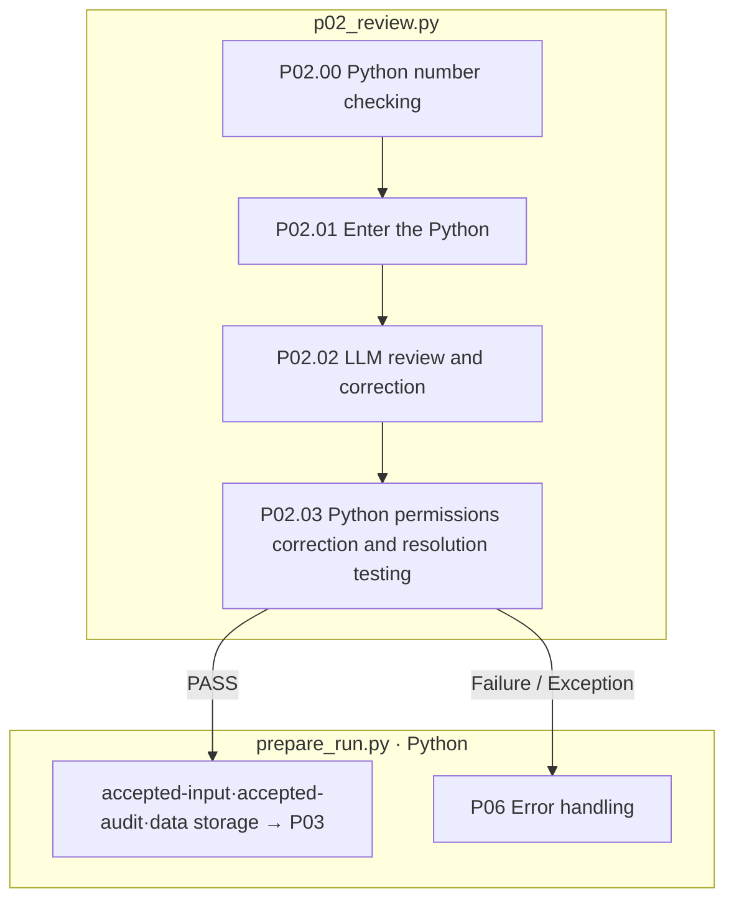

# P02 The original review and limited correction

[Up: Preparation](../README.md) · Previous: [P0]1](../01-source/README.md) · Next: [P0]3](../03-calculation/README.md)

We're going to look at the expression of the correct answer and the numerical instructions, and then we're going back to the original and the correction, and we're leaving the correction with the correction and the corrected position and the reason.

## User requirements and contracts

- Q/C/A: Type and review, unlike POT, this review request includes the original A.
- We're asking for one LLM review and correction at a time, not bypassing the limit of the variable by iterating inside the step.
- The correction must pass the permissible range, value, and numeric preservation checks, and if there are any edits to the UNCHANGED/AMBIGUOUS response, they are dealt with as a conflict.
- AMBIGUOUS or question accuracy problem unsolved is FAIL.

|Step by step|Processing|Input → output|
|---|---|---|
|P02.00 · 00-question-precision|Python `pp01_read_input` Internal|The following article `question_precision.align` Diagnosis|
|P02.01 · 01-read-input|Python `pp01_read_input`|Q/C/A. Group findings → request input|
|P02.02|LLM `pp02_LLM_review_original`|Q/C/A Findings Feedback Response Schema Disposal Edits Reason|
|P02.03|Python `pp03_record_result`|Reply → revision applying test → before/after/edits/audit|



The box is the actual file responsibility and the LLM call is P02.02There's no pink extension node. `02-review/03-record-result/01-result.json`Read from the original, copy, and edit the call to the actual call record.6](../06-exception-handler/README.md)We set this modification object and run the schedule.

The basis: [p0]2_review.py](../../../../src/finarch/dataset/01-preparation/02-review/stage.py), [revisions.py](../../../../src/finarch/dataset/01-preparation/02-review/revisions.py)[Checking is complete flow](../../../../archive/20260923-documentation-reorganization/docs/68-preparation-reviewed-flow.md).

## The order of the real run is the lower folder.

The path used in the gravel counterpart: `reports/run/20260917-003/01-preparation/test-0001/01-round/02-review`The following is the actual verified folder in the execution, but that doesn't mean that all of them are in the wrong quarter.

```text
02-review/
  00-question-precision/
  01-read-input/
  02-LLM-review-original/
  03-record-result/
```
