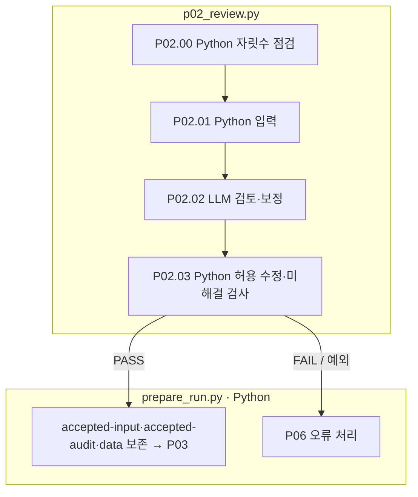

# P02 원문 검토와 제한된 보정

[상위: Preparation](../README.md) · 이전: [P01](../01-source/README.md) · 다음: [P03](../03-calculation/README.md)

질문·본문·원본 정답의 표현과 자릿수 지시를 검토합니다. 보정하면 원본과 보정본, 바꾼 위치와 이유를 함께 남깁니다. 풀이가 gold와 다르다는 이유로 숫자를 바꾸는 단계가 아닙니다.

## 사용자 요구와 계약

- Q/C/A·타입·정밀도를 받아 검토합니다. POT와 달리 이 검토 요청은 원본 A를 포함합니다.
- 한 차수에 한 번의 LLM 검토·보정 요청을 합니다. 단계 내부 반복으로 차수 상한을 우회하지 않습니다.
- 보정은 허용 범위·위치·숫자 보존 검사를 거쳐야 합니다. UNCHANGED/AMBIGUOUS 응답의 edits가 있으면 충돌로 처리합니다.
- AMBIGUOUS 또는 질문 정밀도 문제 미해결은 FAIL입니다. 다음 풀이 단계로 넘기지 않습니다.

|스텝|처리|입력 → 출력|
|---|---|---|
|P02.00 · 00-question-precision|Python `pp01_read_input` 내부|문항 → `question_precision.align` 진단|
|P02.01 · 01-read-input|Python `pp01_read_input`|Q/C/A·진단 findings → 요청 입력|
|P02.02|LLM `pp02_LLM_review_original`|Q/C/A·findings·피드백·응답 스키마 → disposition·edits·reason|
|P02.03|Python `pp03_record_result`|응답 → revision 적용 검사 → before/after/edits/audit|



상자는 실제 파일 책임이며 LLM 호출은 P02.02입니다. 분홍 확장 노드는 없습니다. `02-review/03-record-result/01-result.json`의 원본·보정본·감사부터 읽고 실제 호출 기록과 연결합니다. 후속 재시도는 [P06](../06-exception-handler/README.md)이 수정 대상을 지정하고 schedule이 수행합니다.

근거: [p02_review.py](../../../../src/finarch/dataset/01-preparation/02-review/stage.py), [revisions.py](../../../../src/finarch/dataset/01-preparation/02-review/revisions.py), [검토 완료 흐름](../../../../archive/20260923-documentation-reorganization/docs/68-preparation-reviewed-flow.md).

## 실제 run의 하위 폴더 순서

채번 대조에 사용한 경로: `reports/run/20260917-003/01-preparation/test-0001/01-round/02-review`. 아래는 해당 실행에서 실제 확인한 폴더이며, 미실행 분기까지 모두 존재한다는 뜻은 아닙니다.

```text
02-review/
  00-question-precision/
  01-read-input/
  02-LLM-review-original/
  03-record-result/
```
