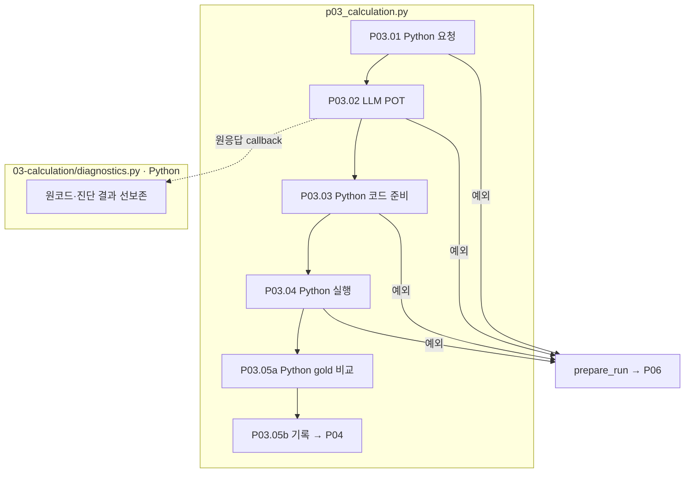

# P03 Python 풀이 생성과 실행

[상위: Preparation](../README.md) · 이전: [P02](../02-review/README.md) · 다음: [P04](../04-graph/README.md)

예를 들어 매출과 비용으로 이익을 구한다면 원문 값, 두 값의 차이, 최종 답을 각각 변수로 만듭니다. 이렇게 해야 나중에 어느 근거를 바꿨을 때 어떤 계산이 달라지는지 추적할 수 있습니다.

## 사용자 요구와 입출력

- 검토된 Q/C·정답 타입·자릿수·배율에서 Python 풀이를 생성합니다. **현재 POT 요청에는 reference_answer와 정답 부호를 넣지 않습니다.** 생성자 일반 허용 범위와 이 역할의 제한을 구별합니다.
- 필요한 import를 코드에 명시하고 원문 값·연산·중간값·최종 답을 분리합니다. 최종 반올림 위치와 중간 정밀도를 보존합니다.
- 원응답과 원코드를 먼저 남깁니다. 숫자 표기 정리·상수 변수화 후에도 원본과 변환 내역을 유지합니다. 표기 오류와 정답 불일치는 별개입니다.
- Python을 실제 실행합니다. 자체 사칙연산 해석기로 실행을 대신하지 않습니다. 정답 불일치를 없애려고 원문·gold·풀이 값을 바꾸지 않습니다.
- 외부 공식·외부 수치는 사용 사실과 필요성·근거를 기록합니다. 기억한 공식을 실제 검색한 것처럼 설명하지 않습니다.

## 세부 스텝과 실제 코드

|스텝|처리 주체 / 함수|출력과 경계|
|---|---|---|
|P03.01|Python `pp01_build_pot_request`|Q/C·형식·scale·raw_id·본문 숫자 색인. gold 값 제외|
|P03.02|LLM `pp02_llm_generate_code`|POT 응답. callback에서 원코드 선보존·진단 실행 후 응답 계약 및 Q/C 인용 검사|
|P03.03|Python `pp03_prepare_code`|상수 변수화와 변환 로그, 작업용 코드·외부 근거 기록|
|P03.04|Python `pp04_execute_python`|실행 결과·변수 trace·정확값|
|P03.05 · 05-record-calculation-artifacts|Python `pp05_compare_answer` → `pp06_record_calculation_artifacts`|정답 비교와 sample/program/execution 저장. gold 보정·별도 재호출 없음. 최종 판정은 P05|



상자는 실제 파일 책임입니다. 진단 실행은 최종 승인 실행과 구별합니다. 분홍 확장 노드는 없습니다. 도달하지 못한 뒤 스텝은 미실행입니다.

## 정답 형식과 외부지식 계약

integer 기준은 0 방향 절삭이며 float는 raw precision 기준 ROUND_HALF_UP입니다. 정확값과 비교용 정규화 값을 함께 해석해야 합니다. 정규화 일치가 의미 정답을 증명하지 않습니다. 괄호 표기만으로 부호를 추정하지 않습니다.

POT v5의 `external_knowledge_requirements`는 외부 의존이 없으면 빈 배열입니다. 의존이 있으면 tag, source_usage_id, Q/C의 triggers(문구·origin·Unicode 위치), why_external, definition/formula, bindings, data_requirements/unit을 연결합니다. EXTERNAL_RULE은 공식·변수 뜻, EXTERNAL_DATA는 대상·기간·항목을 설명합니다. Q/C의 요구 문구 위치와 외부 출처 위치를 혼동하지 않습니다. 과거 v4 응답에는 새 정보를 소급 생성하지 않습니다.

저장 위치는 `03-calculation/01-build-pot-request` → `02-LLM-generate-code` → `03-preserve-response-and-code` → `04-execute-python` → `05-record-calculation-artifacts`입니다. 문서 스텝 번호는 실제 저장 폴더 순서를 따릅니다. 폴더 05 안에서 비교 함수 `pp05`와 저장 함수 `pp06`이 실행됩니다.

근거: [p03_calculation.py](../../../../src/finarch/dataset/01-preparation/03-calculation/stage.py), [정답 정책](../../../../src/finarch/shared/reference.py), [숫자 규칙](../../../../src/finarch/dataset/shared/calculation/number-rules.json), [POT 계약](../../../../src/finarch/dataset/schemas/llm.py), [외부지식 요구 원문](../../../../archive/20260923-documentation-reorganization/docs/72-pot-knowledge-requirements.md).

## 실제 run의 하위 폴더 순서

채번 대조에 사용한 경로: `reports/run/20260917-003/01-preparation/test-0001/01-round/03-calculation`. 아래는 해당 실행에서 실제 확인한 폴더이며, 미실행 분기까지 모두 존재한다는 뜻은 아닙니다.

```text
03-calculation/
  01-build-pot-request/
  02-LLM-generate-code/
  03-preserve-response-and-code/
  04-execute-python/
  05-record-calculation-artifacts/
```
