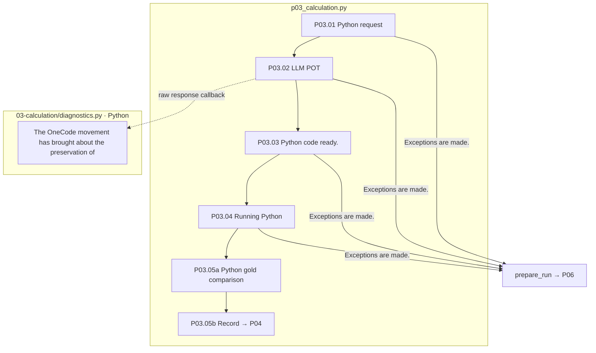

# P03 The creation and execution of Python root

[Up: Preparation](../README.md) · Previous: [P0]2](../02-review/README.md) · Next: [P0]4](../04-graph/README.md)

For example, if you make a profit on revenue and expenses, you make the source items, the difference between the two values, and the final answer, each as a variable, so you can track what calculations change when you change a base later.

## User needs and input

- It generates a Python hash from the Q/C. Correct answer type, numeric ratio. **Current POT requests do not include the reference_answer and the correct answer.** It distinguishes between the generic permissible range of the creator and the limitations of this role.
- It specifies the required import in the code, separates the elemental value, the compound, the intermediate value, and the maximum answer, preserving the final counter-up position and the intermediate precision.
- So we leave the raw response and the source code first, and then we keep the original and the conversion input after the numerical variable is sorted, and then the error and the inconsistency of the markup is sorted.
- It actually runs Python, and it doesn't replace it with its own rule-of-thumb interpreter, and it's not changing the value of the gold-for-gold to eliminate the right-for-right inconsistency.
- The external formal and external numbers record the fact of use, the need, the need. They don't describe the memory formulas as if they were actually searched.

## Detailed steps and actual code.

|Step by step|Processing Subject/Funktion|The outlet and the boundary.|
|---|---|---|
|P03.01|Python `pp01_build_pot_request`|Q/C. Form, scale, raw_id. Color of the text number. Excluding gold value|
|P03.02|LLM `pp02_llm_generate_code`|POT response. Callback to the original code preserve; team run after response contract and Q/C citation check|
|P03.03|Python `pp03_prepare_code`|Continuous variable and conversion logs, code for operation, external database record|
|P03.04|Python `pp04_execute_python`|Exercise results, variable trace, accuracy value|
|P03.05 · 05-record-calculation-artifacts|Python `pp05_compare_answer` → `pp06_record_calculation_artifacts`|The sample/program/execution is saved. gold correction.5|



The box is the actual file responsibility, the diagnostic execution is different from the final approval execution, there's no pink extension node, and the step is a misstep after you don't reach it.

## The right answer format and the external intelligence contract.

The integer standard is 0 Directional cutting and float is the raw precision criterion ROUND_HALF_UP. It must be interpreted together with the correlation value for accuracy and comparison.

POT v5 is the `external_knowledge_requirements`If there is a dependence, it connects the tag, source_usage_id, triggers of Q/C (question_origin_Unicode location), why_external, definition/formula, bindings, data_requirements/unit. EXTERNAL_RULE means form, variable, EXTERNal_DATA explains object, time, subject. Q/C does not confuse the requested phrase location with the external source location.

The storage location `03-calculation/01-build-pot-request` → `02-LLM-generate-code` → `03-preserve-response-and-code` → `04-execute-python` → `05-record-calculation-artifacts`The document step number is the actual storage folder order. 05 Comparison function in `pp05`And save the function `pp06`This is going to run.

The basis: [p0]3_calculation.py](../../../../src/finarch/dataset/01-preparation/03-calculation/stage.py)[Right answer policy](../../../../src/finarch/shared/reference.py)[Number rule](../../../../src/finarch/dataset/shared/calculation/number-rules.json)[POT contract](../../../../src/finarch/dataset/schemas/llm.py)[External Requirements](../../../../archive/20260923-documentation-reorganization/docs/72-pot-knowledge-requirements.md).

## The order of the real run is the lower folder.

The path used in the gravel counterpart: `reports/run/20260917-003/01-preparation/test-0001/01-round/03-calculation`The following is the actual verified folder in the execution, but that doesn't mean that all of them are in the wrong quarter.

```text
03-calculation/
  01-build-pot-request/
  02-LLM-generate-code/
  03-preserve-response-and-code/
  04-execute-python/
  05-record-calculation-artifacts/
```
