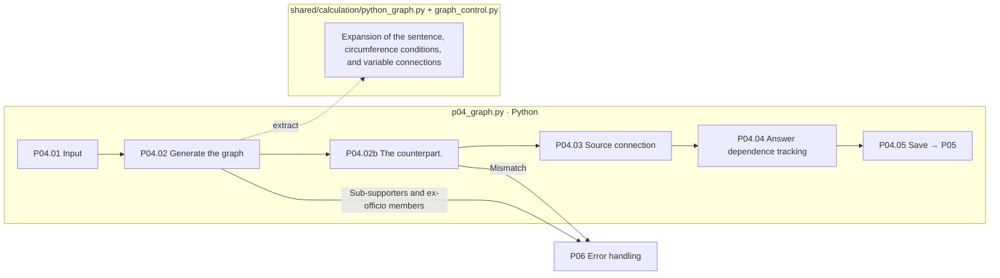

# P04 Calculation graph configuration and source connection

[Up: Preparation](../README.md) · Previous: [P0]3](../03-calculation/README.md) · Next: [P0]5](../05-verification/README.md)

The calculation graph shows the relationship between value and function, like the derivative, the expense, the subtraction, the profit, the dependence.3It's extracted from the Python code that you run.

## Requirements

We contrast variables, mean values, and max values of the same code with Python execution, separating the source graph from the change graph, connecting the external source of the formal data to the node, and edge representing the dependent relationship, separating whether the source is valid or not.

|Step by step|Python function|Input → process → output|
|---|---|---|
|P04.01|`pp01_read_calculation`|POT: Preserving the action value|
|P04.02|`pp02_build_graph`|The code `python_graph.compile_graph` → Graphs: contrasting data|
|P04.02b|`pp03_compare_calculation`|Except when comparing graphs and Python values → inconsistencies|
|P04.03|`pp03_attach_provenance`|The variable of source_usage: the code string → node source tag:usage ID|
|P04.04|`pp04_trace_answer_dependencies`|Final answer forward tracking node → actual answer dependent source|
|P04.05|`pp05_save_graph`|Graph: Stage result stored|



The box is the actual file responsibility and there is no LLM call on all the processing. There is no pink extended node. `pp03` The document number is shared, but the document number follows the stored folder. 02-processing the build-graph details02bSo the source connection is 03- It's attachment-provenance.

## Scope and display

`graph_control.py`There are extended paths, such as finite repetition, condition, function, which are not represented in general Python full support. Run condition connections are kept separate from the numeric input connections. If the run path changes to a change value, they don't reuse the existing path as they were.

The EXTERNAL_RULE/EXTERNAL _DATA of the node is connected to the operation and does not necessarily propagate to all forward nodes. If there is no record of the source of past responses, it is displayed as a m-record. A complete reverse and sub-review of all variables is not a completed function at this stage.3](../../02-generation/03-validation/README.md)is the location.

`04-graph/02-build-graph/04-comparison.json` → `03-attach-provenance` → `04-trace-answer-dependencies` → `05-save-graph/01-graph.json`is read.

The basis: [p0]4_graph.py](../../../../src/finarch/dataset/01-preparation/04-graph/stage.py), [python_graph.py](../../../../src/finarch/dataset/shared/calculation/python_graph.py), [graph_control.py](../../../../src/finarch/dataset/shared/calculation/graph_control.py)[Node source request](../../../../archive/20260923-documentation-reorganization/docs/71-node-provenance.md).

## The order of the real run is the lower folder.

The path used in the gravel counterpart: `reports/run/20260917-003/01-preparation/test-0001/01-round/04-graph`The following is the actual verified folder in the execution, but that doesn't mean that all of them are in the wrong quarter.

```text
04-graph/
  01-read-calculation/
  02-build-graph/
  03-attach-provenance/
  04-trace-answer-dependencies/
  05-save-graph/
```
