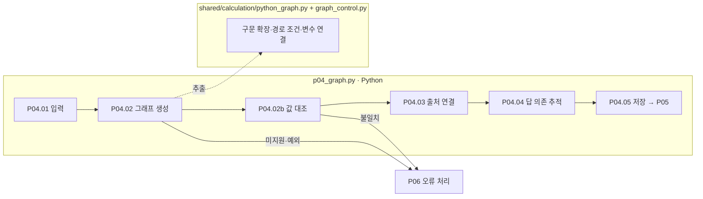

# P04 계산 그래프 구성과 출처 연결

[상위: Preparation](../README.md) · 이전: [P03](../03-calculation/README.md) · 다음: [P05](../05-verification/README.md)

계산 그래프는 ‘매출·비용 → 빼기 → 이익’처럼 값과 연산의 의존 관계를 보여줍니다. LLM에게 그래프를 새로 그리게 하지 않고 P03에서 실행한 Python 코드에서 추출합니다.

## 요구사항

동일 코드의 변수·중간값·최종값을 Python 실행과 대조합니다. 원본 그래프와 변경 그래프를 분리합니다. 외부 공식·데이터의 출처는 node에 연결하며 edge는 의존 관계를 표현합니다. 출처가 있는지와 그 출처가 타당한지는 별개입니다.

|스텝|Python 함수|입력 → 처리 → 출력|
|---|---|---|
|P04.01|`pp01_read_calculation`|POT·실행값 보존|
|P04.02|`pp02_build_graph`|코드 → `python_graph.compile_graph` → 그래프·실행 대조 자료|
|P04.02b|`pp03_compare_calculation`|그래프와 Python 값 비교 → 불일치 시 예외|
|P04.03|`pp03_attach_provenance`|source_usage의 변수·코드 줄 → 노드 출처 태그·usage ID|
|P04.04|`pp04_trace_answer_dependencies`|최종 답 선행 노드 추적 → 실제 답 의존 출처|
|P04.05|`pp05_save_graph`|그래프·단계 결과 저장|



상자는 실제 파일 책임이며 모든 처리에 LLM 호출이 없습니다. 분홍 확장 노드는 없습니다. 실제 두 함수가 `pp03` 접두사를 공유하지만 문서 번호는 저장 폴더를 따릅니다. 계산 대조는 02-build-graph의 세부 처리(02b), 출처 연결은 03-attach-provenance입니다.

## 지원 범위와 표시

`graph_control.py`에는 유한 반복·조건·함수 등 확장 경로가 있습니다. 이를 일반 Python 전체 지원으로 표현하지 않습니다. 실행 조건 연결은 수치 입력 연결과 별도로 보존합니다. 변경값으로 실행 경로가 달라지면 기존 경로를 그대로 정답처럼 재사용하지 않습니다.

노드의 EXTERNAL_RULE/EXTERNAL_DATA는 해당 연산과 연결하며 모든 선행 노드에 무조건 전파하지 않습니다. 과거 응답의 출처 기록이 없으면 미기록으로 표시합니다. 모든 변수의 완전한 역산·우회 검토는 이 단계에서 완료된 기능이 아닙니다. EA의 제한 복원 검사는 [G03](../../02-generation/03-validation/README.md)에 있습니다.

`04-graph/02-build-graph/04-comparison.json` → `03-attach-provenance` → `04-trace-answer-dependencies` → `05-save-graph/01-graph.json`을 읽습니다.

근거: [p04_graph.py](../../../../src/finarch/dataset/01-preparation/04-graph/stage.py), [python_graph.py](../../../../src/finarch/dataset/shared/calculation/python_graph.py), [graph_control.py](../../../../src/finarch/dataset/shared/calculation/graph_control.py), [노드 출처 요구](../../../../archive/20260923-documentation-reorganization/docs/71-node-provenance.md).

## 실제 run의 하위 폴더 순서

채번 대조에 사용한 경로: `reports/run/20260917-003/01-preparation/test-0001/01-round/04-graph`. 아래는 해당 실행에서 실제 확인한 폴더이며, 미실행 분기까지 모두 존재한다는 뜻은 아닙니다.

```text
04-graph/
  01-read-calculation/
  02-build-graph/
  03-attach-provenance/
  04-trace-answer-dependencies/
  05-save-graph/
```
