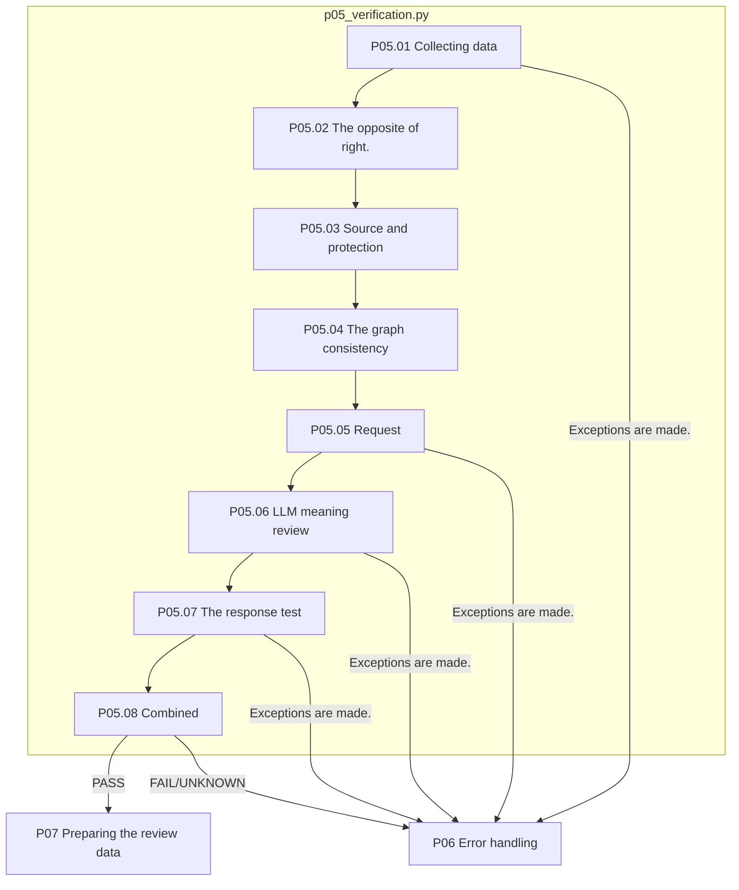

# P05 The original grass is verified.

[Up: Preparation](../README.md) · Previous: [P0]4](../04-graph/README.md) · Passage: [P0]7](../07-human-review/README.md) · Failure: [P0]6](../06-exception-handler/README.md)

Even if the value is right, you can't verify the correct value if you've used the numbers from other companies. This step distinguishes between the execution, response, resource structure, graph test that can be verified in Python and the meaning review of an LLM.

## Requirements and judgments

Python FAIL doesn't cover up LLM PASS. Running success-gold matches alone doesn't confirm meaning accuracy. Reviews are done within a given range of Q/Cs, verifying the need and applicability of external formal data. The fact that there is an external source string isn't a complete fact-checking of an external page.

Current `pp08_record_verdict`All Python tests are PASS, all LLM findings are PASS only when the cohort is INNERAL or EXTERNAL. UNKNOWN;PENDING;FAIL is not a PASS. This is not a judgment of the current code, and it doesn't mean that the accuracy of the LLM judgment itself is guaranteed.

|Step by step|Subject / function|Input → output|
|---|---|---|
|P05.01|Python `pp01_collect_artifacts`|POT/Action/Graph → case data and file hash|
|P05.02|Python `pp02_check_execution_and_answer`|Exact_value: source A → type: accuracy reference comparison|
|P05.03|Python `pp03_check_provenance_structure`|facts/source_usage/external knowledge requirements → Skimma Q/C|
|P05.04|Python `pp04_check_graph_consistency`|The variable trace, node value, front-end contrast → consistency judgment|
|P05.05|Python `pp05_build_verification_request`|Data·Python results → meaning review request|
|P05.06|LLM `pp06_LLM_verify_semantics`|Same request; answer scheme → meaning item by item|
|P05.07|Python `pp07_check_verification_response`|Raw response → Contract test results|
|P05.08|Python `pp08_record_verdict`|Python/LLM results → Comprehensive verdict, exception when failed|



P0 in the file box.5.06It's only an LLM. There are no pink extension nodes. Even if the Python test fails, the code can configure the request and then merge until the meaning review is done. Not all Python failures mean that the LLM will fail immediately.

`05-verification/01-collect-artifacts`through `08-record-verdict/01-result.json`I read in order. I distinguish between the failure of the response form and the failure of text meaning.

The basis: [p0]5_verification.py](../../../../src/finarch/dataset/01-preparation/05-verification/stage.py), [verification.py](../../../../src/finarch/dataset/schemas/verification.py)[current meaning guidelines](../../../../src/finarch/dataset/prompts/01-preparation.05-verification.semantic.md)[Request for completion of inspection](../../../../archive/20260923-documentation-reorganization/docs/68-preparation-reviewed-flow.md).

## The order of the real run is the lower folder.

The path used in the gravel counterpart: `reports/run/20260917-003/01-preparation/test-0001/01-round/05-verification`The following is the actual verified folder in the execution, but that doesn't mean that all of them are in the wrong quarter.

```text
05-verification/
  01-collect-artifacts/
  02-check-execution-and-answer/
  03-check-provenance-structure/
  04-check-graph-consistency/
  05-build-verification-request/
  06-LLM-verify-semantics/
  07-check-verification-response/
  08-record-verdict/
```
