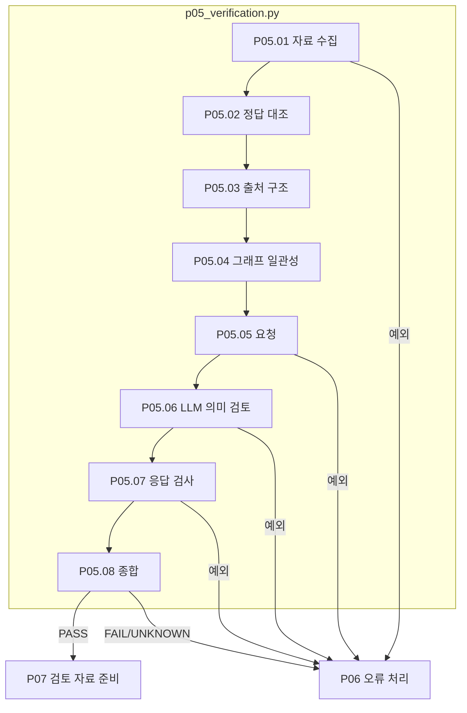

# P05 원문 풀이 검증

[상위: Preparation](../README.md) · 이전: [P04](../04-graph/README.md) · 통과: [P07](../07-human-review/README.md) · 실패: [P06](../06-exception-handler/README.md)

값이 맞았더라도 다른 회사의 수치를 사용했다면 올바른 풀이로 확정할 수 없습니다. 이 단계는 Python으로 확인할 수 있는 실행·정답·출처 구조·그래프 검사와 LLM의 의미 검토를 구별합니다.

## 요구사항과 판정

Python FAIL을 LLM PASS로 덮지 않습니다. 실행 성공·gold 일치만으로 의미 정확성을 확정하지 않습니다. 검토는 주어진 Q/C의 범위에서 수행하며, 외부 공식·데이터의 필요성과 적용 가능성을 확인합니다. 외부 출처 문자열이 있다는 사실은 외부 페이지의 사실 검증 완료가 아닙니다.

현재 `pp08_record_verdict`는 Python 검사 모두 PASS, LLM findings 모두 PASS, cohort가 INTERNAL 또는 EXTERNAL일 때만 PASS입니다. UNKNOWN·PENDING·FAIL은 통과가 아닙니다. 이는 현재 코드의 판정이며 LLM 판단의 정확성 자체가 보장된다는 의미는 아닙니다.

|스텝|주체 / 함수|입력 → 출력|
|---|---|---|
|P05.01|Python `pp01_collect_artifacts`|POT/실행/그래프 → 문항 자료와 파일 해시|
|P05.02|Python `pp02_check_execution_and_answer`|exact_value·원본 A → 타입·정밀도 기준 비교|
|P05.03|Python `pp03_check_provenance_structure`|facts/source_usage/외부지식 요구 → 스키마·Q/C 인용 위치 검사|
|P05.04|Python `pp04_check_graph_consistency`|변수 trace·노드값·앞단 대조 → 일관성 판정|
|P05.05|Python `pp05_build_verification_request`|자료·Python 결과 → 의미 검토 요청|
|P05.06|LLM `pp06_LLM_verify_semantics`|동일 요청·응답 스키마 → 의미 항목별 판단·분류|
|P05.07|Python `pp07_check_verification_response`|원응답 → 계약 검사 결과|
|P05.08|Python `pp08_record_verdict`|Python/LLM 결과 → 종합 verdict, 실패 시 예외|



파일 상자 안에서 P05.06만 LLM입니다. 분홍 확장 노드는 없습니다. Python 검사에서 FAIL 결과가 나더라도 코드가 요청을 구성할 수 있으면 의미 검토까지 수행한 뒤 종합합니다. 모든 Python 실패가 즉시 LLM 미호출을 뜻하지 않습니다.

`05-verification/01-collect-artifacts`부터 `08-record-verdict/01-result.json`까지 순서대로 읽습니다. 응답 형식 실패와 본문 의미 실패를 구분합니다.

근거: [p05_verification.py](../../../../src/finarch/dataset/01-preparation/05-verification/stage.py), [verification.py](../../../../src/finarch/dataset/schemas/verification.py), [현재 의미 지침](../../../../src/finarch/dataset/prompts/01-preparation.05-verification.semantic.md), [검토 완료 요구](../../../../archive/20260923-documentation-reorganization/docs/68-preparation-reviewed-flow.md).

## 실제 run의 하위 폴더 순서

채번 대조에 사용한 경로: `reports/run/20260917-003/01-preparation/test-0001/01-round/05-verification`. 아래는 해당 실행에서 실제 확인한 폴더이며, 미실행 분기까지 모두 존재한다는 뜻은 아닙니다.

```text
05-verification/
  01-collect-artifacts/
  02-check-execution-and-answer/
  03-check-provenance-structure/
  04-check-graph-consistency/
  05-build-verification-request/
  06-LLM-verify-semantics/
  07-check-verification-response/
  08-record-verdict/
```
