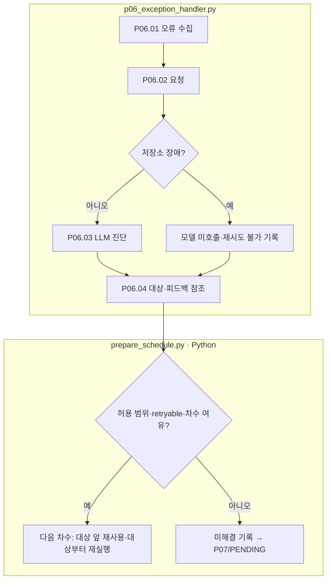

# P06 오류 진단과 다음 차수 연결

[상위: Preparation](../README.md) · 종료/검토: [P07](../07-human-review/README.md) · 공통 규칙: [차수와 피드백](../../90-operations/01-execution.md)

이 단계는 정상 경로에서 매번 실행되는 여섯 번째 처리 단계가 아닙니다. 앞 단계에서 예외나 검증 실패가 발생하면 호출됩니다. 실패를 발견한 단계와 실제 고쳐야 할 단계는 다를 수 있습니다.

## 요구사항과 입출력

문항·발생 차수·실패 위치·실제 근거를 보존하고, 다음 차수의 수정 대상과 유지 조건을 구체적으로 전달합니다. 다른 문항의 오류를 합쳐 공통 조언으로 대체하지 않습니다. 원본 시도는 불변으로 남기며, 재시도 가능한 실패만 상한 내에서 처리합니다.

|스텝|주체 / 함수|입력 → 출력|
|---|---|---|
|P06.01|Python `pp01_capture_exception`|예외·stopped_at·단계 JSON → 오류 근거·파일 해시|
|P06.02|Python `pp02_build_feedback_request`|문항·오류·허용 대상 → 저장 요청|
|P06.03|LLM `pp03_LLM_diagnose_and_feedback`|오류 자료 → retryable·target_step·diagnosis·guidance|
|P06.04|Python `pp04_route_retry`|대상 검사 → 불변 feedback.json·다음 차수 참조|

상자는 파일 책임이고 LLM은 P06.03입니다. 분홍 확장 노드는 없습니다. 현재 허용 target_step은 `02-review`, `03-calculation`, `05-verification`입니다. 임의의 모든 단계로 라우팅하거나 여러 오류의 여러 수정 대상을 동시에 처리하는 기능으로 설명하지 않습니다.

기반 시설 장애는 프롬프트로 고칠 수 없으므로 현재 코드의 분류 조건에 해당하면 모델 호출 없이 기록합니다. Handler 자체가 실패하면 handler-failure를 남깁니다. 자동 종료는 사람 승인도 문항 폐기 결정도 아닙니다. 원인을 확인해 구현 보완할 사항은 별도로 추적합니다.

근거: [p06_exception_handler.py](../../../../src/finarch/dataset/01-preparation/06-exception-handler/stage.py), [prepare_schedule.py](../../../../src/finarch/dataset/01-preparation/prepare_schedule.py), [기존 피드백 요구](../../../../archive/20260923-documentation-reorganization/docs/64-feedback-reference.md).
