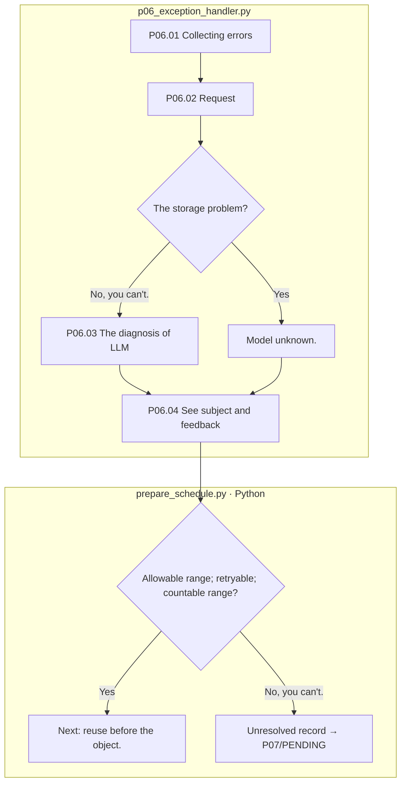

# P06 Error diagnosis and next dimensional connection

[Up: Preparation](../README.md) · End/Check: [P0]7](../07-human-review/README.md) · Common rules: [Quote and feedback](../../90-operations/01-execution.md)

This is not the sixth processing step that runs every time on a normal path, but it's called in the next step if there's an exception or a verification failure, and the steps that found the failure and the steps you actually need to fix may be different.

## Requirements and input

It preserves the cases, the generating parameters, the failure position, the actual basis, and conveys specifically the subject and maintenance of the following parameters. It does not combine the errors of other cases and replace them with common advice. The original attempts remain unchanged, and are handled only within the limits of possible failures.

|Step by step|Subject / function|Input → output|
|---|---|---|
|P06.01|Python `pp01_capture_exception`|Exceptions.stopped_at. Stage JSON → error basis. file hash|
|P06.02|Python `pp02_build_feedback_request`|Article: Subject to authorisation → request for storage|
|P06.03|LLM `pp03_LLM_diagnose_and_feedback`|Error data → retryable; target_step; diagnosis; guidance|
|P06.04|Python `pp04_route_retry`|Subject testing → variable feedback.json. See next parameter|

The box is file responsibility, and the LLM is P0.6.03There is no pink extension node. Currently, target_step is allowed `02-review`, `03-calculation`, `05-verification`It's not routing every step of the way or dealing with multiple corrections of multiple errors at the same time.

Infrastructure failures cannot be fixed promptly, so if they match the current classification conditions of the code, they are recorded without a model call. If the handler itself fails, it leaves a handler-failure. Automatic shutdown is neither human approval nor a decision to scrap a case. It identifies the cause and tracks the implementation complement separately.

The basis: [p0]6_exception_handler.py](../../../../src/finarch/dataset/01-preparation/06-exception-handler/stage.py), [prepare_schedule.py](../../../../src/finarch/dataset/01-preparation/prepare_schedule.py)[Requesting feedback from the presence](../../../../archive/20260923-documentation-reorganization/docs/64-feedback-reference.md).
