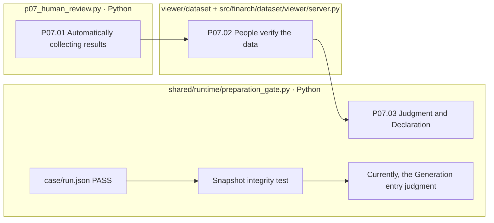

# P07 Preparing the review data and judging the person

[Up: Preparation](../README.md) · Follow-up: [Generation](../../02-generation/README.md)

This is the stage. `run()`It collects the results that people read, not the ones that people approve of the function being executed, but it also distinguishes it from failure interpretation and re-evaluation, which is user behavior.

## Requirements and actual boundaries

- You need to be able to check the results of the original, the copy, the POT, the correct answer, the graph, the verification, on the active charts.
- Human judgments are linked to the reviewers, the perception, the data hash, and when the data changes, they don't write past judgments as approval of new data.
- Reject/Pending gets the reason. Accept verifies the review and release terms, but there are subsequent rules that don't necessarily enforce the reason.
- The general collection function does not automatically call for LLM failure interpretation. Failure interpretation is a user behavior that records a single Korean translation for English analysis and mark-up.

|Step by step|Processing|Outputs|
|---|---|---|
|P07.01|Python `pp01_collect_results`|`07-human-review/01-collect-review-package/01-result.json`|
|P07.02|The person / viewer|Read the data, need no failure to interpret the time.|
|P07.03|Python `record_decision`|decision.json·history.jsonl·file hash|



The file box has no real responsibility, no pink extension nodes, separated the path of human judgment from the path of automatic entry judgment.

## Requirements and differences in perception: Parts that need to be reviewed

The current design explains that only human-approved prints are passed on to the Generation. **Current `preparation_gate.evaluate`Selects the PASS and snapshot of case/run.json and does not read the person's decision as an entry condition.** FAIL/ERROR is rejected, incomplete is pending, file incompleteness is invalid, and when there is no full pending/invalid, the assignment is determined to be ready-made.

The subsequent records have instructions to include automatic testing passes into the experiment, which alone will not suggest that the entire human approval limit for the production has been removed.01](../../99-open-issues.md)I'm not going to change the gate in this task.

The basis: [p0]7_human_review.py](../../../../src/finarch/dataset/01-preparation/07-human-review/stage.py), [preparation_gate.py](../../../../src/finarch/dataset/90-operations/preparation_gate.py)[Existing person review; failure interpretation](../../../../archive/20260923-documentation-reorganization/docs/75-failure-interpretation.md).

## The order of the real run is the lower folder.

The path used in the gravel counterpart: `reports/run/20260917-003/01-preparation/test-0001/01-round/07-human-review`The following is the actual verified folder in the execution, but that doesn't mean that all of them are in the wrong quarter.

```text
07-human-review/
  01-collect-review-package/
```
