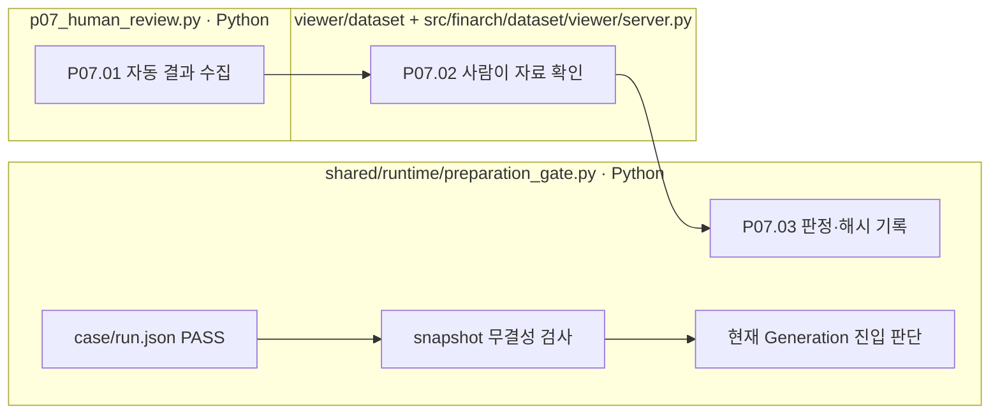

# P07 검토 자료 준비와 사람 판정

[상위: Preparation](../README.md) · 후속: [Generation](../../02-generation/README.md)

이 단계의 `run()`은 사람이 읽을 결과를 모읍니다. 함수가 실행됐다고 사람이 승인한 것은 아닙니다. 별도 사용자 동작인 실패 해석·재검토와도 구별합니다.

## 요구사항과 실제 경계

- 원문·보정본·POT·정답 대조·그래프·검증 결과를 같은 활성 차수에서 확인할 수 있어야 합니다.
- 사람 판정은 검토자·시각·대상 자료 해시와 연결합니다. 자료가 바뀌면 과거 판정을 새 자료의 승인처럼 쓰지 않습니다.
- Reject/Pending은 이유를 받습니다. Accept는 검토·자료 조건을 확인하되 이유를 필수로 강제하지 않는 후속 규칙이 있습니다.
- 일반 수집 함수는 LLM 실패 해석을 자동 호출하지 않습니다. 실패 해석은 영어 분석과 표시용 한국어 번역을 별도 기록하는 사용자 동작입니다.

|스텝|처리|산출물|
|---|---|---|
|P07.01|Python `pp01_collect_results`|`07-human-review/01-collect-review-package/01-result.json`|
|P07.02|사람 / viewer|자료 읽기·필요 시 별도 실패 해석. 자동 실행 스텝 아님|
|P07.03|Python `record_decision`|decision.json·history.jsonl·파일 해시|



파일 상자는 실제 책임, 분홍 확장 노드는 없습니다. 사람 판정 경로와 자동 진입 판단 경로를 분리해 그렸습니다.

## 요구·구현 차이: 검토가 필요한 부분

기존 설계는 사람 승인된 원문만 Generation에 넘긴다고 설명합니다. **현재 `preparation_gate.evaluate`는 case/run.json의 PASS와 snapshot을 기준으로 선정하며 사람 decision을 진입 조건으로 읽지 않습니다.** FAIL/ERROR는 rejected, 미완료는 pending, 파일 부적합은 invalid로 구분합니다. 전체 pending/invalid가 없을 때 배치를 준비 완료로 판정합니다.

후속 기록에는 자동 검사 통과건을 실험에 포함하도록 한 지시가 있습니다. 이것만으로 제작의 사람 승인 경계 전체가 폐지됐다고 추정하지 않겠습니다. 현 동작과 요구의 적용 범위는 [OPEN-01](../../99-open-issues.md)에 기록하며 이번 작업에서 gate를 변경하지 않습니다.

근거: [p07_human_review.py](../../../../src/finarch/dataset/01-preparation/07-human-review/stage.py), [preparation_gate.py](../../../../src/finarch/dataset/90-operations/preparation_gate.py), [기존 사람 검토·실패 해석](../../../../archive/20260923-documentation-reorganization/docs/75-failure-interpretation.md).

## 실제 run의 하위 폴더 순서

채번 대조에 사용한 경로: `reports/run/20260917-003/01-preparation/test-0001/01-round/07-human-review`. 아래는 해당 실행에서 실제 확인한 폴더이며, 미실행 분기까지 모두 존재한다는 뜻은 아닙니다.

```text
07-human-review/
  01-collect-review-package/
```
