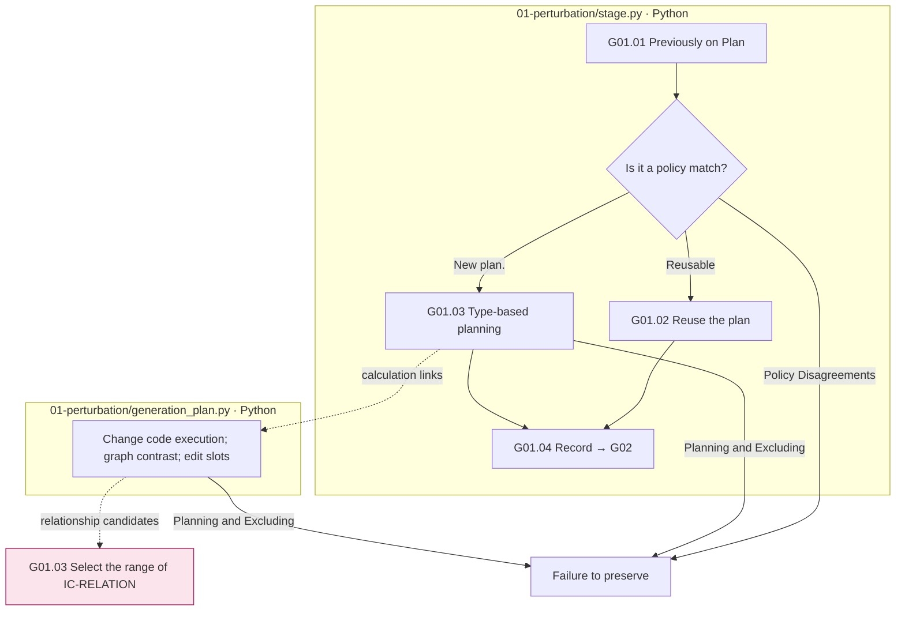
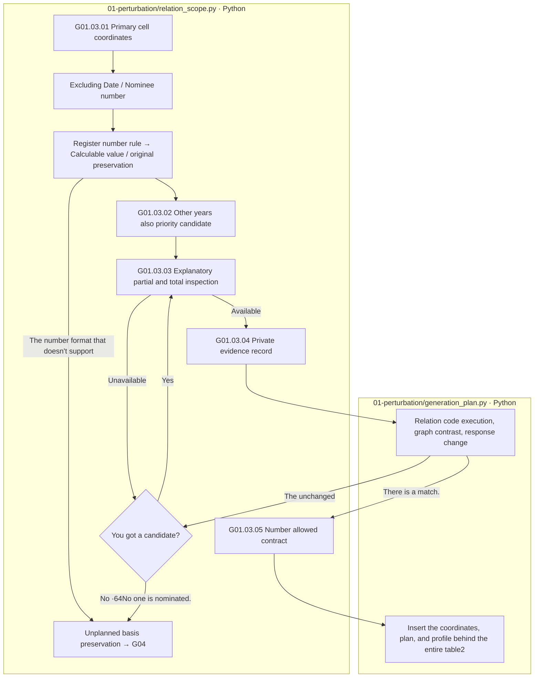

# G01 Transformational planning and computational connectivity

[Top: Generation](../README.md) · Next: [G02 Text realization](../02-generate-text/README.md) · Details: [Conditions for change of type](01-variant-rules.md)

We plan first which calculations will change when we change or delete a value in the source, for example, leaving the result of applying the values A and B to the same calculation, replacing the original correct answer with the new correct answer, and not showing it.

## User requirements

- It maintains the original Q/C·POT graph, indicating the status of the subject, the crime and the weather changes, and not including the completed phrases or the scheduled PASS in the plan.
- It records the A/B condition response of the IC-value, the parent value of the source, the relationship calculation of the relation, the deleted object of the EA and the affected path.
- The same original. 7items types are not independent of each other, they maintain value dependence on the source type and the shared front/back phrase.
- Coefficient diversification distinguishes past opt-in implementations from reservation decisions, which now do not activate new policies as document theory.
- IC-RELATION uses different primitive bases and prioritizes different years. In the explicit partial-total relationship, the whole is placed to the left. The existing numbers of the left object do not repeat themselves in additional sentences, and the right allows only the numbers needed for the reference values, calculations, and validated items/period tables.

## The Step by Step.

|Step by step|Python function|Input → process → output|
|---|---|---|
|G01.01|`gg01_select_prior_plan`|Current type: Previous results → Reusable plan candidate|
|G01.02|`gg02_reuse_plan`|Previously authorized planning → reuse record|
|G01.03|`gg03_build_change_plan`|Original: POT: Graph: Type → Change plan and code/graph|
|G01.04|`gg04_record_plan`|Planning, preparing data → storage contracts|

The box is the actual file responsibility, and there are no LLM calls. The pink RS node represents the downstream flow. The success of the plan at this stage is not the success of the final sentence's meaning verification.

## Select the range of IC-RELATION 2026-10-01 Apply

`relation_scope.py`It also supports JSON and Markdown tables, and when adding the same row values to the calculation input of other years, it registers only the private copies that have preserved the source citation and coordinates. The original Q/C·PoT graph does not modify.

When you read the number cell candidate, date and statement are excluded. `December 28, 2018`The comma of the quantity is not the denominator. `shared/calculation/number_normalization.py`So, we're going to use the registration rule to convert only the computation values. `1,609,000` `1609000`This conversion is a candidate counterpart, and it's a function of the function. `check_structure`, `relation_plan.make_branches`The same way to apply the same to the selected values, the source, the variable, the rule, the description of the plan. `number_normalization`The wrong number comma format leaves an error, not a random deletion.

|The Step by Step.|Actual function/responsibility|Processing|
|---|---|---|
|G01.03.01|`source_cells`, `fact_decimal` / Python|Excluding description, date, registration number rules apply → entry, year, member co-ordinates and calculation numbers|
|G01.03.02|`candidates` / Python|The original calculation input is the same as the other row of the row → different base candidate, different row of the first|
|G01.03.03|`check_structure` / Python|The entire array → group of explicit tables placed to the left, preventing total overlap of nonnegative parts|
|G01.03.04|`add_reference`, `relation_branch`, `checked_branch` / Python|The required source code is based on the correspondence of the application code, the code of conduct, the graph of matching, the effect of the answer|
|G01.03.05|`contract` / Python|Select relationship → Left existing number repeat prohibited; right-hand reference value/calculator/subject/period number allowed range|

The same algorithm can be used if the candidate is a good candidate. `Total <group>` It's limited to the range of numbers that are not negative numbers.3 LLM reviews, and it doesn't guarantee meaningful validity just because it's another lead, and it's not making relationships on its own basis without a corresponding basis.

The IC-RELATION object in the table is not the end of the line, but the last line of the entire table, and it's the coordinate that you insert after the last line. `relation_placement_version: table-after-paragraph-v1`It records the existing relationship plan, which has no placement criteria, and it rebuilds it when it's re-launched.

The plan is to `source-scoped-relation-v2`And the selection-external input is stored. The reset creates a new old relationship plan, and if the relationship plan changes, the existing generated phrases are not reused. The raw response of the past run is not overwritten.](../../../../reports/run/20261001-ic-relation-scope-check/README.md)This is the result of checking plans, contracts, and renewals without a paid LLM call.

Based on: [g0]1_perturbation.py](../../../../src/finarch/dataset/02-generation/01-perturbation/stage.py), [generation_plan.py](../../../../src/finarch/dataset/02-generation/01-perturbation/generation_plan.py)[Definition of existence](../../../../archive/20260923-documentation-reorganization/docs/05-perturbation-definitions.md)[Quality improvement scope](../../../../archive/20260923-documentation-reorganization/docs/quality-improvement-summary-20260917.md).
