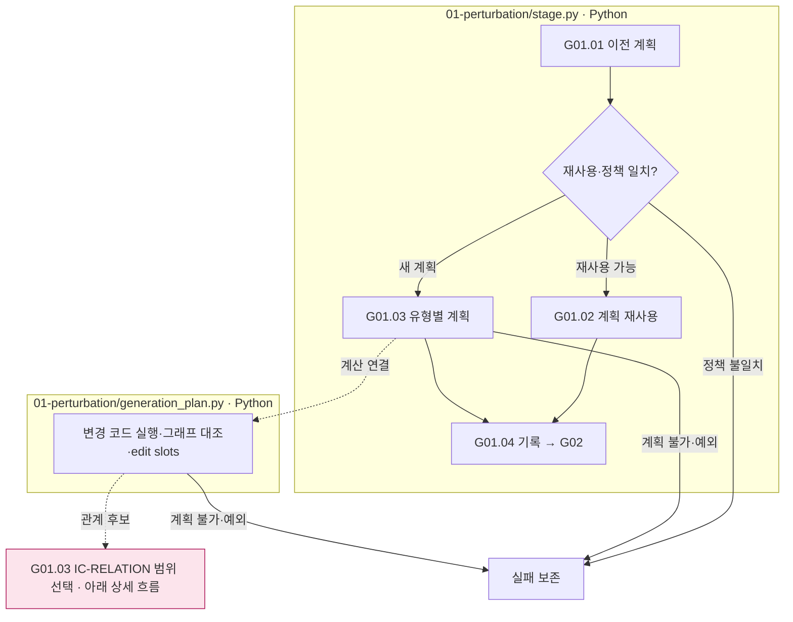
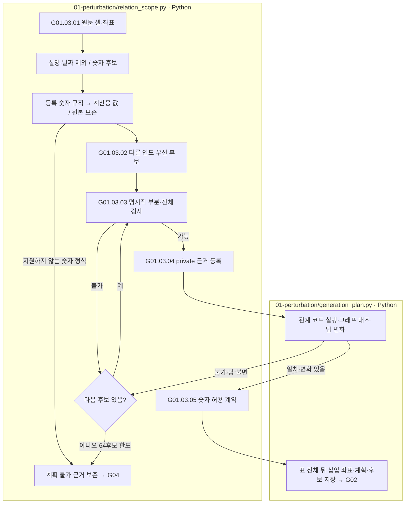

# G01 변형 계획과 계산 연결

[상위: Generation](../README.md) · 다음: [G02 문장 생성](../02-generate-text/README.md) · 상세: [유형별 변경 조건](01-variant-rules.md)

원문의 한 값을 바꾸거나 지울 때 어느 계산이 달라지는지 먼저 계획합니다. 예를 들어 값 A와 대안 B를 각각 같은 계산에 적용한 결과를 남깁니다. ‘원래 정답을 새 정답으로 교체했다’고 표시하지 않습니다.

## 사용자 요구사항

- 원본 Q/C·POT·그래프를 유지하며 변경 대상·범위·기대 상태를 명시합니다. 완성 문장이나 예정 PASS를 계획에 넣지 않습니다.
- IC-value의 A/B 조건부 답, source의 부모 value, relation의 관계 연산, EA의 삭제 대상과 영향을 받는 경로를 기록합니다.
- 같은 원본의 7개 유형은 서로 독립적인 원문이 아닙니다. 출처 유형의 value 의존성과 앞/뒤 문장의 공유를 유지합니다.
- coefficient 다양화는 과거 opt-in 구현과 보류 결정을 구별합니다. 지금 문서 정리로 새 정책을 활성화하지 않습니다.
- IC-RELATION은 서로 다른 원문 근거를 사용하고 다른 연도를 우선합니다. 명시적인 부분·전체 관계에서는 전체를 왼쪽에 둡니다. 왼쪽 대상의 기존 수치는 추가 문장에 반복하지 않으며, 오른쪽 기준값·계수·승인된 항목/기간 표기에 필요한 숫자만 허용합니다.

## 세부 스텝

|스텝|Python 함수|입력 → 처리 → 출력|
|---|---|---|
|G01.01|`gg01_select_prior_plan`|현재 유형·이전 결과 → 재사용 가능한 계획 후보|
|G01.02|`gg02_reuse_plan`|허용된 이전 계획 → 재사용 기록|
|G01.03|`gg03_build_change_plan`|원문·POT·그래프·유형 → 변경 계획과 코드/그래프|
|G01.04|`gg04_record_plan`|계획·기준 자료 → 저장 계약|

상자는 실제 파일 책임이며 LLM 호출은 없습니다. 분홍 RS 노드는 아래 상세 흐름을 뜻합니다. 이 단계의 계획 성공은 최종 문장의 의미 검증 성공이 아닙니다. 새 계획을 만들 수 없는 경우를 정상 변형으로 채택하지 않습니다.

## IC-RELATION 범위 선택 · 2026-10-01 적용

`relation_scope.py`는 원문 표의 항목·기간·위치를 읽습니다. 행×연도 JSON과 Markdown 표를 지원하며, 다른 연도의 같은 행 값을 계산 입력에 추가할 때는 원문 인용·좌표를 보존한 private 사본에만 등록합니다. 원본 Q/C·PoT·그래프는 수정하지 않습니다.

숫자 셀 후보를 읽을 때 날짜·설명문은 제외합니다. `December 28, 2018`의 쉼표는 금액 구분자가 아닙니다. 실제 금액과 기존 PoT 입력은 `shared/calculation/number_normalization.py`의 등록 규칙으로 계산용 값만 변환합니다. 예를 들어 `1,609,000`은 `1609000`으로 계산하되 원문·fact 값은 보존합니다. 이 변환은 후보 대조, `check_structure`, `relation_plan.make_branches`에 동일하게 적용하며 선택된 양쪽 값의 원본·변환값·규칙·해시는 계획의 `number_normalization`에 저장합니다. 잘못된 숫자 쉼표 형식은 임의로 지우지 않고 오류로 남깁니다.

|세부 스텝|실제 함수 / 책임|처리|
|---|---|---|
|G01.03.01|`source_cells`, `fact_decimal` / Python|설명·날짜 제외, 등록 숫자 규칙 적용 → 항목·연도·원문 좌표와 계산용 숫자|
|G01.03.02|`candidates` / Python|원래 계산 입력과 같은 행의 다른 연도 → 서로 다른 근거 후보, 다른 연도 우선|
|G01.03.03|`check_structure` / Python|명시적 표 그룹·총계 → 전체를 왼쪽에 배치, 음수가 아닌 부분의 전체 초과 방지|
|G01.03.04|`add_reference`, `relation_branch`, `checked_branch` / Python|필요한 원문 근거 사본 → 관계 적용 코드·실행·그래프 일치·답 영향 확인|
|G01.03.05|`contract` / Python|선택 관계 → 왼쪽 기존 수치 반복 금지·오른쪽 기준값/계수/항목/기간의 숫자 허용 범위|

같은 연도도 타당한 후보이면 사용할 수 있습니다. 부분·전체의 기계적 판단은 표의 명시적 그룹과 `Total <group>` 행, 음수가 아닌 수치가 있는 범위에 한정합니다. 다른 형태의 문맥·단위·회사 의미는 G03 LLM이 검토합니다. 다른 연도라는 이유만으로 의미 타당성을 보장하지 않습니다. 대응 근거가 없으면 자기 자신을 기준으로 관계를 만들지 않습니다.

표에 있는 IC-RELATION 대상은 행 끝이 아니라 표 전체의 마지막 행 뒤를 삽입 좌표로 지정합니다. 문장은 빈 줄로 구분하며 `relation_placement_version: table-after-paragraph-v1`을 기록합니다. 이 배치 기준이 없는 기존 관계 계획은 재시도할 때 다시 만듭니다.

계획에는 `source-scoped-relation-v2`와 선택·제외 이력이 저장됩니다. 재시도는 구형 관계 계획을 새로 만들고, 관계 계획이 달라졌으면 기존 생성 문장도 재사용하지 않습니다. 과거 run의 원응답·판정은 덮어쓰지 않습니다. [로컬 확인 기록](../../../../reports/run/20261001-ic-relation-scope-check/README.md)은 유료 LLM 호출 없이 계획·계약·재개를 검사한 결과입니다.

근거: [g01_perturbation.py](../../../../src/finarch/dataset/02-generation/01-perturbation/stage.py), [generation_plan.py](../../../../src/finarch/dataset/02-generation/01-perturbation/generation_plan.py), [기존 정의](../../../../archive/20260923-documentation-reorganization/docs/05-perturbation-definitions.md), [품질 개선 적용 범위](../../../../archive/20260923-documentation-reorganization/docs/quality-improvement-summary-20260917.md).
