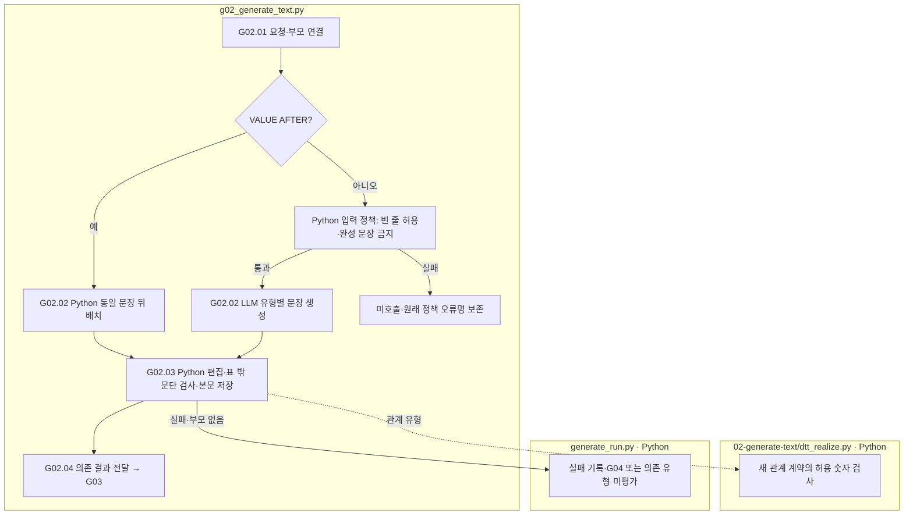

# G02 변경 계획을 최종 문장에 반영

[상위: Generation](../README.md) · 이전: [G01](../01-perturbation/README.md) · 다음: [G03](../03-validation/README.md)

원문과 변경할 위치·조건을 받아 편집 patch를 생성합니다. 예를 들어 값 충돌 유형은 새 주장 문장을 받아 지정 위치에 넣고, EA는 삭제 대상 구간을 다듬습니다. 모델이 돌려준 patch와 Python이 적용한 최종 본문을 모두 남깁니다.

## 요구사항

완성 답안·완성 문장·예정 PASS를 프롬프트에 미리 넣지 않습니다. 편집 대상·수치·허용 위치·보존 조건을 지시합니다. 기존 원응답을 새 생성처럼 표시하지 않습니다. 영어 생성문과 한국어 표시 번역을 분리합니다.

IC-RELATION은 승인된 방향·각 항목의 연도를 그대로 문장화합니다. 추가 문장의 왼쪽에는 항목·연도만 쓰고 기존 수치는 반복하지 않습니다. 오른쪽 기준값은 edit slot이 허용할 때 표기할 수 있습니다. 새 계획의 Python 숫자 검사는 본문의 모든 수치를 허용하지 않고 계수·기준값·지정 연도만 허용합니다. 같은 숫자가 다른 역할로 쓰이면 숫자만으로 판단할 수 없으므로 G03 의미 검토가 필요합니다.

표에 있는 대상을 설명하는 관계 문장은 IC-VALUE와 같은 표 전체 경계를 사용하여 마지막 행 뒤의 독립 문단에 추가합니다. Python이 삽입 좌표를 지정하고, 빈 줄을 요구하며, 표 내부 삽입·구분 줄 누락은 저장 전에 거절합니다. LLM은 지정된 위치의 관계 문장만 작성합니다. 기존 run과 원응답은 자동으로 덮어쓰지 않습니다.

입력 정책은 `required_prefix`의 빈 줄·공백만 허용합니다. 이는 문단 배치 조건이며, 미리 작성된 문장은 계속 금지합니다. 입력 정책 위반은 API 호출 전에 원래 오류명을 남기며 일반 통신 오류로 숨기지 않습니다.

현재 지침: [IC-RELATION 생성 프롬프트](../../../../src/finarch/dataset/prompts/02-generation.02-generate-text.ic-relation.md). 응답 schema의 patches 구조는 유지하며 IC-RELATION 프롬프트 선택 버전은 4입니다.

|스텝|주체 / 함수|입력 → 출력|
|---|---|---|
|G02.01|Python `gg01_build_generation_request`|계획 또는 SOURCE의 VALUE 부모 → 요청·부모 해시|
|G02.02|LLM / Python `gg02_llm_generate_text`|일반 유형은 LLM patch. VALUE AFTER는 BEFORE 문장을 Python으로 뒤에 배치하여 새 생성 호출 0회|
|G02.03|Python `gg03_check_and_record_response`|응답 계약·범위·숫자·표 밖 문단 배치 검사 → observation과 patches|
|G02.04|Python `gg04_publish_value_dependency`|VALUE BEFORE 결과 → 같은 문항의 공유 의존 결과|



상자는 파일 책임이며 분홍 확장 노드는 없습니다. VALUE AFTER도 최종 본문 의미 검사는 별도로 수행합니다. SOURCE 입력은 부모가 BEFORE인지 AFTER인지와 순서를 유지합니다. 부모가 실패한 상태를 독립된 SOURCE 생성 성공으로 표시하지 않습니다.

주요 산출물은 `02-generate-text/01-input.json`, 실제 호출 기록 또는 `02-place-paired-sentence.json`, `03-edit-check.json`, `04-observation.json`, `05-patches.json`입니다. 뷰어에서 당시 프롬프트·응답·표시 본문의 경로를 구별해야 합니다.

근거: [g02_generate_text.py](../../../../src/finarch/dataset/02-generation/02-generate-text/stage.py), [dtt_realize.py](../../../../src/finarch/dataset/02-generation/02-generate-text/dtt_realize.py), [사전 작성 출력 제거](../../../../archive/20260923-documentation-reorganization/docs/27-preconstructed-output-removal.md), [유형별 생성 요구](../../../../archive/20260923-documentation-reorganization/docs/24-type-specific-realization-prompts.md).

## 실제 run의 하위 폴더 순서

채번 대조에 사용한 경로: `reports/run/20260917-003/02-generation/01-round/test-0001/01-ic-value-before/02-generate-text`. 아래는 해당 실행에서 실제 확인한 폴더이며, 미실행 분기까지 모두 존재한다는 뜻은 아닙니다.

```text
02-generate-text/
  01-request/
  02-LLM-call/
```
