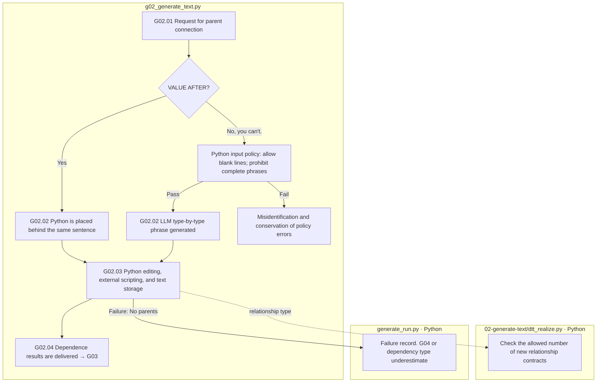

# G02 Reflect the change plan in the final sentence

[Top: Generation](../README.md) · Previous: [G0]1](../01-perturbation/README.md) · Next: [G03](../03-validation/README.md)

For example, the value-clash type takes a new claim phrase and puts it in the specified location, and EA scrambles the deleted subject area, leaving the model-returned patch and the final text that Python applied.

## Requirements

Complete response, complete sentence, and schedule PASS are not pre-installed in the prompt. It specifies the editing object, search, permissions location, and storage conditions. It does not display the existing raw response as a new creation. It separates the English generic text from the Korean language display translation.

IC-RELATION phrases the length of each approved directional and correctional item exactly the same way. In the left of the additional sentence, you use only the linear and correction, and you don't repeat the existing numbers. The right-hand baseline can be marked when the edit slot allows. The Python number check in the new scheme doesn't allow all the numbers in the text, but only the coefficient, the baseline, and correctionals.3 We need a meaning review.

Relation phrases that describe objects in a table use the entire boundary of the table, such as IC-VALUE, and add them to the independent document after the last row. Python specifies the insert coordinates, requests blank lines, and rejects the insert and substrate spacing gap inside the table before saving. LLM only writes the relationship phrases for the specified location. Existing run and raw response are not automatically overwritten.

The input policy is `required_prefix`This is a condition for the placement of the phrases, and it keeps pre-written phrases from being banned. Input policy violations leave the original error name before the API calls and do not hide it as a common communication error.

Current instructions: [IC-RELATION generated prompt](../../../../src/finarch/dataset/prompts/02-generation.02-generate-text.ic-relation.md)The patches structure of the response schema is maintained and the IC-RELATION prompt selection version is 4.

|Step by step|Subject / function|Input → output|
|---|---|---|
|G02.01|Python `gg01_build_generation_request`|The plan or the SOURCE VALUE of the parent → request parent|
|G02.02|LLM / Python `gg02_llm_generate_text`|The general type is LLM patch. VALUE AFTER places the BEFORE phrase back into Python and calls for new generations. 0times|
|G02.03|Python `gg03_check_and_record_response`|The response contract, the crime, the number, the outline of the chart, the observation and patches.|
|G02.04|Python `gg04_publish_value_dependency`|VALUE BEFORE results → The result of the same case sharing dependence|



The box is file-responsible and there is no pink extension node. The final text meaning check is also performed separately after the VALUE. The SOURCE entry keeps the parent BEFORE or AFTER in order. The parent failure does not indicate the independent SOURCE creation success.

The main output is `02-generate-text/01-input.json`, real call record or `02-place-paired-sentence.json`, `03-edit-check.json`, `04-observation.json`, `05-patches.json`So in the Viewer, you have to distinguish the path of the time-frame response and the time-scale.

Based on: [g0]2_generate_text.py](../../../../src/finarch/dataset/02-generation/02-generate-text/stage.py), [dtt_realize.py](../../../../src/finarch/dataset/02-generation/02-generate-text/dtt_realize.py)[Exit history writing](../../../../archive/20260923-documentation-reorganization/docs/27-preconstructed-output-removal.md)[Type-specific generation requirements](../../../../archive/20260923-documentation-reorganization/docs/24-type-specific-realization-prompts.md).

## The order of the real run is the lower folder.

The path used in the gravel counterpart: `reports/run/20260917-003/02-generation/01-round/test-0001/01-ic-value-before/02-generate-text`The following is the actual verified folder in the execution, but that doesn't mean that all of them are in the wrong quarter.

```text
02-generate-text/
  01-request/
  02-LLM-call/
```
